# 一条正则，怎么把 CPU 吃光

2019 年 7 月 2 日，Cloudflare 的工程师发现一件怪事：全球各机房的 CPU 一起冲到接近 100%，用户看到的页面开始 502，而流量在几分钟里掉了八成。
不是 DDoS。不是硬件故障。也不是有人在改负载均衡。
是一条正则表达式。

那天 13:42，一条新的 WAF 规则被自动流程推上了线，内容就是把 XSS 检测的特征表加了一行。三分钟后，第一声 PagerDuty 响了：一个从机房外面模拟用户请求的自检失败了。14:00，工程师从 CPU 曲线和 strace 的输出里把矛头指向 WAF。14:07，全局 WAF 被关停；到 14:09，流量和 CPU 回到正常。
中间 27 分钟。

这条规则里的关键片段，本质上只是 `.*.*=.*`。这么简单的一行东西，为什么能把一整片机房的 CPU 吃掉，是这篇文章想讲清楚的事。答案不在正则语法里，在处理引擎的搜索方式里。

## 先看机器怎么干活

正则要先编译成一个小程序，再拿文本去跑这个小程序。程序的样子很好懂，拿 `ab*c` 举例：一个 `a`，任意多个 `b`(可以零个)，最后跟一个 `c`。

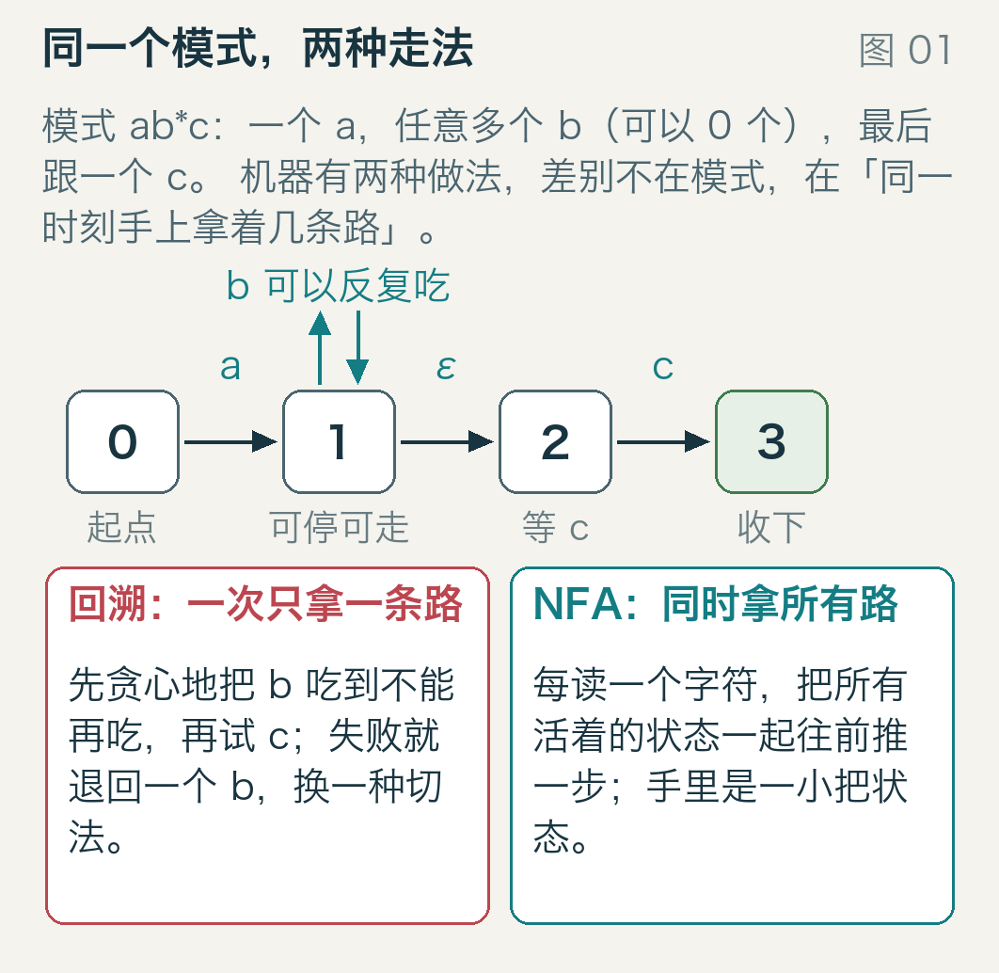

图上四个圈是四个状态。0 号是起点，吃到一个 `a` 走到 1 号；1 号身上挂着一个 `b` 的自环，意思是「可以继续吃 b，也可以不吃了」；不吃就走 ε 边到 2 号，等一个 `c`；吃到 `c` 进 3 号，收下。

关键在 1 号那个岔路：ε 边意味着同一时刻「继续吃 b」和「准备收尾」两条路都通。机器对着这个岔路有两种活法。

**第一种，一次只拿一条路。** 先贪心地吃 b，吃到不能再吃，再试 c。c 不匹配就退回上一个 b，换一种切法接着试。这种做法叫回溯，Perl、Python、Java、PHP、Ruby 的引擎都是这一套。它的直觉非常贴近人写代码的方式，所以四十年来一直是默认选择。

**第二种，把所有活着的路一起拿着。** 每读一个字符，把当前所有还活着的状态一起往前推一步，推出新的一小把状态。这种做法叫 NFA 模拟，1968 年 Thompson 那篇论文给的就是它。
两种做法都能得到正确答案。差别在代价：文本一旦长起来，第一种可能慢到不可理喻，第二种不会。

## 编译出来长什么样

图上是画给人看的圈和箭头，真正跑的是指令表。模型把 `ab*c` 编译成五条指令：

| 编号 | 指令 | 意思 |
|---|---|---|
| 0 | `char a → 1` | 吃一个 a，跳到 1 |
| 1 | `split 2, 3` | 两条路：先试 2，不行再回来试 3 |
| 2 | `char b → 1` | 吃一个 b，跳回 1 |
| 3 | `char c → 4` | 吃一个 c，跳到 4 |
| 4 | `match` | 收工 |

`split` 是全部麻烦的来源。它是唯一能让「执行到哪儿了」分叉的指令：一条路往下走，另一条记在待办清单上。回溯引擎的待办清单就是递归栈：先走第一条，失败就回来走第二条。NFA 引擎不要待办清单，它两条一起走。
`(a+)+b` 的五条指令更能说明问题：

| 编号 | 指令 | 意思 |
|---|---|---|
| 0 | `char a → 1` | 吃一个 a |
| 1 | `split 0, 2` | 要么回去再吃一个 a，要么往 2 走 |
| 2 | `split 0, 3` | 要么回去再吃一个 a，要么往 3 走 |
| 3 | `char b → 4` | 吃一个 b |
| 4 | `match` | 收工 |

1 号和 2 号都跳回 0 号。「再吃一个 a」这件事有两条路可以走到：从 1 号来，或者从 2 号来。两条路吃掉的字符一样、落点一样、后面要面对的东西也一样，但回溯引擎不知道它们等价，于是每多一个 a，分叉就翻一倍——这就是 `(a+)+` 和 `a+` 的全部区别。
顺带一提，这张指令表也解释了「步」这个单位：执行一条指令算一步。`split` 的两条路要各走一次才算完，所以它是这里最贵的指令。

## 指数是怎么长出来的

拿 `(a+)+b` 去匹配一串 `a`，这串 `a` 里没有 `b`，所以注定失配。

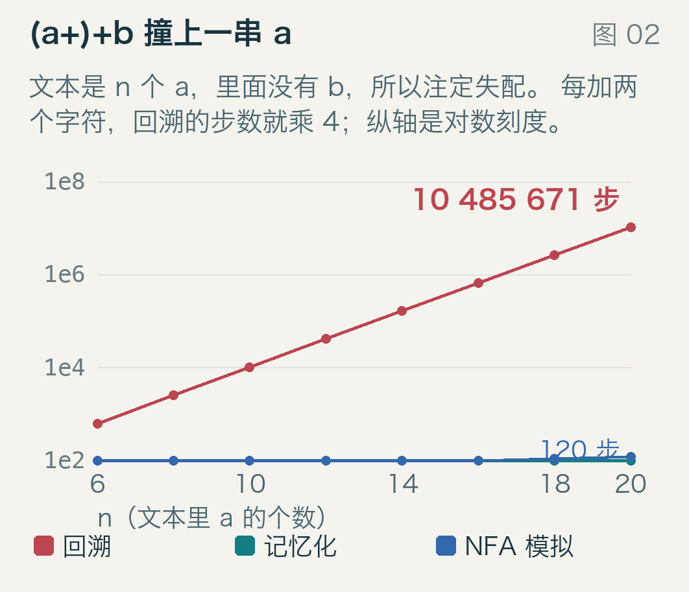

红线是回溯，纵轴是对数刻度。n 从 6 涨到 20，只有 14 个字符的差别，步数从 607 涨到了 10 485 671，涨了一万七千倍。每加两个字符，红线上跳一格——每两个字符，乘 4。
绿线和蓝线是另外两种做法，在同一张图里几乎贴着地面。n = 20 时它们分别是 81 步和 120 步。

为什么回溯会这样？因为 `(a+)+` 允许把同一串 `a` 切成很多段。

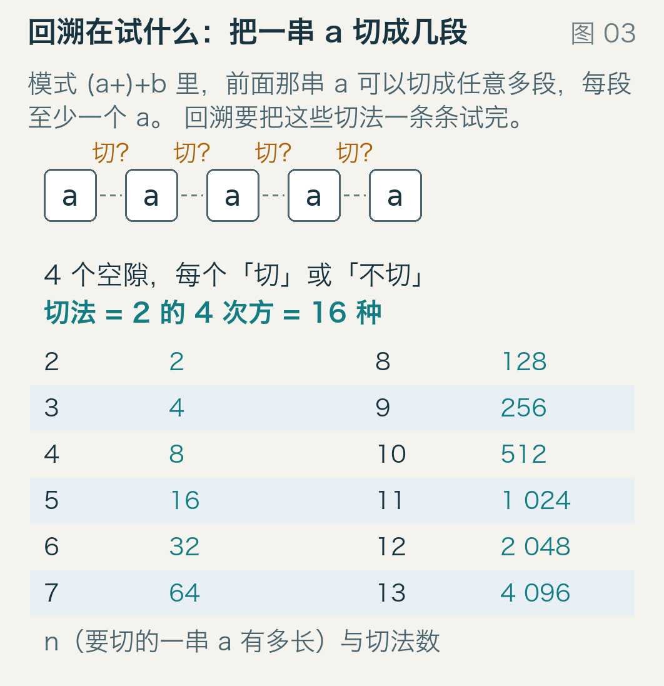

5 个 `a` 之间有 4 个空隙，每个空隙「切」或「不切」，就是 2 的 4 次方 = 16 种切法。n 个 `a` 就是 2 的 n−1 次方：

| n | 2 | 4 | 6 | 8 | 10 | 12 | 14 |
|---|---|---|---|---|---|---|---|
| 切法 | 2 | 8 | 32 | 128 | 512 | 2 048 | 8 192 |

`b` 不在文本里，所以每一种切法都得试完才能说「不匹配」。回溯的做法就是把这些切法一个个走一遍。它不是在「匹配文本」，它是在「枚举切法」。
`(a|a)*b` 是同一个病的另一个样子：两个分支长得一模一样，写的人显然不会这么写，但机器不会替你合并，两条路都老老实实走。n 从 6 到 14，回溯从 1 235 步涨到 327 595 步，记忆化 35 到 75，模拟 53 到 117。
三种做法放到一张表里，对比更直接：

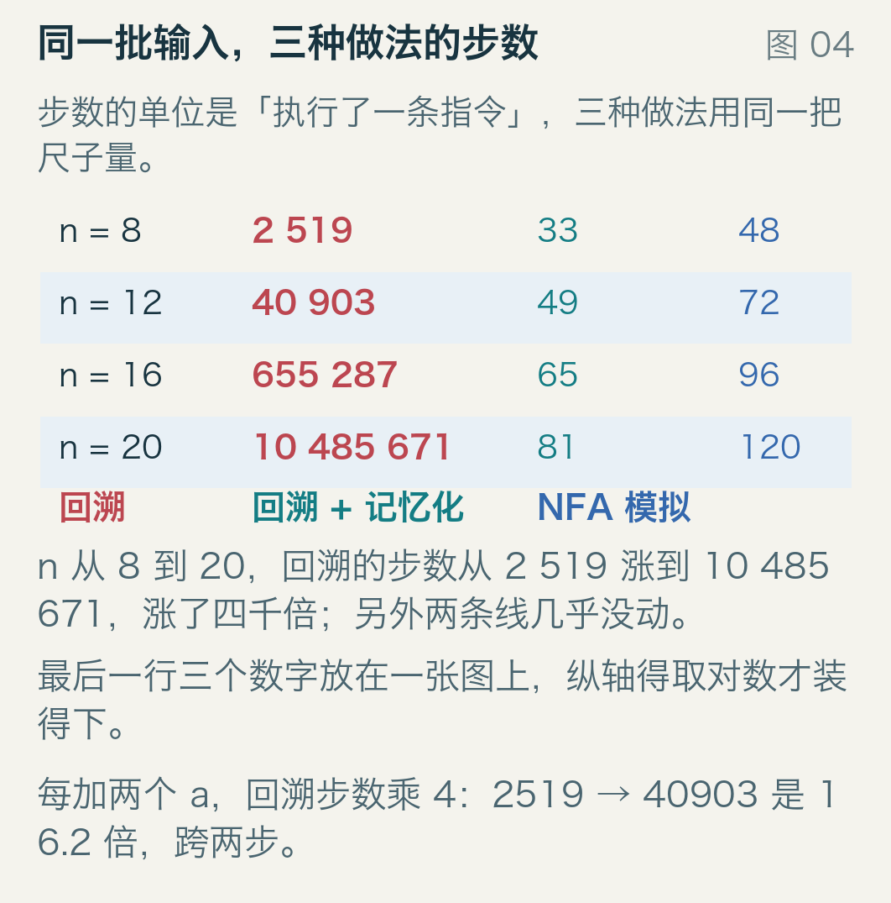

这张表最值得看的是最后一列的增长率。回溯从 40 903 到 10 485 671，翻了 256 倍；NFA 从 72 到 120，翻了 1.7 倍。同一个模式、同一批文本，差距随长度越拉越大，没有上限。

还有一个必须交代的口径：三种执行器共用同一个计数器，回溯器每走一条指令 +1，NFA 的闭包展开和字符消费也各 +1。用同一把尺子量，数字才能放在一张图里比。这不是 CPU 周期，是「干的活有多少」；真实的秒数还要乘以每条指令的开销，那个常数在各种语言里差得很远，但形状是一样的。

## 换成真事里那一行

`(a+)+b` 是教科书式的病态模式，没人会真写。但真事里那一行是 `.*.*=.*`，看起来人畜无害：任意字符若干，一个等号，任意字符若干——谁不写这种式子？

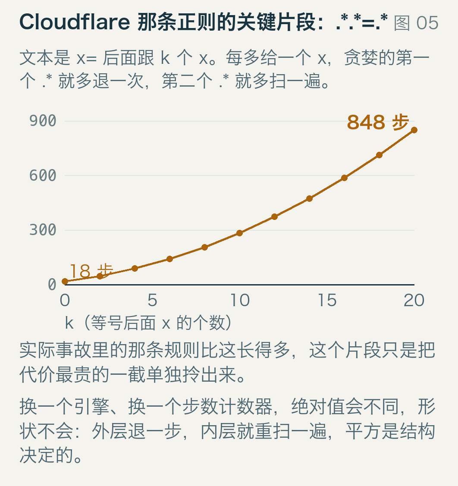

文本是 `x=` 后面跟 k 个 `x`。k 从 0 涨到 20，回溯的步数从 18 涨到 848，大致是一条开口向上的抛物线。原因是两个 `.*` 叠加：第一个 `.*` 贪婪地吞掉整串，发现后面还要匹配，只好一个字符一个字符地退；每退一步，第二个 `.*` 就要把剩下的部分从头扫一遍。两层「退」嵌套在一起，代价就变成了长度的平方。

平方不吓人，平方乘上一个常数才吓人。真实事故里那条规则前面还有一长串 `(?:...)` 备选组，文本是用户提交的表单，长度能到几千字节，而且每个请求都在跑。
更要命的是失败的那一半。

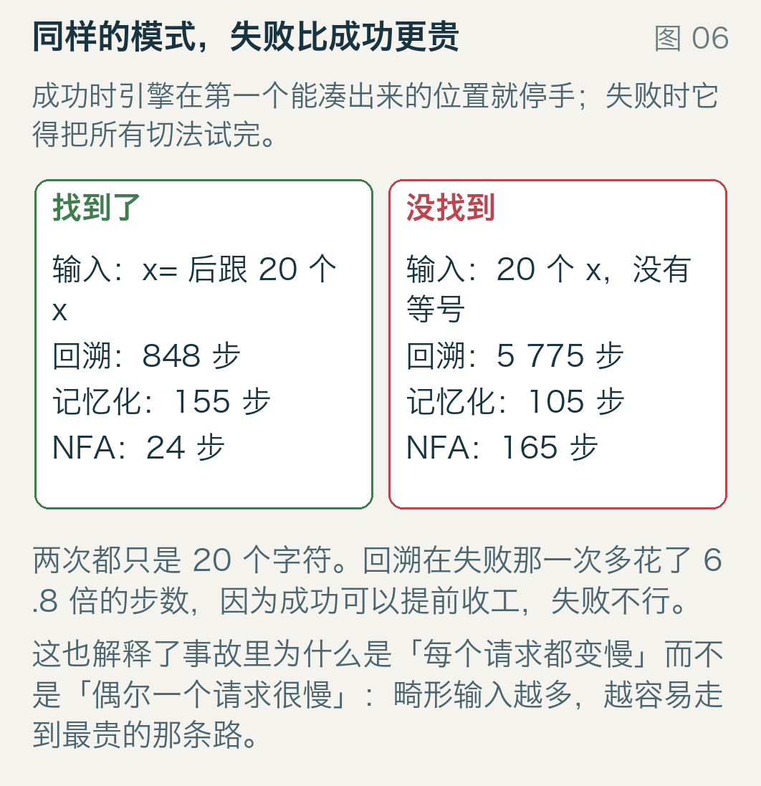

同样是 20 个字符，匹配成功时回溯只花 848 步——它在第一个能凑出来的位置就收工了。失败时花 5 775 步，是六点八倍。原因不难想：成功可以提前退出，失败必须把所有可能性走完。
这解释了一个容易被误读的现象：事故里慢的不是「某些特别长的请求」，而是「每个请求都慢」。攻击者不需要构造什么精巧的输入，只要提交一堆不合法的内容，就能让每条请求都走最贵的那条路。

## 换写法有用吗

有人第一反应是：那我把贪婪改成惰性(`.*?`)，让它别一口气吞完。

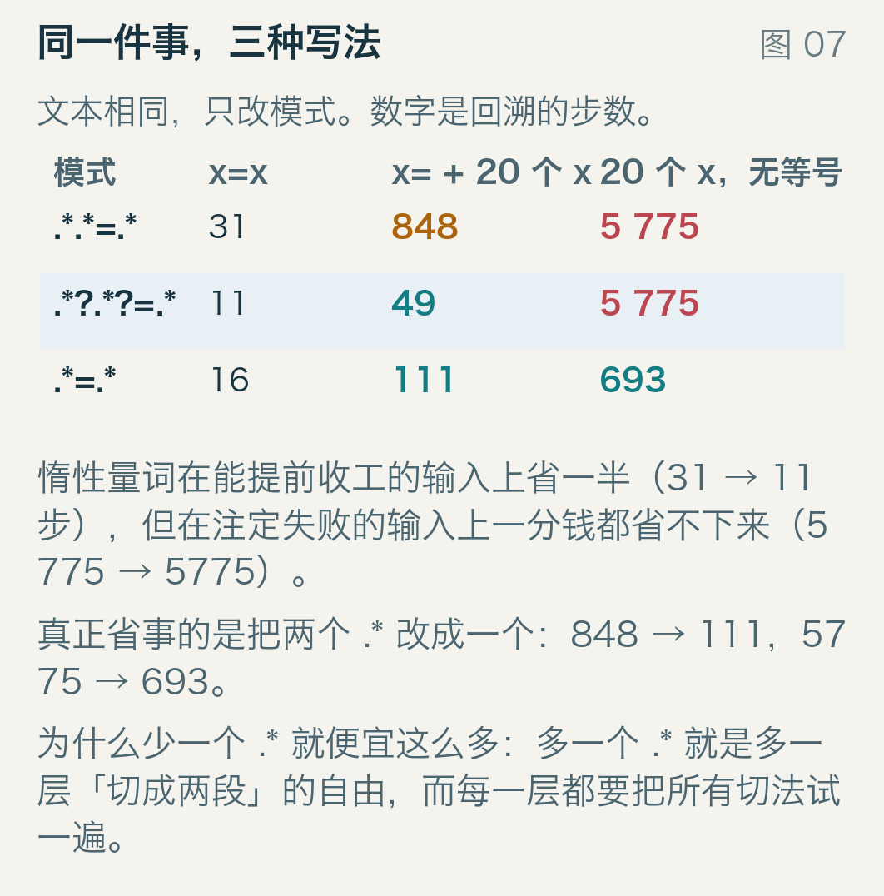

三行数字，顺序是「短输入 `x=x`」「`x=` 后 20 个 x」「20 个 x，没有等号」。
惰性量词确实在能提前收工的输入上省下一大截：31 → 11 步，848 → 49 步，比改写模式还便宜。但在注定失败的那一列，它一分钱都没省：5 775 → 5 775。原因也直白——不匹配的时候没有「提前收工」这回事，该试的还得试。

真正管用的是第三行：把 `.*.*` 改成一个 `.*`。三列全部降下来，31 → 16，848 → 111，5 775 → 693。
这不是什么调参技巧，是结构性的：每多一个 `.*` 就多一层「把剩下的文本切成两段」的自由，而每一层都要把所有切法试一遍。少一个量词，就少一整层嵌套。

## 另一条路：同时推进

现在回头看第一种做法的反面。NFA 模拟不给文本「切段」的机会，它把「同时」当成真的同时。

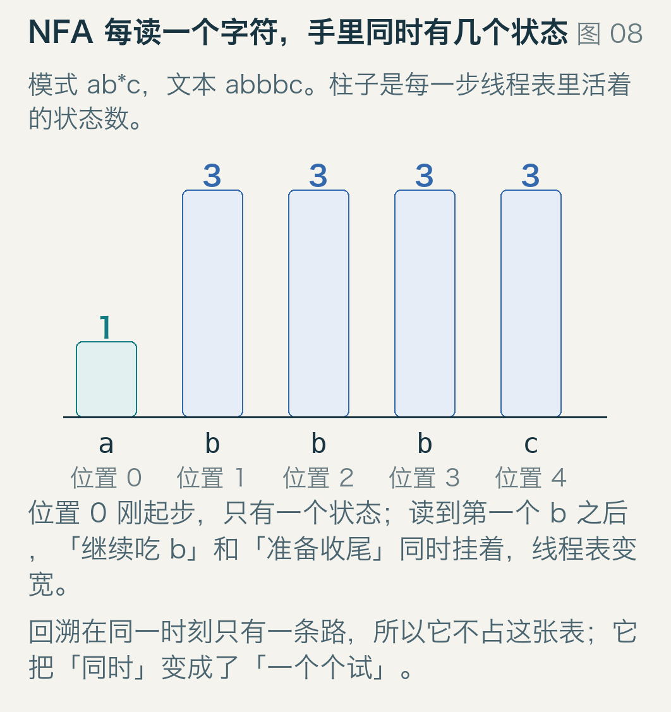

模式 `ab*c`，文本 `abbbc`。位置 0 刚起步，线程表里只有 1 个状态；读到第一个 `b` 之后，「继续吃 b」和「准备收尾」同时挂着，线程表变成 3 个状态；后面一直保持 3 个。

回溯在同一时刻只有一条路。它把「同时」换成了「一个个试」——省了内存，花掉了时间。

线程表有个性质天生压住了复杂度：同一个状态在同一个位置上，只需要存在一次。重复加入没有意义，因为从同一个状态、同一个位置出发，后面发生的事完全一样。所以每读一个字符，线程表的宽度最多是「模式编译出来的状态数」。这就是线性时间的来源。
把文本拉长一百倍看看：

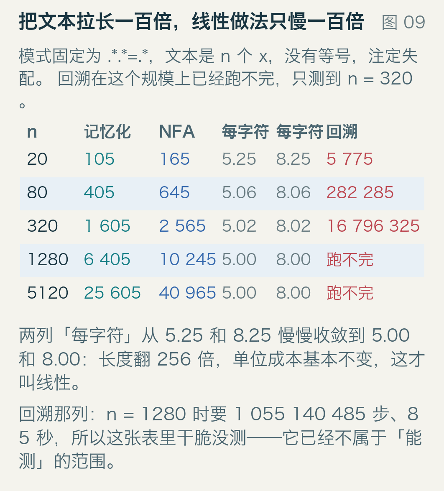

模式固定 `.*.*=.*`，文本是 n 个 `x`，没有等号，注定失配。n 从 20 到 5 120，涨了 256 倍；记忆化的步数从 105 到 25 605，也是 244 倍；NFA 从 165 到 40 965，248 倍。

两列「每字符」比总数更能说明问题：5.25 → 5.00，8.25 → 8.00。长度翻 256 倍，单位成本基本不动，这才叫线性。
回溯那一列没测到最后。n = 320 时 16 796 325 步；n = 1 280 时要 1 055 140 485 步、85 秒。85 秒不是「有点慢」，是「这个量级已经不属于能测的范围」——如果再往后加一个零，等待时间会从秒变成天。

顺带一个便宜技巧：

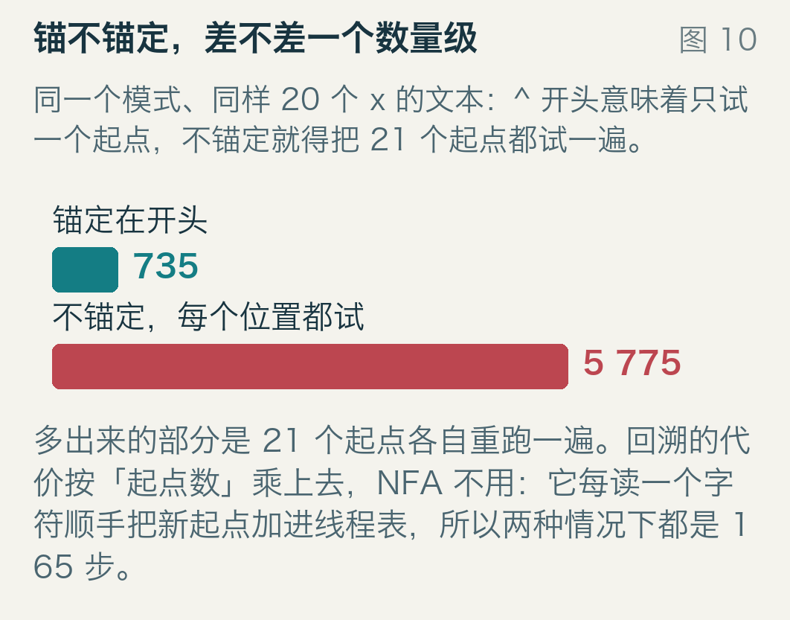

同一个模式、同样 20 个 `x`。加了 `^` 只试一个起点，735 步；不锚定就把 21 个起点都试一遍，5 775 步，差 7.9 倍。

注意 NFA 在两种情况下都是 165 步。因为它每读一个字符顺手把新起点加进线程表，「多起点」对它不是额外开销，是同一张表里多几个状态。回溯做不到这一点：多一个起点就是重跑一遍。
工程上的对应做法很土但有效：能用 `^` 就加 `^`，能用完整匹配就别用「在文本里找」。省下来的倍数不是一点。

## 第三种做法：记住走过的格子

回溯不一定要慢。它慢是因为同一个「状态 + 位置」的组合会被不同的路径反复踩到，每次踩都重新试一遍，而结果总是失败。那就记住。

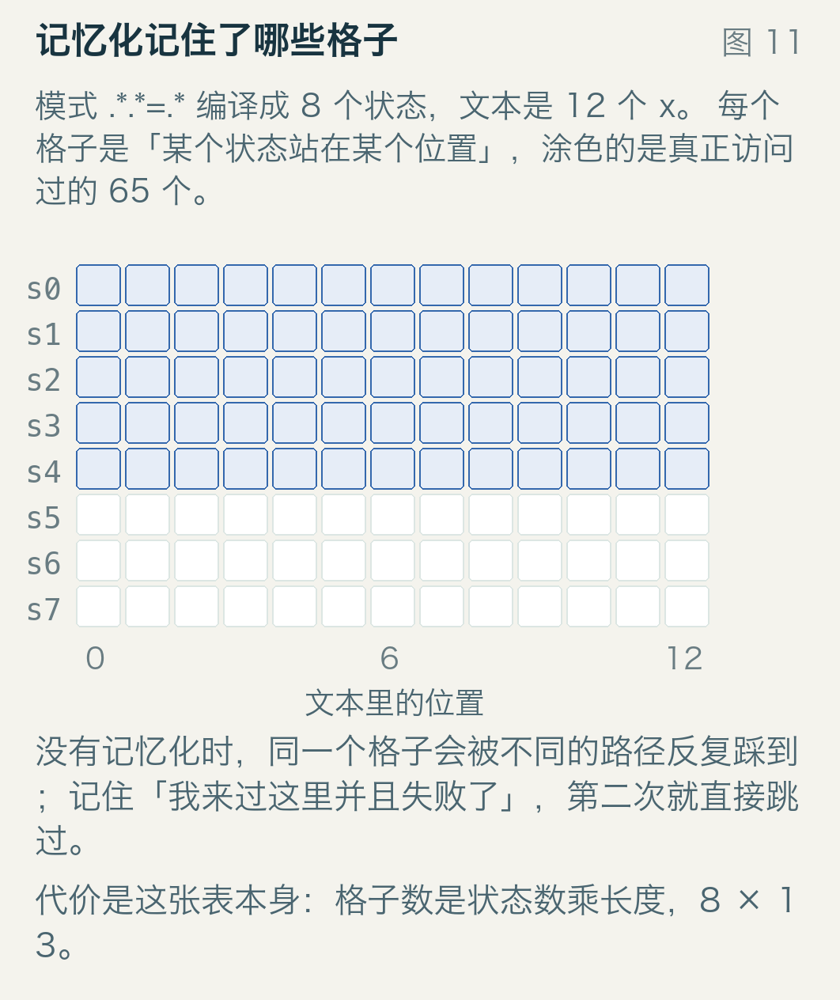

这张图的每个格子是「某个状态站在某个位置」。模式 `.*.*=.*` 编译成 8 个状态，文本 12 个 `x`，一共 104 个格子，真正被访问过的 65 个。记忆化引擎总共走了 65 步，而同一个输入让纯回溯走 5 775 步，差不多九十倍的差距，全部来自「同一个格子只算一次」。

代价是那张表本身：格子数是状态数乘长度。文本五千字节、模式二十个状态，就是十万个格子。这也是为什么记忆化在真实引擎里用得不多：省了时间，吃掉了内存，而且不是所有引擎都愿意为它付出这份内存。
它还丢了一样东西：捕获组。回溯天然知道「这一次匹配是从哪儿来的」，记忆化只记得「这条路不通」，不记得路过的细节。

## 模式本身变大，会怎样

前面几组实验都是模式固定、文本变长。反过来呢？

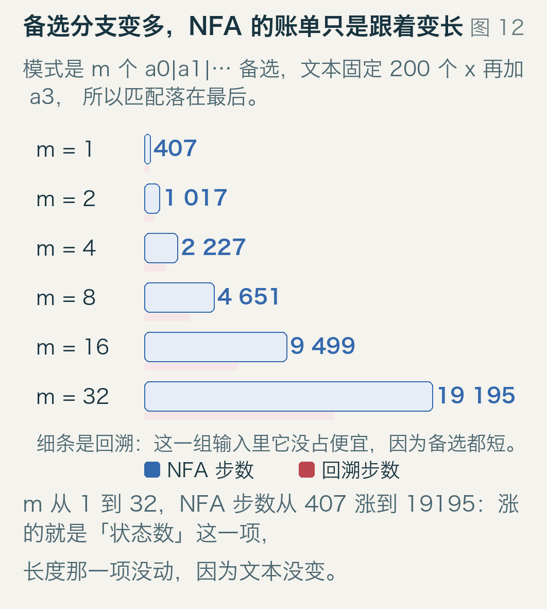

模式是 m 个分支的备选组，文本固定 200 个 `x` 再加 `a3`，所以匹配落在最后。m 从 1 到 32，NFA 的步数从 407 涨到 19 195，涨了 47 倍；同一时期模式从 2 个状态长到 117 个。

这里 NFA 的账单也跟着变大了，只是它变大的是「状态数」这一项，不是「长度」那一项。线性时间从来不是「步数不变」，是「步数 = 状态数 × 长度」。模式变复杂，第一条因子就变大——宇宙里没有白拿的东西。
细条是回溯，这一组里它反而不吃亏：备选分支都短，而且文本前面的 200 个 `x` 一个分支都不匹配，试一次就知道不成，不需要枚举切法。病态需要「能切分的结构」，不是「长的模式」。

## 三种做法的账

到这里可以把三张牌摊开：

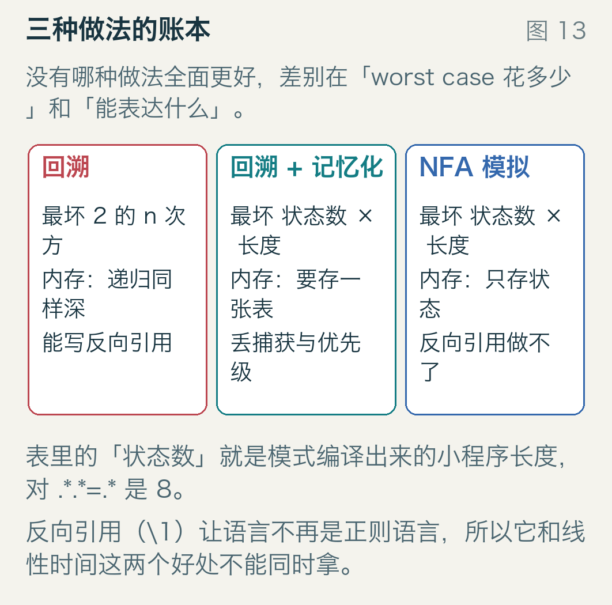

没有哪种做法全面更好。回溯的最坏情况是指数，但它能写反向引用和环视，而且好实现；记忆化和 NFA 是线性的，但前者丢捕获、后者做不了反向引用。

反向引用(`\1`)为什么这么要紧？因为一旦语言里有了它，这门语言就不再是正则语言了——用有限自动机表达不了「记住前面抓到的第几个字符，后面再比一次」。所以「线性时间」和「能写反向引用」这两个好处，原理上不能同时拿。
这也解释了一个常见困惑：为什么 Go 的 `regexp` 不支持 `\1`，为什么 Rust 的 `regex` crate 也不支持。不是作者偷懒，是他们选定了「保证线性」，就只能砍掉这一块。

## 这套做法五十年前就有了

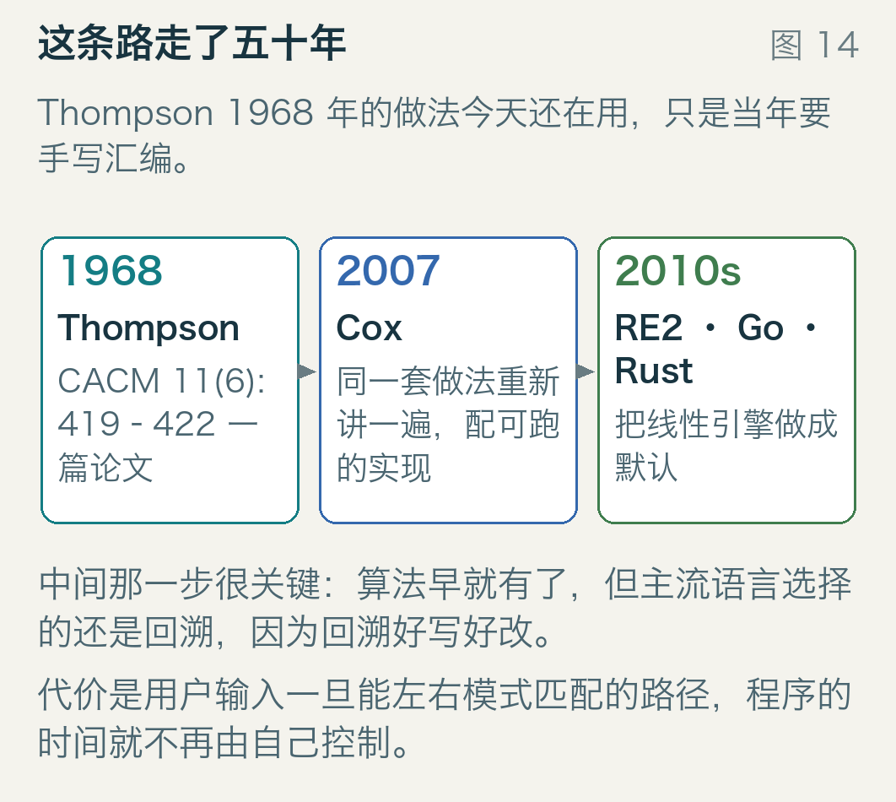

1968 年 6 月，Ken Thompson 在 CACM 11 卷 6 期发表《Programming Techniques: Regular expression search algorithm》(419–422 页，DOI 10.1145/363347.363387)，把正则匹配做成一次线性扫描。那时候没有 Python，也没有 Perl，他得手写汇编来跑这个东西。

同一时期他给 `ed` 写了正则搜索，后来演化成 `grep`。今天你在终端里敲的 `grep`，和那篇论文里的做法是同一件事。
2007 年，Russ Cox 把这套做法重新讲了一遍，标题有点刺：《Regular Expression Matching Can Be Simple And Fast (but is slow in Java, Perl, PHP, Python, Ruby, ...)》。他顺手给了一个可跑的对照实现，还有那个后来出了名的例子：模式写成 n 个 `a?` 再接 n 个 `a`，文本是 n 个 `a`。回溯的步数随 n 指数增长，NFA 只是缓慢上升。

我的模型里跑了同一个例子(锚定版本)：

| n | 4 | 6 | 8 | 10 | 12 | 14 |
|---|---|---|---|---|---|---|
| 回溯 | 78 | 382 | 1 790 | 8 190 | 36 862 | 163 838 |
| 记忆化 | 35 | 70 | 117 | 176 | 247 | 330 |
| NFA | 55 | 112 | 189 | 286 | 403 | 540 |

这一组和前面几组有个不同：它们全部匹配成功。回溯的指数爆炸并不需要「失败」，只要它在成功之前把一堆无用的路径走完就行——`a?` 的每一次「可选」都在制造分叉，分叉在成功之前全部要试。
2010 年代之后，情况有变化。

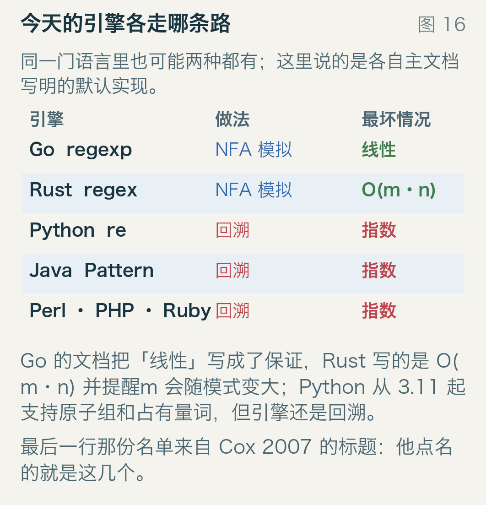

Go 的 `regexp` 从一开始就用 NFA 模拟，文档把线性写成了保证。Rust 的 `regex` crate 走同一条路，复杂度写上 O(m·n) 并提醒 m 会随模式变大。RE2 是 Google 的那份 C++ 实现，卖点同样是「不可信输入也安全」。

而 Python、Java、Perl、PHP、Ruby 到今天还是回溯。原因不神秘：回溯引擎好实现、支持捕获和反向引用、对绝大多数真实模式性能更好。`re` 从 3.11 起加了原子组和占有量词，让写模式的人可以手工阻止某些回溯，但引擎本身的算法没变。
选型建议因此也很土：模式是开发写的、输入是可信的，回溯挺好；模式或输入有一个来自外面，就别赌。

## 回到 2019 年那 27 分钟

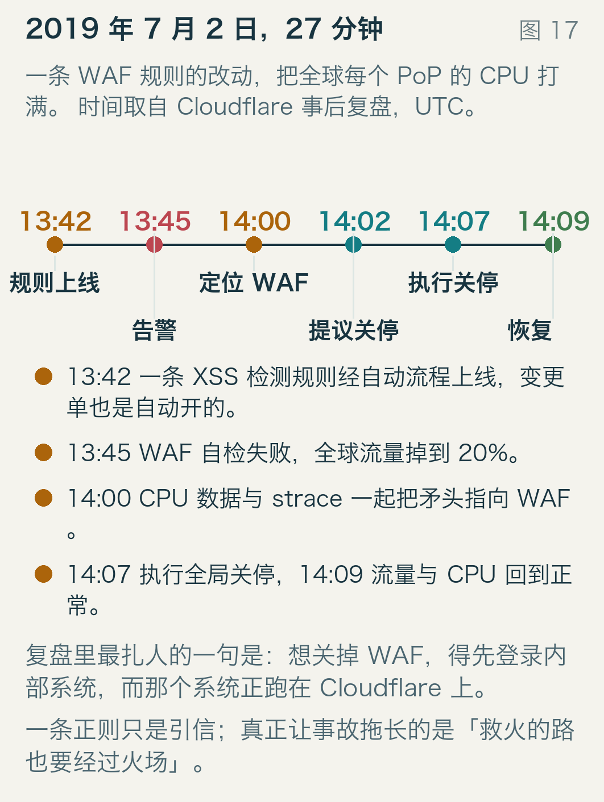

复盘里有两件事值得单独记住。
第一件，和正则本身关系不大，但对所有在写线上系统的人都适用：想关掉 WAF，得先登录内部系统，而那个内部系统正跑在 Cloudflare 上。于是「救火的路也要经过火场」。从 14:00 定位到 14:07 才执行，这七分钟耗的不是技术判断，是权限与依赖。
第二件是那条规则到底长什么样。

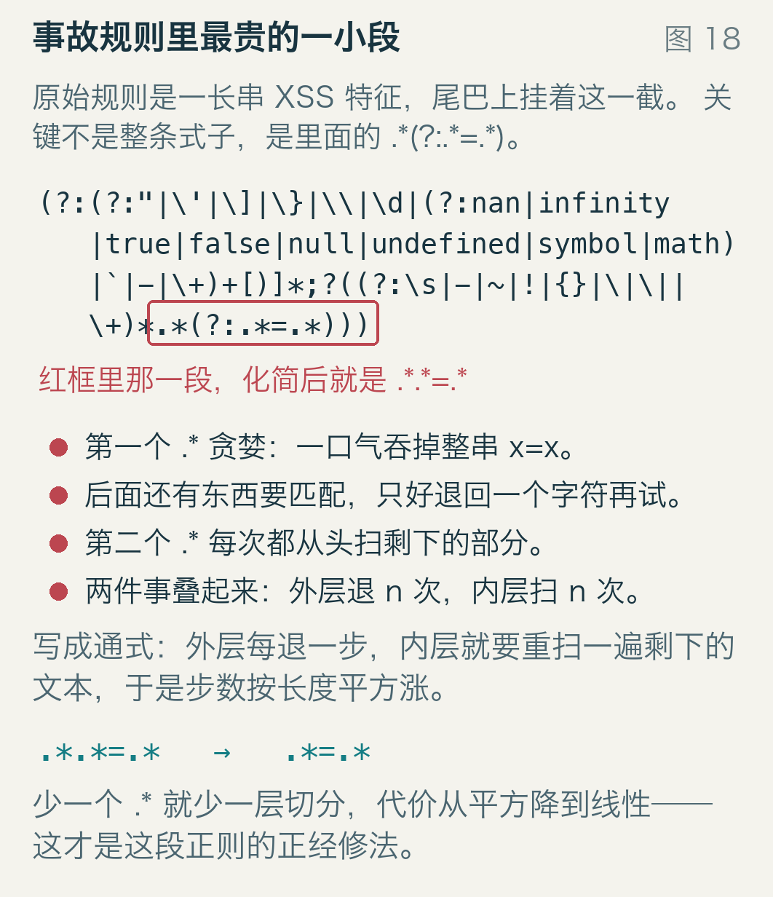

原始规则是一长串 XSS 特征拼起来的，图上是节选，尾巴上挂着 `.*(?:.*=.*)`。红色框里那一段，化简之后就是 `.*.*=.*`。
这就是前面那三张图讲的事：两个 `.*` 叠在一起，每个都贪婪，失败时外层退 n 次、内层扫 n 次，代价按长度的平方涨；而每个 HTTP 请求都要过一遍。

修法也就在图里：`.*.*=.*` 改成 `.*=.*`。少一个 `.*`，少一层切分，平方变线性。真实事故里的修法不是这一行，而是把整条规则先摘掉——先止血，再改。

## 所以，遇到慢正则怎么办

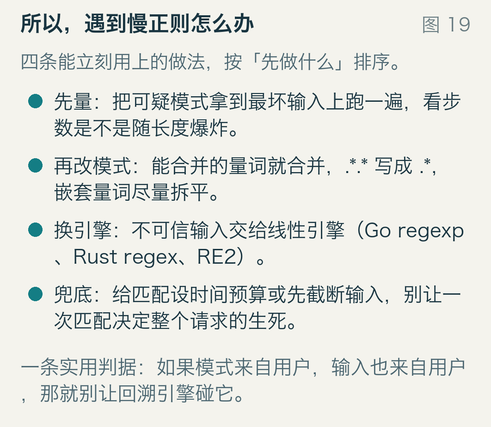

按顺序做四件事。

先量。别猜。把可疑模式拿到最坏输入上跑一遍，看步数是不是随长度爆炸。最简单的判据是：把文本长度翻倍，步数大致也翻倍，那就没事；步数翻四倍，那就是嵌套；步数翻 2 的 n 次方，那就是这一类。这篇文章里的所有数字都是这么来的。

再改模式。能合并的量词就合并(`.*.*` → `.*`)，嵌套量词尽量拆平，能锚定就锚定，能把「在文本里找」换成「完整匹配」就换。这些改动不需要换引擎，收益经常是一个数量级。

换引擎。输入来自外部，就把它交给线性引擎。Go 原生就是，Python 可以走 `re2` 绑定或 `regex` 模块的超时参数，Rust 用 `regex` crate，Java 里没有官方方案但可以调 RE2/J。

兜底。给匹配设时间预算，或者先截断输入。别让一次匹配决定整个请求的生死——这一条在事故里表现得特别直白：一条规则上线，全球 CPU 一起满，因为每个请求都在跑同一段最坏的路径。

## 这个模型做了什么，没做什么

文中所有数字来自仓库里的 `examples/rxe.py`(三种执行器)和 `examples/run_model.py`(十组实验)，结果落在 `examples/results.json`。模型刻意只做了一个子集：字面字符、`.`、`\d \w \s`、字符类、分组、交替、`* + ?` 以及它们的惰性变体、`^ $`。
刻意没做的：反向引用和环视。不是没时间，是自动机表达不了它们——这本身就是正文里的论点。任何声称「线性 NFA 引擎支持 `\1`」的说法，要么在骗人，要么在某个地方偷偷退回了回溯。

也没做的：Unicode 类别、位置断言、回溯引用里的捕获组语义、以及真实引擎里成堆的优化(前缀扫描、字面量加速、DFA 缓存)。所以这篇文章里的步数应该当成「同一把尺子下的相对比较」，而不是「Python 跑这条正则要多少纳秒」。
有两处可以手算复核：

其一，`(a+)+b` 在 n 个 `a` 上的步数，实测数据拟合出来是 **5·2^(n+1) − 4n − 9**。n = 6 时 640 − 33 = 607；n = 20 时 10 485 760 − 89 = 10 485 671。两个都对得上，中间 14 个点也全对。

其二，`(a|a)*b` 是 **5·2^(n+2) − 5n − 15**。n = 6：1 280 − 45 = 1 235；n = 14：327 680 − 85 = 327 595。
这两条式子说明一件事：指数不是「大概很快」，是可以写成闭式的、精确的、跟实现无关的量。

---

复现方式写在 [README.md](README.md)；十组实验的名字与图号对应关系写在 [sources.md](sources.md)。
