# 一个 0.0001 的主元，把答案带偏了一倍

有一段算术，写起来和人手算一模一样：把第一个方程乘一个数，从第二个方程里减掉，消去一个未知数，再往回代。这段算术用了两千年，今天还在每一台机器的线性代数库里跑。
它有一个开关，教科书上常常只用一句话带过：轮到消去第 k 个未知数时，拿哪一行当除数。
这句话决定的不是速度，是有没有答案。

## 一个三位有效数字的事故

方程组长这样：

```
0.0001 · x1 + x2 = 1
        x1 + x2 = 2
```

真解不难：两式相减，`x1 = 1/0.9999 = 1.00010001…`，`x2 = 0.99989999…`。
按最朴素的顺序消元，第一步要用第一个方程 ×`10000` 去减第二个方程：

```
(1 − 10000·0.0001) x1 + (1 − 10000) x2 = 2 − 10000
```

写成三位有效数字，右端是 `2 − 10000 = −9998`，舍成 `−1.00e4`；x2 的系数 `1 − 10000 = −9999`，也是 `−1.00e4`；x1 的系数正好 `0`。于是第二个方程变成 `−1.00e4·x2 = −1.00e4`，`x2 = 1.000`。代回第一个方程：`0.0001·x1 + 1.000 = 1.000`，`x1 = 0`。

答案 `(0, 1)`。代回检验第二个方程，左边 `0 + 1 = 1`，右边是 2，差了整整一倍。
错的地方很具体：那个 `1 − 10000` 本来等于 `−9999`，三位有效数字只留得下 `−10000`，被舍掉的 1 相对于剩下的 `10000` 是万分之一，但它乘上 `10000` 倍之后就成了答案里的全部内容。除以 `0.0001` 这个动作，把舍入误差放大了 `10000` 倍。

换成先交换两行、用 `x1 + x2 = 2` 当主元呢？乘数是 `0.0001`，被改写的元素是 `1 − 0.0001 = 0.9999`，三位有效数字里保得住。同样三位精度，答案是 `x1 = 1.000`、`x2 = 1.000`，误差万分之一。
同一道题，同一套消元步骤，只改了「先除哪个数」，一个错得离谱，一个错在最后一位。这就是pivot 这个词，中文叫主元在数值计算里的分量。

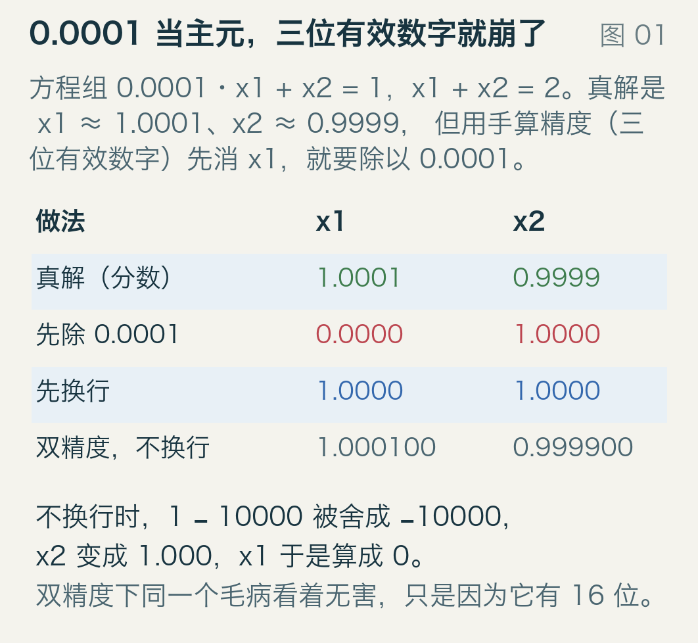

同一个方程组在双精度下算，两种做法都看不出毛病。这张表最后一行就是这个提醒：双精度不选主元也给出 1.000100，真值是 1.00010001，误差 3e−13。麻烦的地方在于，它不会告诉你「这次运气好」。

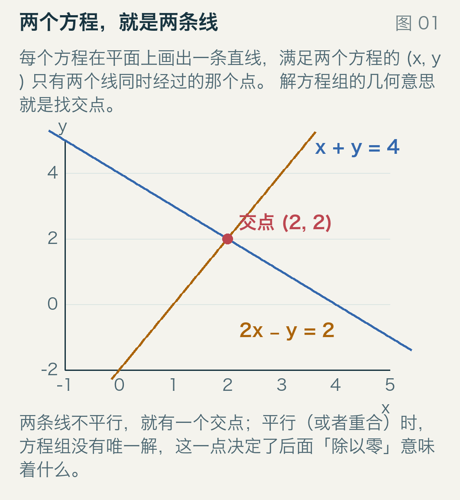

先把几何摆出来。每个方程是平面上一条直线，方程组的解是两条线的交点。行的顺序、消元的顺序，都是纸面上的操作，交点始终在那里。这一点很重要：后面所有的花招都不改变题目，只改变我们怎么走过去。

## 消元到底做了一件什么事

拿一组好算的数：

```
x1 + x2 = 4
2x1 − x2 = 2
```

第一个方程乘 2，从第二个里减掉：第二个方程里的 2x1 减 2x1 消失了，剩下 −3x2 = −6，也就是 x2 = 2。再代回第一个，x1 = 2。

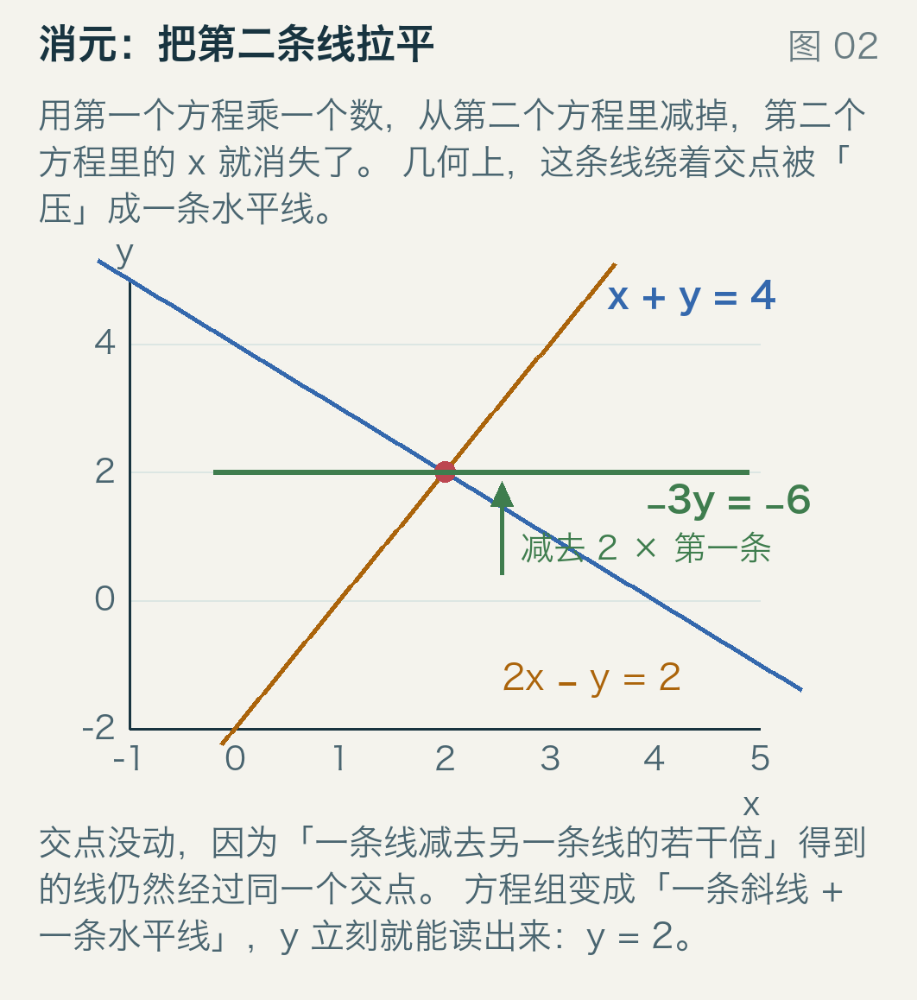

图上那条琥珀色的斜线是第二个方程，那条绿线是「第二个方程减去两倍第一个方程」得到的。它们都经过交点 (2, 2)，因为「一条线减去另一条线的若干倍」得到的线必然经过交点；只是新线是水平的，x2 的值直接写在上面。
这就是消元的全部秘密：它不是解方程，它是**把方程组换成一组更好解的等价方程**。等价的意思是解集不变——每一步都在把线绕交点旋转或平移，交点不动。

## 手算一个三阶的例子

二阶太顺了，看不出主元这回事。换一个三阶的：

```
 2x1 +  x2 −  x3 =  8
−3x1 −  x2 + 2x3 = −11
−2x1 +  x2 + 2x3 = −3
```

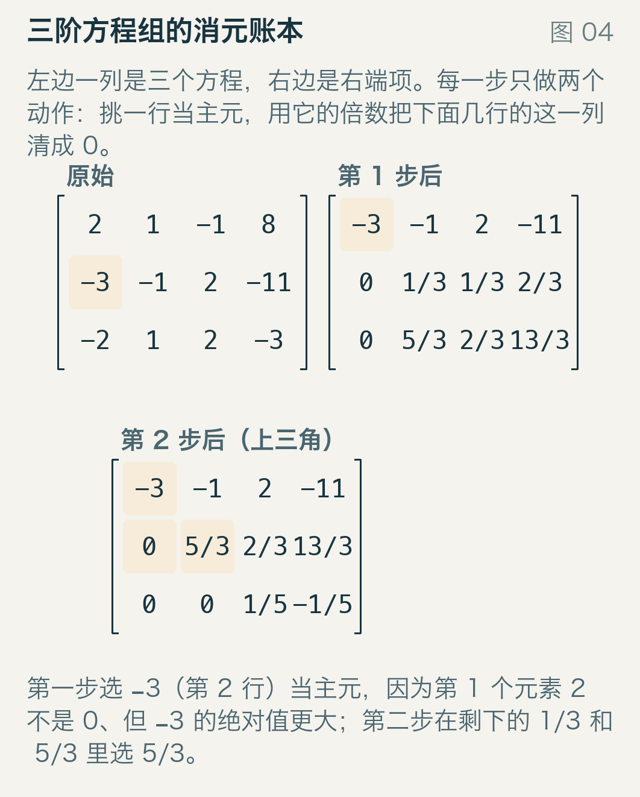

第一步，看第一列：`2、−3、−2`。挑绝对值最大的 `−3`，把第 2 行换到第 1 行，这一步在下一节讲，先当它是顺手。然后用第 1 行去消下面两行的 x1：第 2 行减去 `(−2/3)` 倍的第 1 行，第 3 行减去 `(2/3)` 倍的第 1 行。

第二步，看第二列剩下的两个元素：`1/3` 和 `5/3`。挑 `5/3`，用它当主元，把 `1/3` 消成 0。做完以后矩阵变成上三角：对角线以下全是 0。

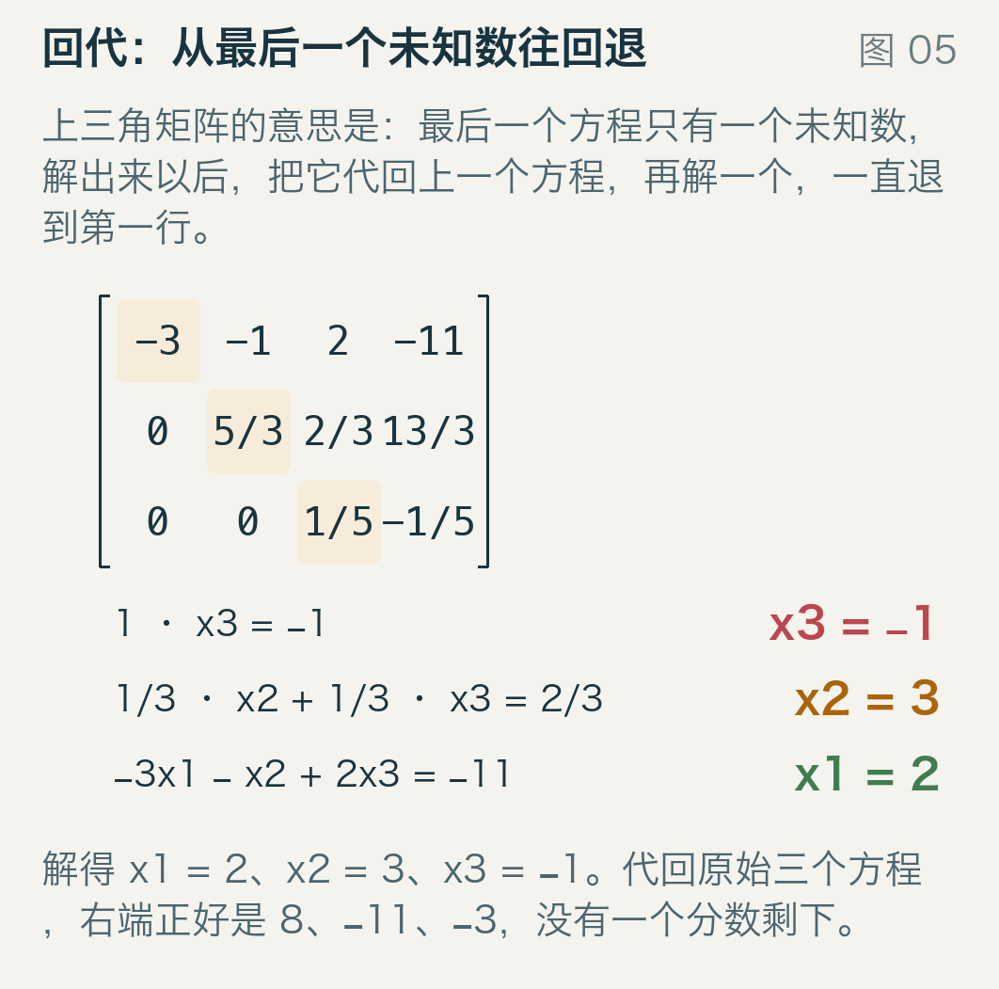

然后是回代。最后一行 1/5·x3 = −1/5 直接给出 x3 = −1。带到第二行求出 x2 = 3，再带到第一行求出 x1 = 2。
代回原始三个方程：2·2 + 3 − (−1) = 8，−3·2 − 3 + 2·(−1) = −11，−2·2 + 3 + 2·(−1) = −3。三个都对，而且没有一个分数剩下——这道题是照着整数解造出来的，方便手算。

步数也能数：n 阶时，消元阶段要做大约 n³/3 次乘法和同样多的加减，回代再来 n²/2 次。三阶就是 9 次乘法和几次减法，一支笔三十秒。

## 主元是 0 的时候

把上一个例子改一点，让第一个方程的 x1 系数变成 0：

```
     x2 +  x3 = 3
 x1 + x2 + x3 = 4
 x1 − x2 + x3 = 2
```

解是 (1, 1, 2)。题本身没有任何毛病，三条方程互相独立。

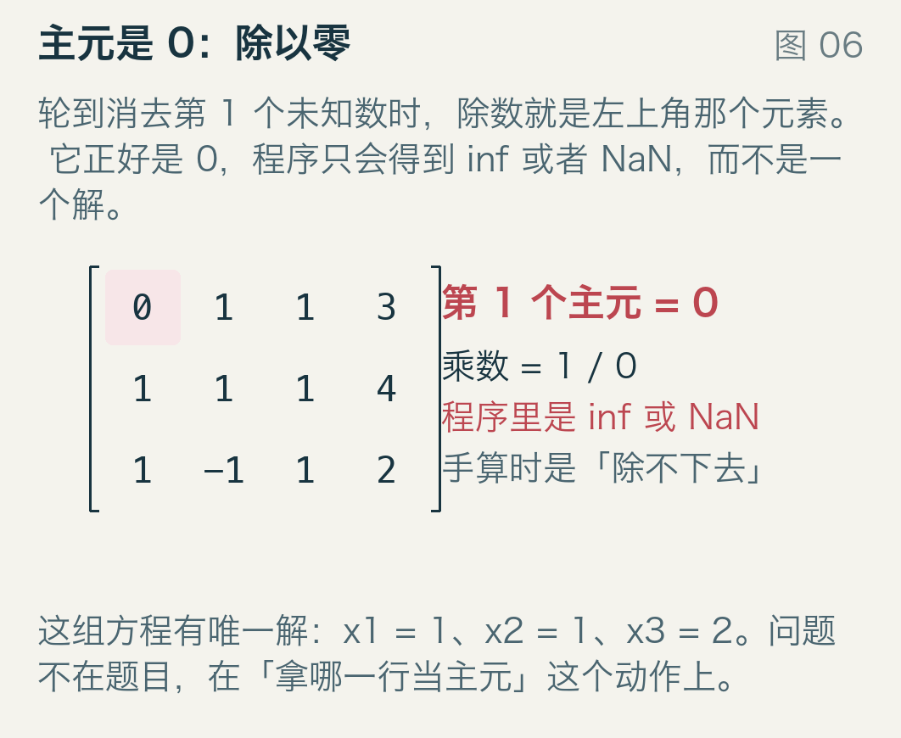

但按顺序做第一步，除数就是左上角那个 0。乘数 1/0 在程序里是 inf，在纸上写不出来。后面的运算全部变成 NaN——NaN 还不够老实，很多库会给你一个 inf 然后悄悄继续，最后输出一串看起来像数字的东西。
这里要停一下：这组方程有唯一解，问题不在题目，在我们选的路径。

## 换一行，就换了一个除数

既然 0 不能当除数，就换一行来当。

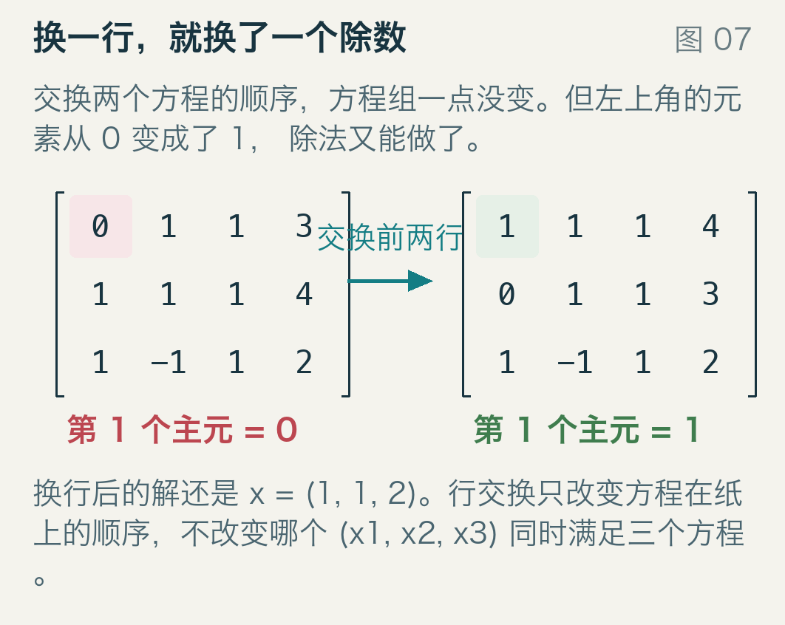

交换前两行，方程组变成：

```
 x1 + x2 + x3 = 4
     x2 + x3 = 3
 x1 − x2 + x3 = 2
```

同样的三个方程，只是纸上顺序变了。解仍然是 (1, 1, 2)，因为它满足的是「同时成立」，而「同时」不讲先后。
现在主元是 1，第一步能做了。做完第二步，第三个主元落在 −2 上，第三步落在 1 上，一路顺利。

## 不是随便换一行

能换了，接下来就要挑。挑错了会怎样，第一节已经演示过：0.0001 当主元，三位有效数字就完蛋。
挑法叫部分主元，英文 partial pivoting：规则是在当前这一列还没处理过的元素里，挑绝对值最大的那一行，换到上面来。

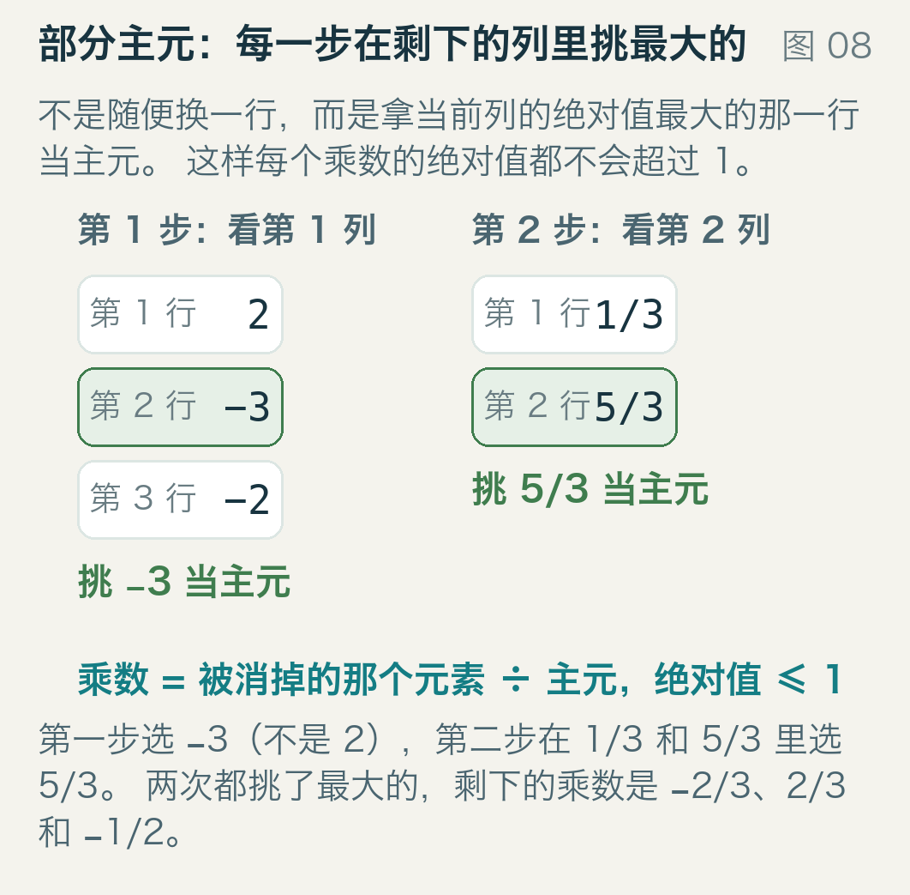

三阶例子里，第一步在第一列 `[2, −3, −2]` 里挑 `−3`；第二步在 `[1/3, 5/3]` 里挑 `5/3`。挑完以后算出来的乘数是 `−2/3`、`2/3` 和 `−1/2`，没有一个大过 1。
这个「不超过 1」不是巧合，是选法的直接后果：乘数是「被消掉的元素 ÷ 主元」，而主元是这一列里绝对值最大的，所以被消掉的元素绝对值一定 ≤ 主元，商一定 ≤ 1。

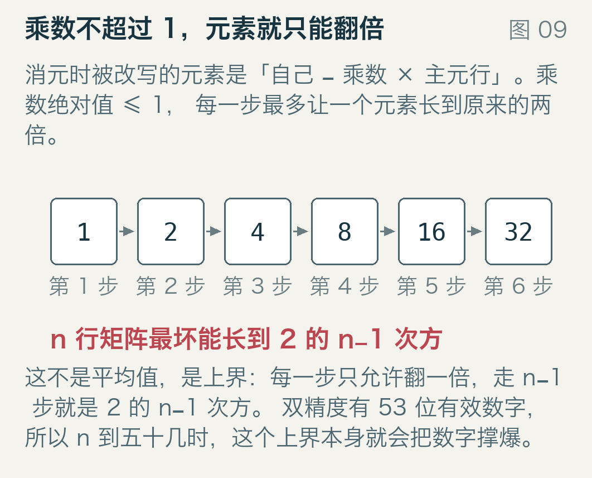

为什么要盯着这个 1？因为消元每改写一个元素，写的新值是「自己 − 乘数 × 主元行的对应元素」。三个数都不超过当前最大值的绝对值，那么新值最多是原最大值的两倍。每一步最多翻一倍，n 行矩阵走 n−1 步，最坏情况就是长到 2 的 n−1 次方。

这个上界很松，但它是一条硬保证。没有主元，乘数可能是 10000，一步就把小数点推出去四位，就像第一节那样。

## 这个上界真的能达到

上界要能造出来才算数。Wilkinson 造过一个矩阵，形状是：下三角全是 −1，对角线全是 1，最后一列全是 1。
消元时每一步的乘数都是 1，最后一列每一轮都翻倍：`1、2、4、8`……走完 `n−1` 步，元素长到 `2 的 n−1 次方`。模型实测：`n = 5` 时 `16` 倍，`n = 10` 时 `512` 倍，`n = 30` 时 `536 870 912` 倍。

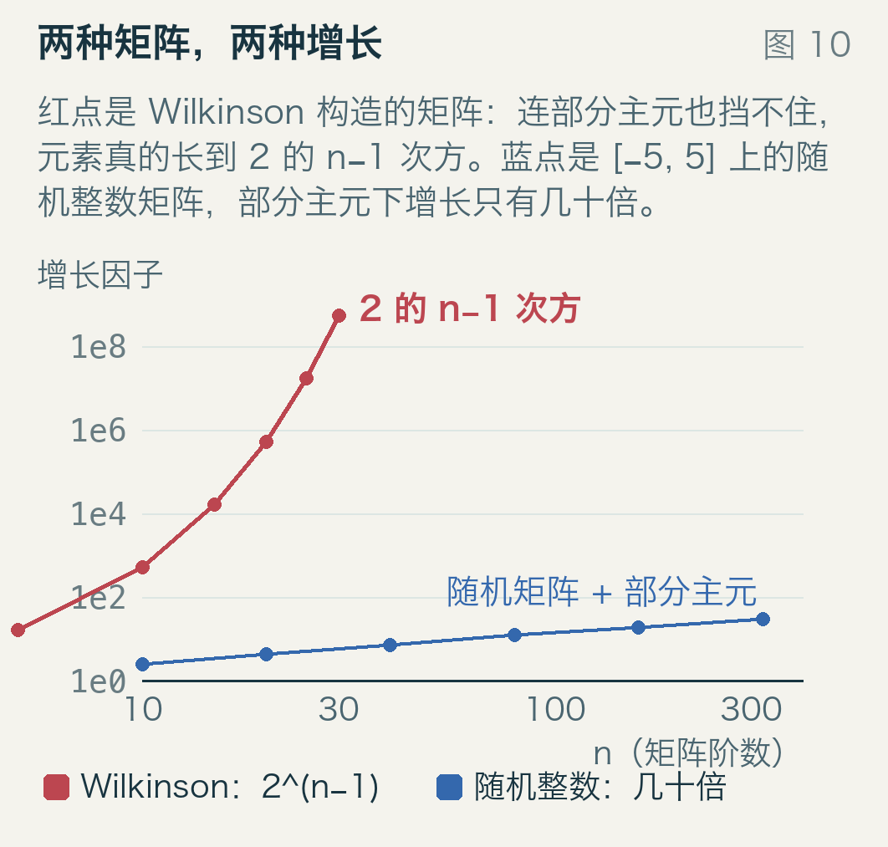

注意图里红线的意思：这个矩阵连部分主元也挡不住。因为它的所有元素绝对值都是 1，部分主元挑不出更好的，乘数照样是 1，最后一列照样翻倍。`2 的 n−1 次方` 是部分主元的理论上界，而这个理论上界是可以被达到的。
好消息是随机矩阵离这个上界很远。模型在 `[−5, 5]` 的随机整数矩阵上跑了 `20` 个种子：`n = 10` 时部分主元的增长中位数是 `2.4` 倍，`n = 320` 时是 `29.8` 倍——从几十到几十，跟 `2 的 319 次方` 差着两百多个数量级。同一批矩阵不选主元，中位数从 `24.7` 倍涨到 `25 042` 倍，而且 `20` 个种子里有 `5` 个，`n = 10`和 `6` 个，`n = 320`直接撞上零主元。

顺带一个容易踩的坑：随机 ±1 矩阵本身经常恰好奇异。把 3 阶的 512 个 ±1 矩阵全枚举一遍，320 个行列式为 0；4 阶的 65 536 个里有 43 264 个。所以拿 ±1 矩阵做「随机测试」，不选主元的消元经常会撞死在一列 0 上，你会误以为是代码写错了。

## 双精度也挡不住

第一节那个 0.0001 的例子看着像手算精度的问题。换个问法：机器精度够高，是不是就没事了？
模型把 [0.0001, 1; 1, 1] 这组数换成单精度，也就是 float32，约 7 位有效数字重跑一遍。真解 (1, 1) 不变，误差是这么走的：p = 0.1 时误差 2.4e−7，p = 0.001 时 7.3e−5，p = 1e−5 时 1.4e−3，p = 1e−7 时 0.19——x1 偏了 19%。

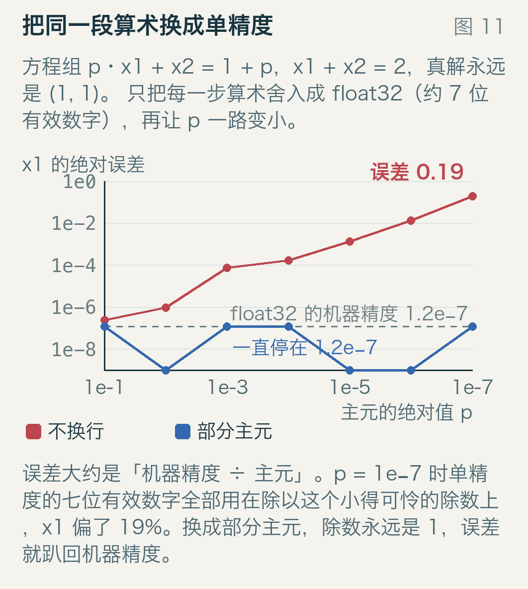

曲线几乎是斜率为 −1 的直线：误差 ≈ 机器精度 ÷ 主元。把这句写成数字：1.2e−7 / 1e−7 ≈ 1，而实测是 0.19，同量级。这不是「可能出问题」，是可以算出来的量。
同一张图上蓝线一直趴在 1.2e−7 附近。因为部分主元让除数永远不小于 1，那个除法根本没机会放大误差。

双精度有 16 位十进制有效数字，同样的机制只是往后推了九位。第一节的例子在双精度下误差只有 3e−13，看起来没事。但把它换成半精度、混合精度、定点算术，或者主元小到 1e−12，同样的故事会原样重演。主元的判据不是「是不是 0」，而是「相对于这一列其他元素有多小」。

## 残差小，答案不一定对

到这里容易得出一个错结论：只要每步残差小，解就是对的。
Hilbert 矩阵是最好的反例。它的元素是 1/(i+j−1)，第 n 阶长这样：

```
1     1/2   1/3   ...
1/2   1/3   1/4   ...
1/3   1/4   1/5   ...
```

hilbert 矩阵的解向量取全 1 时，右端项就是每行的和。模型用双精度、带部分主元解它，再检查两件事：把算出来的解代回方程，误差有多大（残差）；解本身离 (1, 1, …, 1) 有多远（向前误差）。
n = 10 时：相对残差 0，在双精度里小于 1e−17，解的最大偏差 5.9e−4。

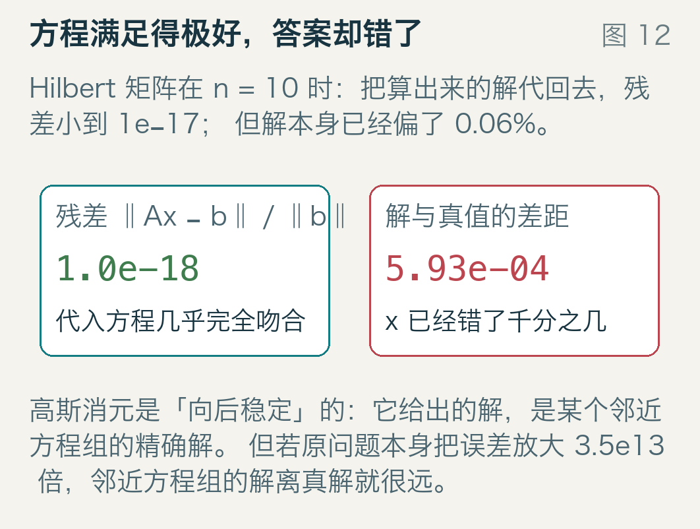

方程被满足得无可挑剔，答案却错了万分之六。这不是程序有 bug，这是高斯消元的一条性质叫「向后稳定」：它给出的解是某个**邻近**方程组的精确解，邻近的程度大约是机器精度乘上增长因子。问题在于，原问题本身会把这种邻近放大——放大倍数就是条件数。

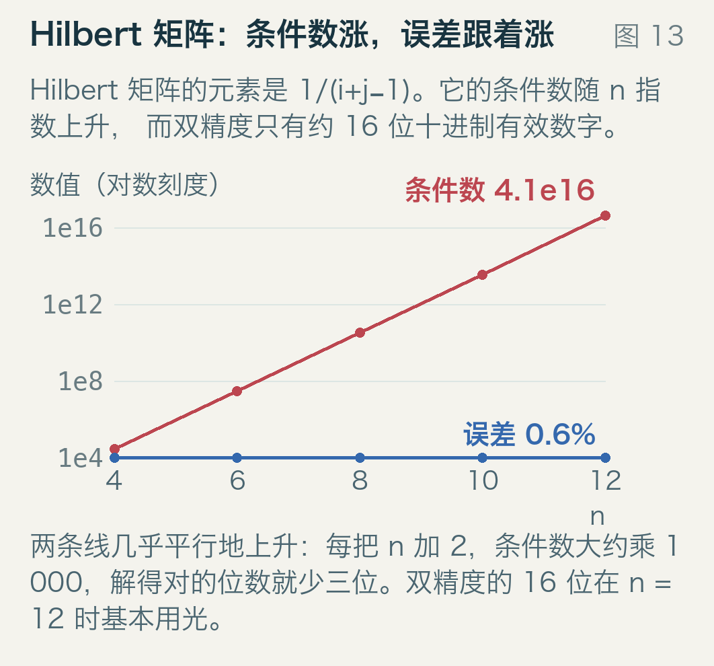

条件数随 n 指数上涨：n = 4 时 2.8e4，n = 8 时 3.4e10，n = 12 时 4.1e16。向前误差跟着走：1.5e−13、3.4e−7、6.0e−3。两条线在图上几乎平行，斜率差就是「每加 2 阶，条件数乘 1000，解得对的位数少 3 位」。
粗算一下也对得上：条件数 3.5e13 × 机器精度 1.1e−16 ≈ 3.9e−3，实测 5.9e−4，同一个量级。

## 条件数的几何长相

条件数听着抽象，把它摆到平面上就是一句话：两条线的夹角越小，交点越经不起抖。
固定两条线在 (1, 0) 相交，把第二条线的斜率做成 tan θ，再把它的右端项挪动一个 ε。交点的水平位移正好是 ε / tan θ。

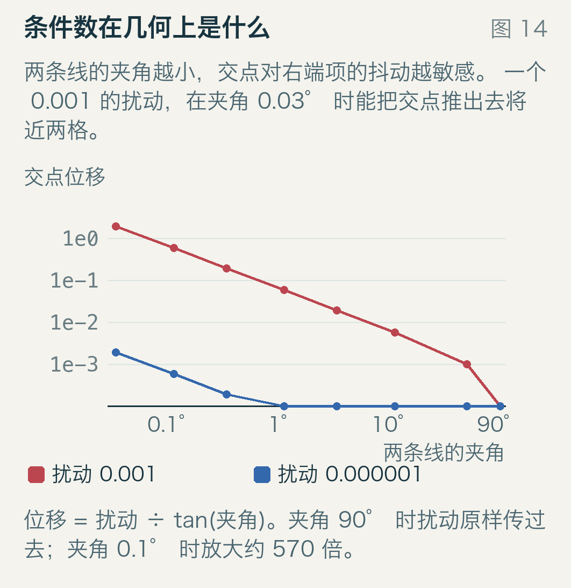

`θ = 90°`，两条线垂直时，扰动原样传过去，位移 `0.001`。`θ = 10°` 时位移 `0.0057`。`θ = 1°` 时 `0.057`，`θ = 0.1°` 时 `0.57`，`θ = 0.03°` 时 `1.91`——扰动还没到千分之一，交点已经被推出去了将近两个单位。

这就是条件数：**问题本身对输入的敏感度**。主元选择管的是「算术别爆」，条件数管的是「这题值不值得信」。两件事互不替代：病态问题换什么主元都病态，良态问题不选主元也能崩。

实际使用里这个区别很有用。解出来的东西明显不对，先看条件数；条件数正常而答案离谱，才该怀疑算法或数据。

## 代价

选主元不是免费的，但它便宜得离谱。

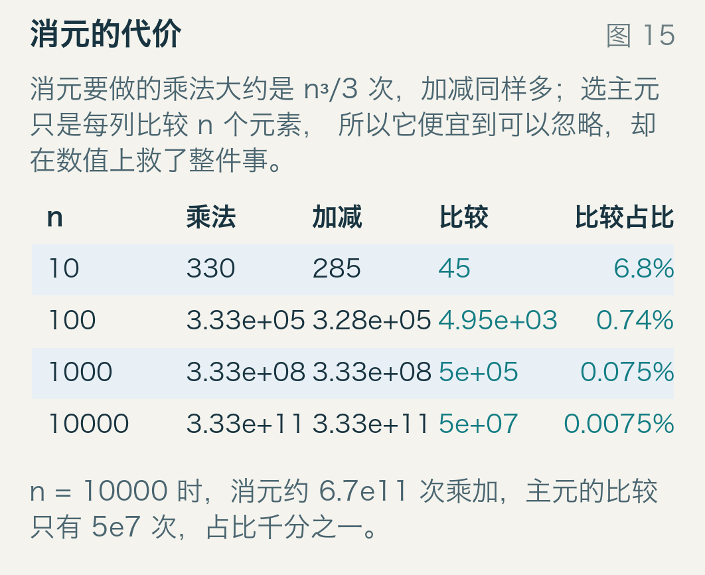

`n = 1000` 的矩阵，消元阶段约 `3.3e8` 次乘法、`3.3e8` 次加减，而选主元只需要在这一列里比较，总数 `n²/2 = 5.0e5` 次，占比 `0.075%`。`n = 10000` 时占比 `0.0075%`。
换句话说：用万分之几的额外操作，换掉「除以零」和「放大小主元」这两个风险。这是数值计算里性价比最高的买卖之一。

比较也不能漏掉：如果连「选哪个」都要用除法算，就不便宜了。完全主元，英文 complete pivoting每步在整块剩余子矩阵里找最大值，比较次数从 n²/2 涨到 n³/3，和消元本身一样贵。

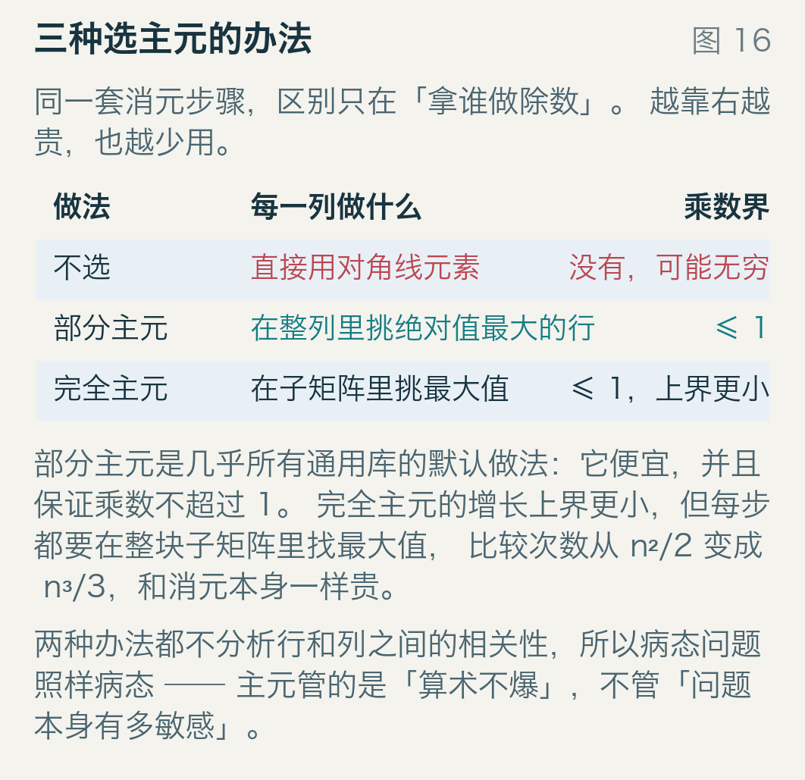

三种做法的差别就在这张表里：不选，便宜但可能除以零，乘数无界；部分主元，便宜，乘数 ≤ 1；完全主元，贵，增长上界更小但换不来数量级的好处。通用库里默认的是中间那个。

## 真实库里的样子

LAPACK 的 `dgesv` 就是做这件事的：解双精度一般矩阵的线性方程组。它内部先调 `dgetrf` 做带部分主元的 LU 分解，再调 `dgetrs` 用分解结果做三角求解。

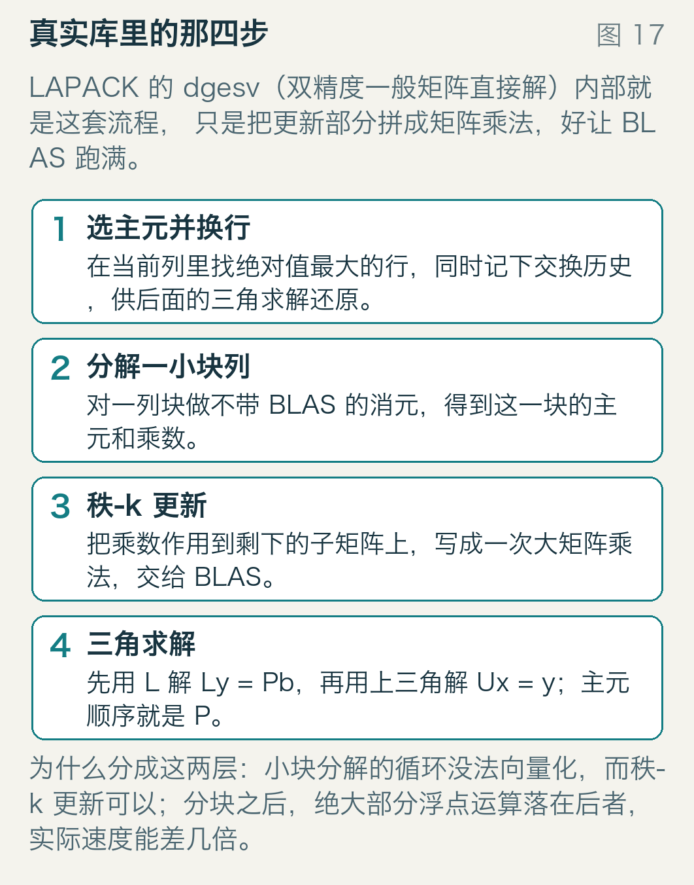

`dgetrf` 不是老老实实一列一列做。它把矩阵切成列块：对一小块列做不带 BLAS 的消元（这部分循环短、依赖强，向量化不了），然后把这一步的乘数作用到剩下的大块子矩阵上（这部分是矩阵乘法，能让 BLAS 跑到接近峰值）。分块之后，绝大部分浮点运算落在后者。
这也解释了为什么「自己写一个三重循环的高斯消元」在小矩阵上够用、在大矩阵上慢几十倍：不是算法错，是没给编译器可向量化的结构。

Python 里，`numpy.linalg.solve` 和 `scipy.linalg.solve` 走的都是这条路径。SciPy 在矩阵接近奇异时会发 `LinAlgWarning`，提示的正是条件数。看到这个警告别当噪音，它是这道题在说「我给的答案只能信前几位」。

## 这个模型做了什么，没做什么

所有数字来自 `examples/ge.py`，三套算术分别是精确分数、有限位有效数字、float32和 `examples/run_model.py`，一共七组实验，落在 `examples/results.json`。画图脚本读这份账本，不另外算数。
做了的：精确分数消元（可以核对玩具例子解出整数）、有限位舍入的消元（模拟手算）、float32 舍入（用 `struct` 打包解包）、部分主元、增长因子统计、Hilbert 矩阵的条件数与向前误差、±1 矩阵全枚举。
没做的：完全主元、稀疏矩阵、分块实现的性能测量、复数矩阵、对称正定矩阵的特殊解法，Cholesky 分解。也没测真实 BLAS 的速度，`dgesv` 那张图是结构示意，不是性能曲线。

有两处可以自己复核。其一，三阶例子三个主元依次是 −3、5/3、1/5，乘数是 −2/3、2/3、−1/2，代回三个方程正好是 8、−11、−3。其二，单精度扫描里 p = 1e−7 时 x1 = 1.19，真值是 1，误差 0.19；把 p 换成 1e−5，误差掉到 1.4e−3，比值正好差 100 倍——「误差 ≈ 机器精度 ÷ 主元」这条线可以自己验。

至于历史：这套消元在《九章算术》的「方程」章里就有完整写法，用算筹摆系数、逐行相减，还给出了负数的运算法则；高斯 1809 年在《天体运动论》里用它处理最小二乘的正规方程，名字是二十世纪数值分析文献才固定成「高斯消元」的。误差分析——尤其是主元选择与增长因子的那套语言——是 Wilkinson 在 1960 年代建立起来的。这篇文章里的数字全是模型现算的，不引自这些文献。

## 三句话


消元在做什么：拿一行的倍数把下面几行的某一列清成 0，几何上是把线绕交点转平，解不动。

为什么必须选主元：除数是 0 就崩；除数很小就把舍入误差放大成答案的主体。换成这一列里绝对值最大的那行，乘数不超过 1，最坏增长被压在 2 的 n−1 次方。

它救不了什么：主元只保证算术不爆，不改变问题的敏感度。条件数大的题，残差再小，解也可能错很多位——那是题目的事，不是算法的事。

---

复现步骤在 [README.md](README.md)，每张图的数字出处与来源在 [sources.md](sources.md)。
