# 九成满的表，查不到要走 56 步

有一张 4099 个槽的表，里面装了 3689 个键。这不挤，九成满而已。
现在查一个键。如果它确实在表里，平均走 5.6 步就能碰到；如果它不在，平均要走 56 步。

差十倍。同一个表，同一条规则，区别只在「查到了就停」和「查不到就得一路走到底」。这条规则本身简单到一句话：算出一个起点，撞了就往下一个槽试，试到头就绕回开头。

这就是线性探测。它便宜的地方便宜得离谱：下一个槽就在内存里隔壁，一次加法一次比较；它贵的地方也很朴素，所有键挤在一条连续的区域里，那条区域越长，落进去的键越倒霉。

## 一条规则，一张能手算的表

取表长 `m = 7`，依次插入 `1、8、15、2、9`。位置就是键除以 `7` 的余数。

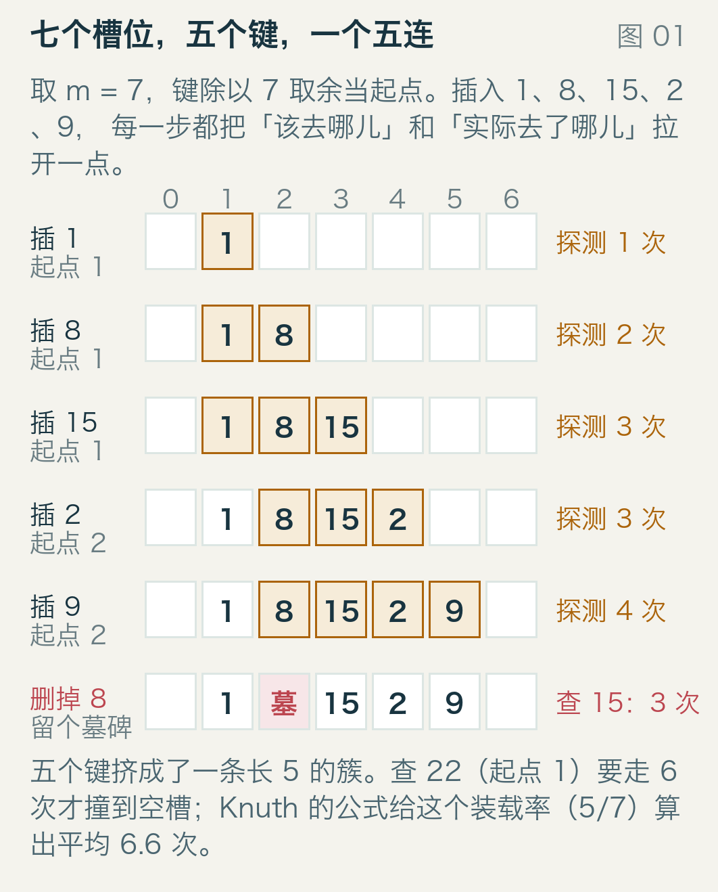

图的读法：七个格子是七个槽，格子上方的数字是槽号；每一行是插入一个键之后的表；琥珀色底格是这次插入真正试过的槽，右边的「探测 N 次」就是试了几个。

插 `1`，余数 `1`，槽 `1` 空着，一步到位。插 `8`，余数也是 `1`，槽 `1` 里坐着 `1`，往后挪一格到槽 `2`。插 `15` 更惨，槽 `1`、槽 `2` 都有人，落到槽 `3`。插 `2`，余数 `2`，槽 `2` 被 `8` 占着，接着往后找到槽 `4`。插 `9` 是最后一个，余数 `2`，从槽 `2` 一路试到槽 `5`。

五个键，槽 `1` 到槽 `5` 连成一串，没有空隙。这就是一条「簇」，英文叫 cluster。
现在删掉 `8`。这里有个坑，很多人第一次实现都会踩：不能把槽 `2` 直接清空。清空之后，查 `15` 的时候会从槽 `1` 出发，走到槽 `2` 看见空的，按「撞到空槽就说明没这个键」的规矩返回「不存在」，可 `15` 明明就坐在槽 `3`。

所以删掉的槽要留个记号，一个「这里曾经有东西」的墓碑，英文叫 tombstone。查询时墓碑不算空，要跳过去继续走；插入时可以把它当空位用。
图 01 最后一行就是墓碑的样子。查 `15` 依然要 `3` 步（槽 `1`、墓碑、槽 `3`），查 `8` 要走 `6` 步确认它真的没了，查一个根本没插入过的 `22`（余数 `1`）也要走 `6` 步，因为整条簇都得走完，撞到槽 `6` 的空位才敢说「没有」。

## 把代价量出来

「走几步」这个说法得变成能比较的数。
一次查找的探测次数，是它依次检查过的槽数。装载率 α 是已占用的槽数除以总槽数。查表里有键和查表里没键是两件事，分开算：成功的查找碰到键就停；失败的查找必须碰到空槽才停，或者把整条簇走完。

拿 m = `4099` 的素数表，键由 splitmix64 生成，按 α 装填，然后查每一个已插入的键，再查 `1500 个` 不在表里的键。整个过程只用标准库，跑一次 `examples/run_model.py` 就能重算。
α = `0.9` 时，成功查找平均 `5.55 次`、最长那条 `355 次`；失败查找平均 `55.71 次`。峰值和平均值差了两个数量级，这个差距后面还要回来谈。

## 簇是怎么长起来的

取两张 `m = 64` 的表，一张装 `32` 个键（`50%`），一张装 `57` 个（`89%`），键用同一个随机源生成。


每张图有 `64` 个小格子，排成两行，颜色相同的相邻格子是同一条簇，白色是空槽。这张图的重点不是颜色好看，是「连成片」这件事：装载率 `50%` 时最长的一条簇是 `7` 格，装载率 `89%` 时出现了一条 `25` 格的簇，四分之一的表连成了一块。

簇会自己加速。一个键的起点如果落在簇中间，它只能被推到簇尾；一旦推到簇尾，簇就长了一格，簇尾的「接收面积」就更大。两条簇中间只要空一格，下一个落点不巧的键就会把那一格填上，两条簇立刻合并成一条。
这个现象有个名字，叫 primary clustering，中文译作主聚集。1957 年发表那篇论文的人就已经看出来了。

## 1957 和 1963：公式从哪来

W. Wesley Peterson 在 IBM 工作，1957 年在《IBM Journal of Research and Development》上发了一篇《Addressing for Random-Access Storage》（第 1 卷第 2 期，130–146 页）。他把几种「撞了就试下一个」的探测顺序的期望比较次数都算了一遍，其中包括最朴素的「挨着往后试」；他注意到这一种在表装满时代价明显更差，而那些代价集中在成片的连续占用区上，也就是后来被叫做簇的东西。
Knuth 后来给出了闭式。这两个式子在 Knuth 1963 年的笔记里就已经成形，1973 年印进《计算机程序设计艺术》第三卷 6.4 节，一直用到现在：

```
成功： ½ · (1 + 1/(1−α))
失败： ½ · (1 + 1/(1−α)²)
```

上面那张 `m = 7`、装了 `5` 个键的表，`α = 5/7`，也就是 `1−α = 2/7`：

```
成功：½ · (1 + 3.5)     = 2.25
失败：½ · (1 + 12.25)   = 6.625
```

这两个是「随便查一个键」的平均值，和前面手算表里「查 22 要 6 步」不是一回事：那是一个具体的键，这是所有键的平均。6 和 6.625 撞在一起只是巧合，量级对上了而已。

失败代价里那个平方值得多看两眼。`α = 0.5` 时是 `2.5` 次，`α = 0.9` 时是 `50.5` 次，`α = 0.95` 时是 `200.5` 次。装载率从一半涨到九成五，失败查找贵了八十倍。成功的查找呢？从 `1.5` 次到 `10.5` 次，七倍。

这就是为什么「哈希表查不到键特别慢」不是都市传说。

## 实测压在公式上

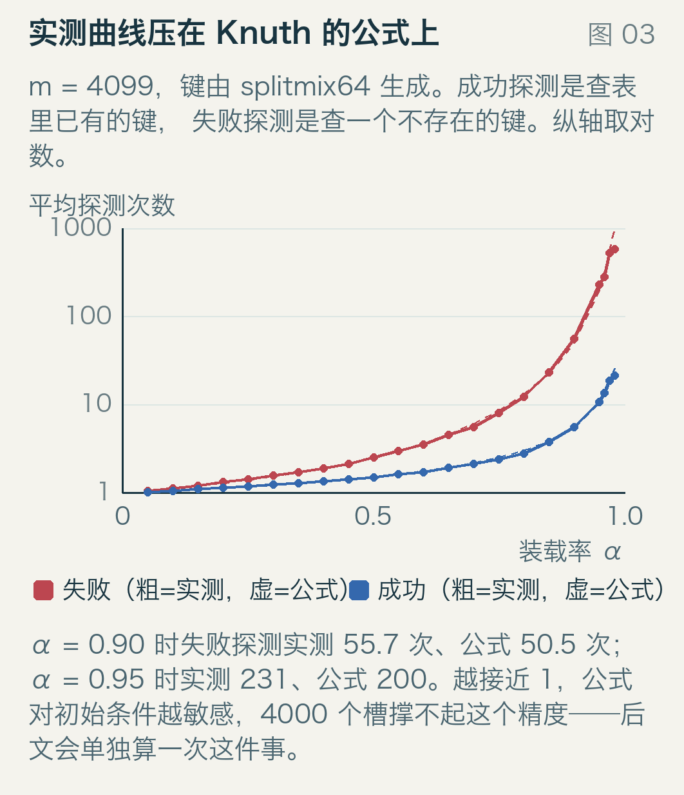

横轴是装载率，纵轴是平均探测次数，取对数。粗线是实测，虚线是上面的公式；红色是失败查找，蓝色是成功查找。

两条蓝线基本重合，两条红线在 α 超过 0.8 之后开始分叉，实测略高于公式。到 `α = 0.95` 时实测 `230.6` 次、公式 `200.4` 次；`α = 0.96` 时实测反而低于公式（`280.6` 对 `312.9`）。这种上下跳动不是公式错了，是 `4099` 个槽在这个装载率下已经撑不住精度，只剩 `164` 个空槽，能取样的探测路径太少，测出来的平均值本身就在抖。
公式在此止步，但表格的用处还在：

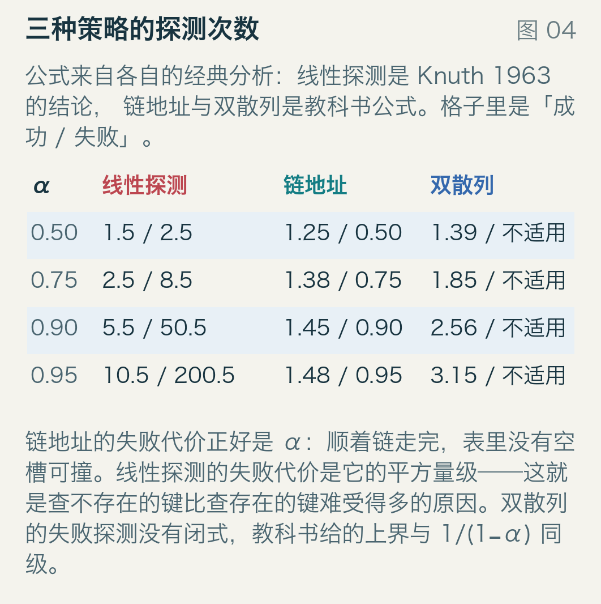

同样是 `α = 0.9`，链地址的平均成功探测是 `1.45` 次，失败代价是 `0.9` 次，因为每条链上平均挂 α 个键，查不到就要把整条走完；双散列成功 `2.56` 次；线性探测成功 `5.50` 次、失败 `50.5` 次。

链地址在这个对比里赢得很轻松，这是它成为 C++ `unordered_map` 默认实现的原因之一。但代价藏在别处：每个键要挂一个指针节点，一次链上的跳转就是一次潜在的高速缓存未命中，而线性探测要试的下一个槽就在同一条缓存行里。公式只算比较次数，不算这个。

## α 逼近 1 时，公式开始偏高

上面那张曲线在 α ≥ 0.95 之后就不太听话了。`α = 0.98` 时，`4099` 个槽的实测失败探测是 `575` 次，公式给 `1249.9` 次，差了不止一倍，而且是实测**低于**公式。

这不是公式失效，是表太小。公式假设探测路径可以无限延长，可表里只有 4099 个槽，最坏情况被表长截断了。换一张 `65537` 个槽的表重做同一个装载率：实测 `966.4` 次，公式 `1250.0` 次，差距缩到原来的四成；最长的一条簇是 `6897` 格，占全表的十分之一。再往上，实测会继续贴着公式收敛。

顺便，这张大表也解释了为什么原文只在 α ≤ 0.95 的区间里用公式做结论：在小表上谈 98% 装载率，测出来的主要是表长。

## 尾巴比平均值难缠

平均值之外还有分布。α = 0.9 的时候，3689 个键各自的探测次数长这样：

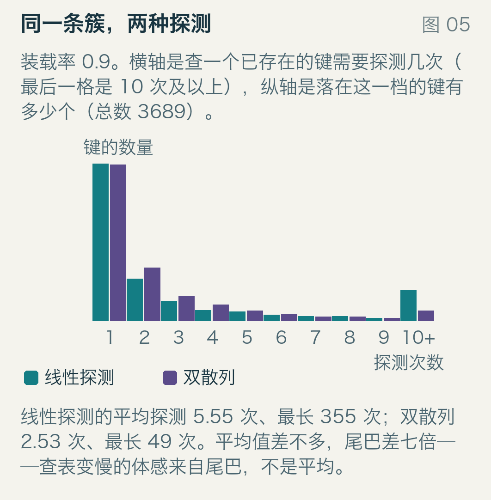

横轴是探测次数，最后一格是「`10 次` 及以上」；纵轴是落在这一档的键数。青绿色是线性探测，紫色是双散列，步长随键变，m 取素数 `4099`。
线性探测有 `2026 个` 键一次命中，超过一半的键根本不撞。要试 `10 次` 以上才找到的有 `399 个`，最坏那个到了 `355 次`。双散列的平均值是 `2.53 次`，最长 `49 次`，`10 次` 以上的只有 `129 个`。

平均值差一倍多，最长差七倍。写代码的人感觉到的慢，通常是那条尾巴。

## 簇长涨得比探测次数快

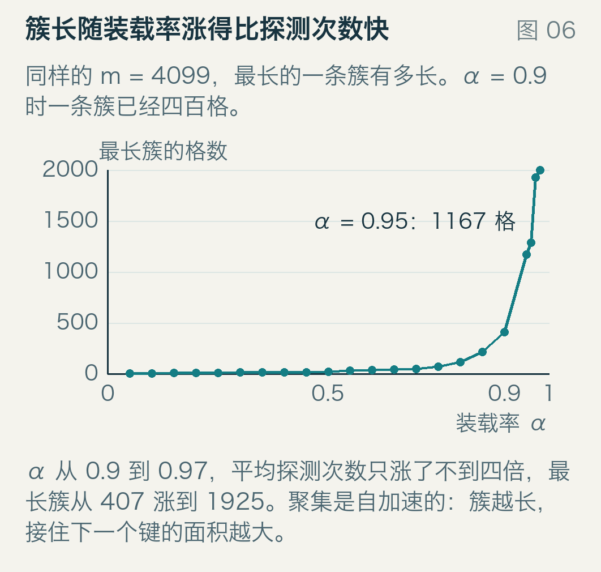

这张图画的是最长一条簇有多少格，横轴装载率。α = `0.9` 时最长簇 `407 格`，α = `0.95` 时 `1167 格`，α = `0.97` 时 `1925 格`——将近半张表。
从 `0.9` 到 `0.97`，平均探测次数从 `5.55` 涨到 `18.59`，不到四倍；最长簇从 `407` 涨到 `1925`，将近五倍。簇长是产能上限：一条 `1925 格` 的簇意味着落进它的键平均要走几百步。

真正让工程上难受的还不是平均值，是最坏情况。表越满，最坏情况越像「几乎没有上限」。

## 让位：Robin Hood

1985 年，Pedro Celis、Per-Åke Larson 和 J. Ian Munro 在 FOCS 上发了一篇《Robin Hood Hashing》，规则只有一句：**谁离自己的起点更远，谁优先坐这个位置**。
具体做法是给每个槽额外记住它离起点走了多远。插入新键时，如果当前槽里那位跑的距离比新来的短，就让新来的坐这儿，把原来那位请出来、带着它自己的距离继续往下一格找。被挤走的是一个已经跑了一段路的人，他的距离继续累积；新来的留在这里，从零开始。

用 m = 11 的表走一遍，依次插 8、9、19、30：

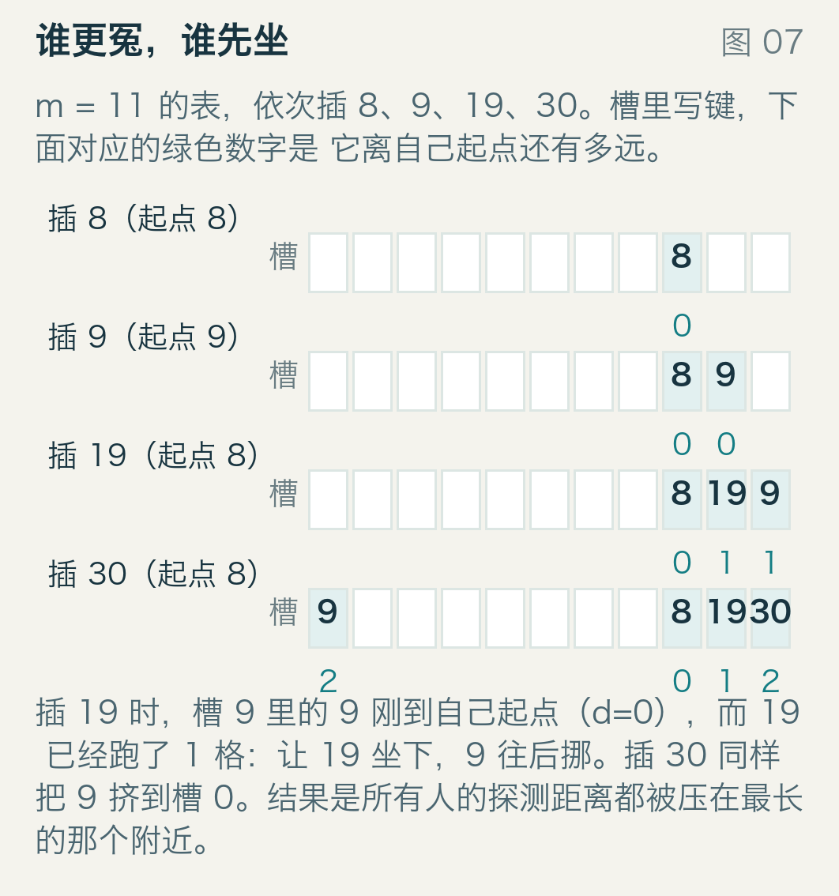

槽里写着键，下面那个绿色数字是它离自己起点还有几格。
插 8 和 9 都一步到位，各自坐在自己的起点上（距离 0）。插 19 时，起点是 8，槽 8 里坐着 8（距离 0），槽 9 里坐着 9（距离 0）。19 已经跑了一格，比槽 9 里的 9 更冤，于是 19 坐上槽 9，9 被挤到槽 10。插 30 时同理：槽 10 里的 9 已经跑了一格、比 30 的起步更冤，这次轮到 9 让位，30 坐进槽 10，9 被挤到槽 0（绕着表走了）。
结果是所有键的探测距离被压平：最长的那个决定了所有人的上限，没有谁的运气能特别背。1985 年那篇论文要论证的就是这件事：让位不改变成功查找的平均探测次数，但把它的波动压得很小。

看实测：

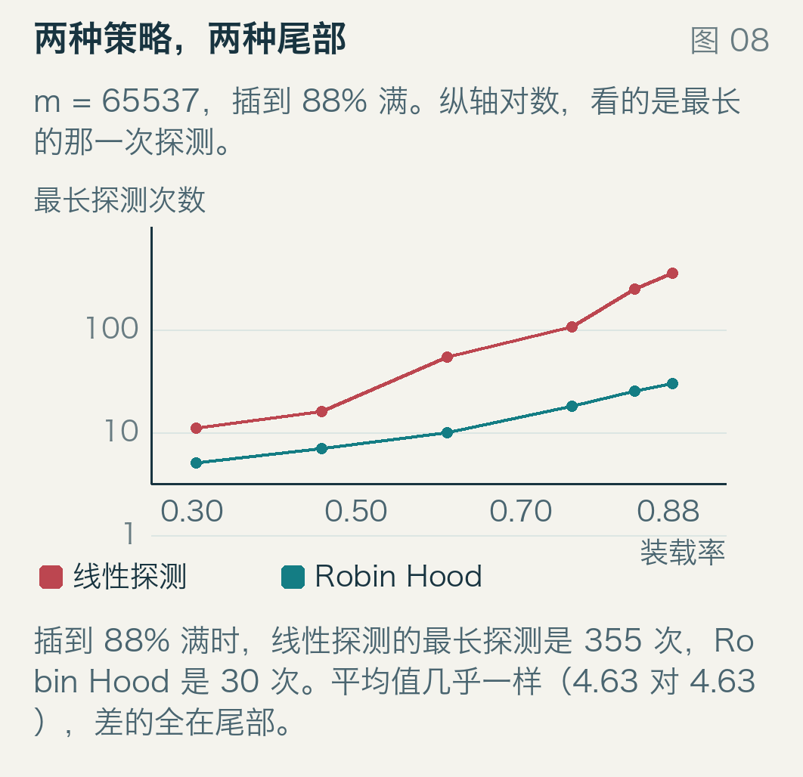

横轴装载率，纵轴最长探测次数，取对数。红线是线性探测，青绿是 Robin Hood。m = `65537`，插到 `88%` 满。
线性探测的最长探测 `355 次`，Robin Hood `30 次`；平均探测次数 `4.63` 对 `4.63`，两位小数完全一样。

这正是 Robin Hood 的取舍：均值一分不动，尾巴削掉一个数量级。代价是插入时的交换（88% 装载下 110052 次交换）和每个槽多存一个距离，或等价地多存一个起点。

## 删除：墓碑的账

回到删除。墓碑不多占真正的位置，但它们在探测时挡路。
`m = 4099`，插到 `85%` 满（`3484` 个键），然后删掉 `1200` 个。此时活着的键还有 `2284` 个，占用率 `56%`，但表里另有 `1200` 个墓碑。

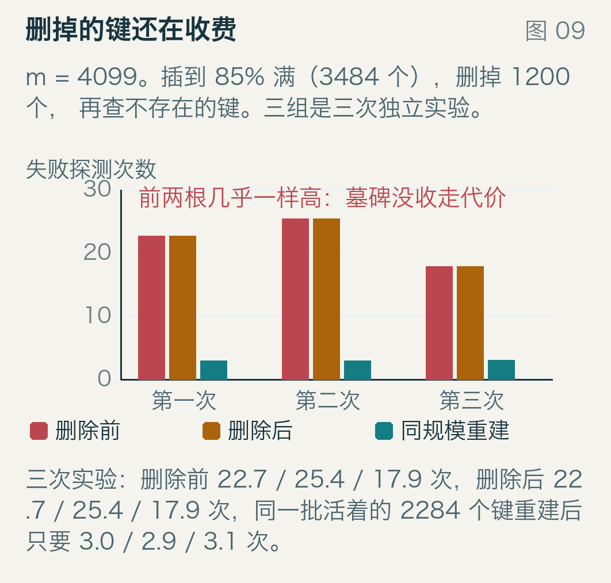

三组柱子，每组三根：删除前查不存在的键、删除后查不存在的键、把这 `2284 个` 活键重新插进一张空表再查。三组是三次独立的实验。
`22.7` 和 `22.7`：删了三分之一，失败查找一次都没便宜。同一个键集合换个干净的表重建，代价掉到 `3.0 次`。
成功查找也被拖慢：删除前平均 `3.79 次`，删除后 `5.15 次`，重建后 `1.57 次`。

原因很简单：探测路径上看不见「空」，只看得见「非空」。墓碑填上了本该结束探测的空槽，探测只好继续走。对探测来说，这张表还是 85% 满。

工程上的处理有两条路。一条是定期重建：墓碑数量超过活键数量（或超过某个比例）时，把活键搬进一张新表，旧表扔掉。另一条是不用墓碑——线性探测有「回移删除」（backward-shift deletion）：删掉一个槽之后，看紧跟其后的键，如果把它自己重新探测一遍会发现它能落在更前面，就往前挪一格，接着看下一个。这样表里永远没有墓碑，也不会留下空洞，代价是一次删除可能移动好几个键；链地址那种「摘掉一个节点」的删除在这里不成立，因为槽不是链表节点，而是探测序列上的一格。

## 换探测顺序

如果簇是问题，让第二步不再总是「隔壁」就能拆开它。
双散列（double hashing）的第二个步长由键自己决定，比如 `1 + (k / m) mod (m−1)`。每个键有自己的一条探测路径，两条路径交叉也无所谓，因为不会再形成连续的区域。
实测 `α = 0.9`：平均成功 `2.53` 次，最长 `49` 次。线性探测是 `5.55` 和 `355`。

代价是缓存。双散列的每一步都跳到表里另一处，几乎每次探测都是一次新的缓存行访问；线性探测的几个候选槽挤在同一条 64 字节的缓存行里，一次加载能覆盖好几个槽。所以在真实机器上，双散列「比较次数少」的优势常常被「内存访问次数多」吃掉，这也是为什么现代库宁可要线性探测加分组比较。
二次探测（quadratic probing）是折中：步长 1、4、9、16……，能打散主聚集，但同样会形成次聚集（起点相同的键走同样的序列）。

## 现代实现：一次比 16 个

既然簇是线性探测的本质代价，现代库的做法不是消灭簇，而是**让沿簇走这件事变便宜**。
Google 的 Abseil 库在 2018 年 9 月公开了瑞士表（SwissTable）的实现，思路是这样：每个槽配一个控制字节，占用的槽写键的哈希里取出的 7 位指纹，空槽和删过的槽各用一个不会与指纹撞的值标出来。这 16 个控制字节紧紧排在一起，占 16 字节，一条 SIMD 指令就能一次比较完。

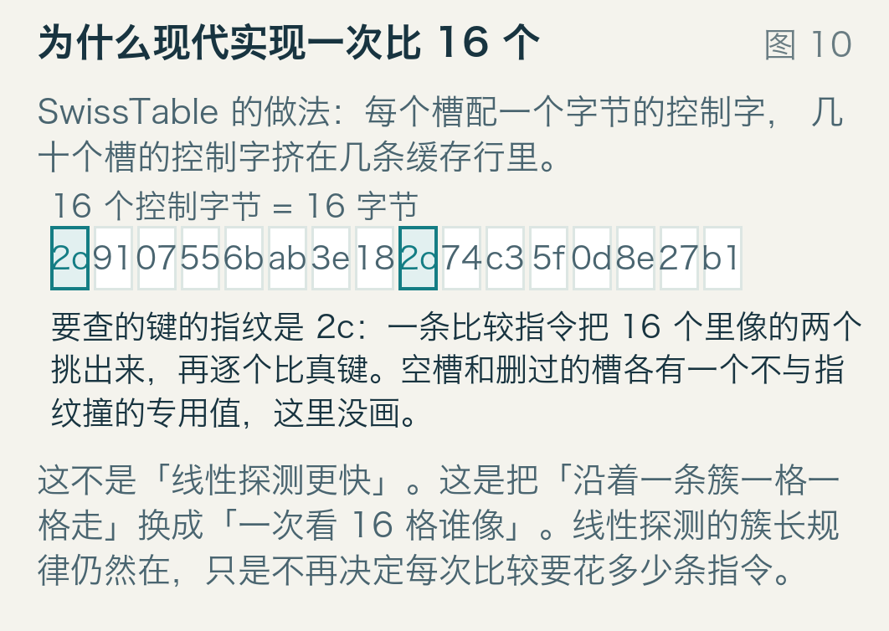

图里 16 个格子里是 16 个控制字节（示意数据，不是运行时抓的），要查的键指纹是 `2c`。青绿色那两个是「像」的候选，接着才去比真键。
比较次数还是很多，簇还是那么长，但每次比较的指令数从「取一个槽、比一次、跳」变成「一条指令比 16 个」。这就是把簇的代价从「命中延迟」摊到「批量比较」里。

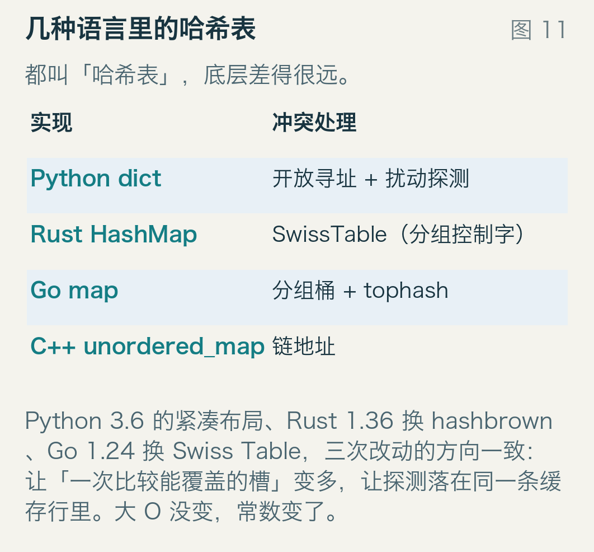

Python 的 dict 从 3.6 起用紧凑布局，索引数组加键值数组，探测走 hash 的扰动位，每轮 `perturb >>= 5`，是二次式探测的一种；Rust 的 `HashMap` 在 1.36 换成 hashbrown，就是 SwissTable 的 Rust 实现；Go 的内置 map 一直到 1.23 还是「8 个槽一组的桶 + 一个 tophash 字节」，1.24 换成 Swiss Table，`GOEXPERIMENT=noswissmap` 可以退回旧实现；C++ 的 `unordered_map` 标准只规定平均复杂度，主流实现都是链地址。

## 什么时候它是对的

线性探测不是「过时的实现」。它在几种情况下确实是最优解：

- 装载率控制在 0.5 到 0.7，键的数量可以预估，不做大量删除。α = 0.7 时失败代价约 6 次，α = 0.9 时 50 次，把扩容阈值定在 0.7 附近比省内存更划算。
- 表需要紧凑、遍历要快。开放寻址的槽就是键值本身，没有指针，一次线性扫描就是全部数据；链地址要追着指针走一遍堆上的节点。
- 键不能来自对手。线性探测的探测序列完全可预测，谁掌握了哈希函数，谁就能挑一批键把某条簇撑爆。2011 年 28C3 会议上 Klink 和 Wälde 演示过这套攻击，也就是 HashDoS，之后 Python 3.3 给字符串哈希加了随机化种子，Rust 的 `HashMap` 默认用 SipHash，这些措施都是为了让攻击者猜不到起点。

反过来，几种情况下要小心：

- m 取 2 的幂时，`hash & (m−1)` 只用到了哈希的低位。如果哈希函数的低位有规律，比如指针地址、小整数，所有键会挤到少数几个起点上，簇立刻变成灾难。要么用素数 m，要么先混洗。
- 需要频繁删除。墓碑会让表「看起来比实际满」，除非实现回移删除或定期重建。
- 需要稳定遍历顺序。探测顺序取决于插入历史，扩容会重排，所以任何依赖遍历顺序的代码都会在某个版本更新后出错。

最后那个差异，在现代库里被刻意保留。Python 的 dict 从 3.7 起保证插入顺序，Rust 的 `HashMap` 明确不保证顺序，Go 的 map 每次遍历起点都随机，不是实现偷懒，是迫使调用方不要依赖它。

## 三句话

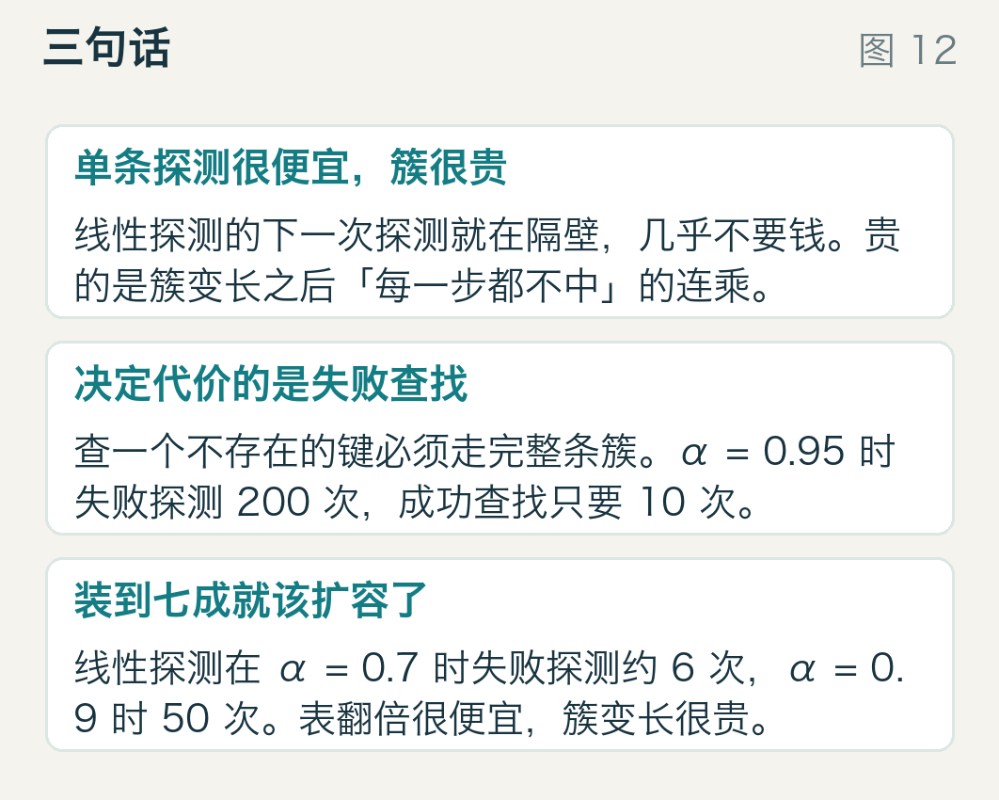

线性探测的单步代价极低，因为要试的下一个槽就在内存里隔壁；代价全部来自簇：簇越长，一次落空的探测就越可能连续落空很多次。

决定体验的是失败查找。查一个不存在的键必须走完整条簇，α = 0.95 时两百次上下，而查存在的键只要十次。缓存未命中、性能剖析里那条突然变慢的路径，多半在这里。

装载率到七成就该动手了。α = 0.7 时失败探测约 6 次，α = 0.9 时 50 次。表翻倍的开销是确定的、一次性的；簇变长的开销是分摊到每次查询里的、看不见的。
