# 同样的跳跃，30 帧跳矮了 13 厘米

同一段跳跃代码，在 60 Hz 的机器上跳 1.000 米，在 30 Hz 的机器上跳 0.933 米，在 240 Hz 的机器上跳 1.050 米。
三台机器跑的是同一个函数、同一个初始速度、同一个重力。没有 bug，没有随机数，也没有计时器误差，差的只是「一帧算多久」。而真正的答案，那个连续解，是 1.067 米。三个数没有一个对。

这件事通常被当成物理引擎的精度问题混过去。它不是。它是时间被切成固定格子之后，必然出现的一个半步偏移：只要每一帧的长度是 dt，误差就和 dt 成正比，改小 dt 只会把它变小，不会让它消失。

## 先手算一次

起跳速度 8 m/s，重力 30 m/s²，比地球的 9.8 大得多，是 2D 平台游戏常见的手感值，一帧 1/60 秒。
连续解很好算：最高点是 v²/2g = 64/60 = 1.0667 米，到达最高点用 v/g = 0.267 秒，也就是 16 帧。
离散的算法只有两行，也是绝大多数引擎里那两行：

```
v = v - g * dt
y = y + v * dt
```

一帧里先把速度减掉 g·dt，再用**新**速度推位置。第 k 帧的速度是 v_k = 8 − 0.5k，这一帧走 (8−0.5k)/60 米——累加起来是一个等差数列：

```
k=1   v=7.5   y=0.1250
k=2   v=7.0   y=0.2417
k=3   v=6.5   y=0.3500
...
k=16  v=0.0   y=1.0000     ← 在这里掉头
```

手算：这 16 帧走的距离是 7.5、7、…、0，等差数列，和是 16×(7.5+0)/2 = 60 米每秒，除以 60 得一米整。
要是把两行换个顺序——先用**旧**速度推位置、再减速度——同样这 16 帧走的是 8、7.5、…、0.5，和是 68，得到 1.1333 米。
两个和相差 8 米每秒，乘上 dt 就是 0.133 米。差别的全部来源是第一帧：先减速的那一种，第一帧只走了 7.5/60 米；先移动的那一种走了 8/60 米。

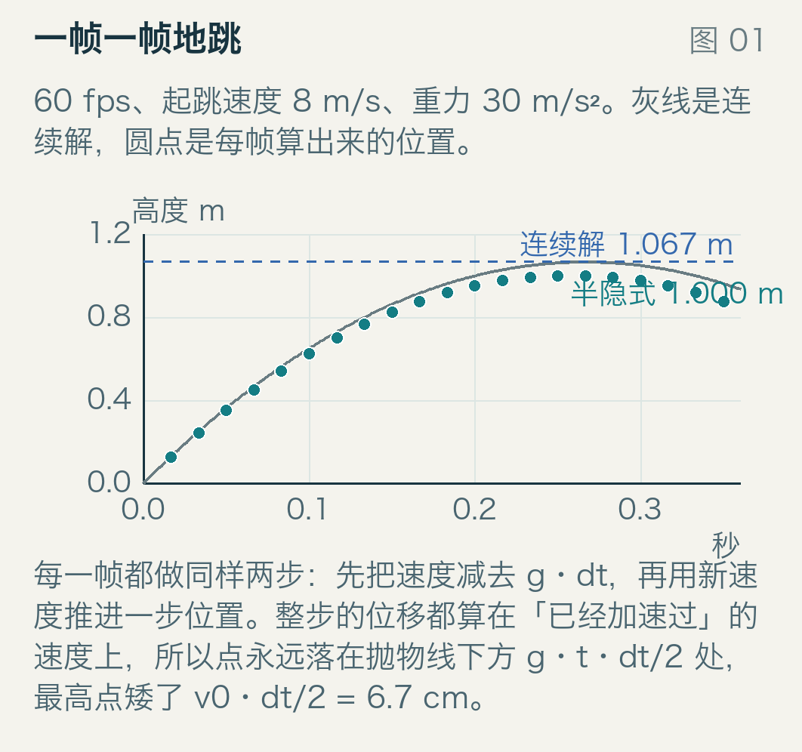

图里灰线是连续解的抛物线，青点是从 0 开始每帧算一次得到的采样位置，蓝虚线是连续解的最高点 1.067 米。
点一直在抛物线的下方，差 g·t·dt/2：每一帧的位置都对应「已经加速过」的速度，而真实轨迹在这一段里还没加速那么多。所以离散路径整体偏矮，最高点正好矮 0.067 米。
真按「先算位置、再加速度」写，同一个例子得到 1.1333 米，偏高同样的 0.067 米。

## 那个 0.067 米是算得出来的

偏高和偏矮的绝对值一样，不是巧合。取一帧的位移 Δy = v·dt，把速度换成时间的函数：

```
偏低：y_max = v0²/2g − v0·dt/2
偏高：y_max = v0²/2g + v0·dt/2
```

代入 v0 = 8、dt = 1/60，v0·dt/2 = 0.0667。这就是图里那 6.7 厘米的全部来源。
这个等式在 v0/(g·dt) 正好是整数时精确成立，30、60、120、240 fps 都满足，因为最高点刚好落在一个采样点上。24 fps 时 v0/(g·dt) = 6.4，最高点落在两次采样之间，实测偏低 15.0%，而 v0·dt/2 给的是 15.6%；相差的那一点是采样本身丢掉的，不是积分器的。

「误差和 dt 成正比」这句话于是可以验证：24 fps 偏低 15.0%，30 fps 偏低 12.5%，60 fps 偏低 6.25%，120 fps 偏低 3.13%，240 fps 偏低 1.56%，1000 fps 偏低 0.37%。帧率每翻一倍，误差减半。

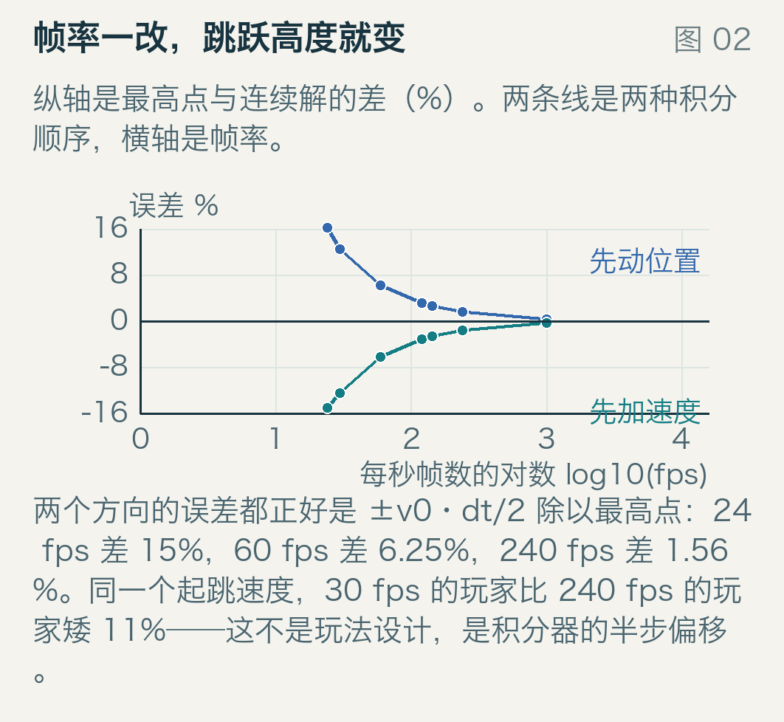

横轴是每秒帧数的对数，纵轴是最高点相对连续解的偏差，蓝线是「先动位置」，青线是「先加速度」。两条线是镜像的，斜率都是 −1：这就是一阶误差的样子。
具体到玩家能感觉到的量：30 fps 的最高点 0.933 米，240 fps 是 1.050 米，差 11%。一个需要精确跳过 1 米高台阶的关卡，在两种机器上一个能过一个不能过。这类差评通常被归到「优化差」，其实是积分器把帧率写进了物理。

## 固定 dt 不是为了让结果变准

固定 dt 的目的从来不是让数字更接近连续解。它是为了让同一个输入在每一台机器上产生同一个输出。

如果 dt 跟着帧率走，这件事立刻完蛋。卡一下 dt 就变大，物理结果就变；显卡换了，dt 的序列整个变了；录一段回放，对手的机器上会放出另一个故事。

2004 年 6 月 10 日，Glenn Fiedler 在 Gaffer On Games 上发了一篇《Fix Your Timestep!》，把这些事一次讲清楚了。他先给出最朴素的写法，每一帧用固定的 1/60，然后指出它只在「刷新率恰好是 60、而且每帧都算得完」时成立；接着给出「用上一帧耗时当 dt」的写法，并点明这个写法的核心问题：
> the behavior of your physics simulation depends on the delta time you pass in.

他列的后果里有两条很具体：dt 变大时弹簧模拟会「exploding to infinity」，快速物体能穿墙。后面两节会用实验把这两条都量一遍。
那篇文章里还有一句更实用的判断：指望模拟器能正确处理任意 dt 是不现实的，现实的做法是保证 dt 不超过某个上限。

## 累加器：把渲染时间和物理时间分开

Fiedler 的解法是把时钟反过来装：不是「这一帧有多少时间，就跑多少物理」，而是「渲染器不断生产时间，物理按 dt 一格一格地消费」。

```
accumulator += frameTime
while accumulator >= dt:
    integrate(state, dt)
    accumulator -= dt
render(state)
```

消费不掉的那点时间不丢，留在累加器里等下一帧。
跑一个 120 帧的抖动序列，帧时间在 10 到 28 毫秒之间均匀随机，dt 固定为 1/60：

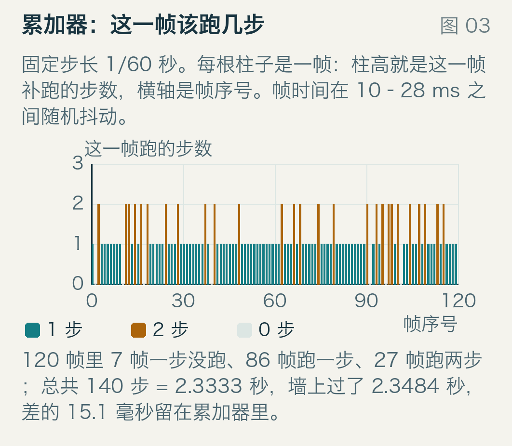

每根柱子是一帧，柱高是这一帧补跑的步数，青色 1 步、琥珀 2 步、灰白 0 步，横轴是帧序号。
统计下来 7 帧一步没跑、86 帧跑一步、27 帧跑两步，总共 140 步，等于 2.3333 秒；而墙上过了 2.3484 秒。差的 15.1 毫秒就在累加器里躺着：物理时间永远比画面时间晚一点点，但永远不会漏掉。

「永远不会漏掉」这句话是有条件的。它只在每帧开销小于一帧时间时成立。

## 闸门与死亡螺旋

假设某一帧卡了 500 毫秒，比如加载了一个贴图、或者操作系统把线程抢走了。
照实补的话，那一帧要跑 30 步。之后物理追上了时间，画面会先停半秒、再跳一下到该在的位置。

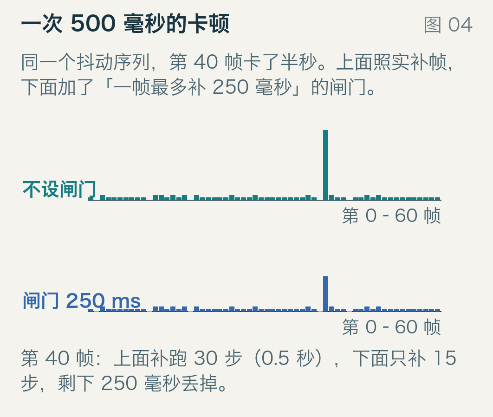

上下两块是同一个抖动序列、同一帧卡顿。上面不设闸门，第 40 帧补 30 步；下面设了「一帧最多补 250 毫秒」，只补 15 步，剩下 250 毫秒直接丢掉。
`frameTime > 0.25` 就截断到 0.25，这个 0.25 秒就是 Fiedler 那篇 2004 年的文章里写死的数，二十年后仍是常见默认值。

闸门解决的是「卡一下」，解决不了「一直慢」。真正危险的是每步开销本身变大：物理步变多了，一帧就变长；一帧变长了，要补的步更多。
设每帧的基础开销 20 毫秒，渲染、脚本、IO 都算在里面，每一步物理花 c 毫秒，那么稳态下帧时间 t 满足

```
t = 20 + (t / 16.67) · c
```

解出来 t = 20 / (1 − c/16.67)。c = 10 毫秒时 t = 50 毫秒；c = 15 时 t = 200 毫秒；c = 16 时 t = 500 毫秒；c 到了 16.67，分母是 0，没有稳态——这条曲线往无穷远处跑。

我把这个递推真的跑了一遍（每帧步数由累加器决定，步数又决定下一帧的耗时），结果和公式对得上：c = 10 实测 48.5 毫秒、c = 15 是 183.5、c = 16 是 482.5，c = 18 时 60 帧内就冲到 5.4 秒。

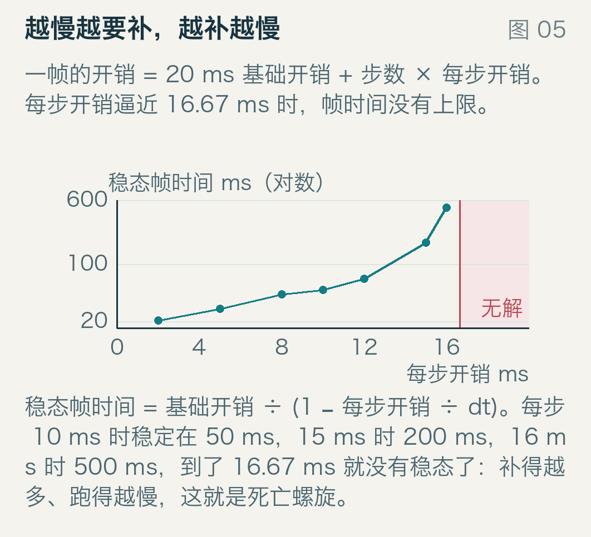

横轴是每步开销，纵轴是稳态帧时间（对数）。青点是实测，右红区是「每步开销 ≥ 16.67 ms」，那里没有稳态。
这就是死亡螺旋。Godot 4 的文档在 `physics/common/max_physics_steps_per_frame` 这一项下面直接用了这个说法，还写出了它的形状：
> This snowballs into a situation where framerate keeps dropping until it reaches a very low framerate (typically 1-2 FPS) and is called the physics spiral of death.

那个设置的默认值是 8，物理频率默认 60 Hz，上限是每帧 8 步，也就是 133 毫秒的物理时间，再多就丢掉。

## 半固定步长留下的尾巴

Fiedler 的文章里有个中间方案：不攒累加器，而是把这一帧的时间切成若干段、每段不超过 dt，最后一段用剩下的零头。它保证了 dt 有上限，也让物理时间紧跟画面时间，但最后那个零头是「不规整」的一步。
同一个跳跃函数，喂 1/60 得到 1.000 米，喂 0.0137 秒得到 1.012 米，差一厘米出头，单看一个跳跃无关紧要。但如果物理里有一处对初值敏感（双摆、叠起来的箱子、绳索），这点差别几十秒后就会长成两个不同的世界，后面一节会量。这就是为什么「半固定」只适合手感，不适合回放和对战。

## 快的东西会直接穿过墙

固定 dt 的另一个代价是采样。碰撞检测只在每步末尾看一次位置。
一颗 40 m/s 的子弹，dt = 1/60，每步走 0.667 米。一面 0.1 米厚的墙，如果子弹在这一步开始之前还在墙左边、这一步结束之后已经到了墙右边，中间那一段没有任何一次采样落在墙里——这一次碰撞就丢掉了。
把墙随机摆在五个步长的范围内，每种速度试 200 次，数一下有多少次整个跳过：

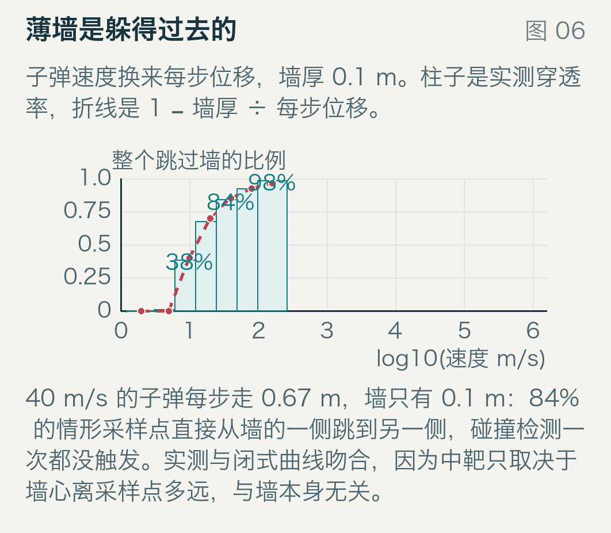

柱子是实测穿透率，红色虚线是 1 − 墙厚 ÷ 每步位移。横轴是速度的对数，纵轴是被跳过（没检测到）的比例。
10 m/s 时 38.5%，20 m/s 时 67.5%，40 m/s 时 84%，160 m/s 时 98.5%。实测和闭式曲线吻合，因为中靶与否只取决于墙心离最近那个采样点多远，与墙本身的材料、厚度分布都无关。

两种补救办法。第一种是把一大步切成 n 个小步，n = ⌈速度 × dt ÷ 墙厚⌉：

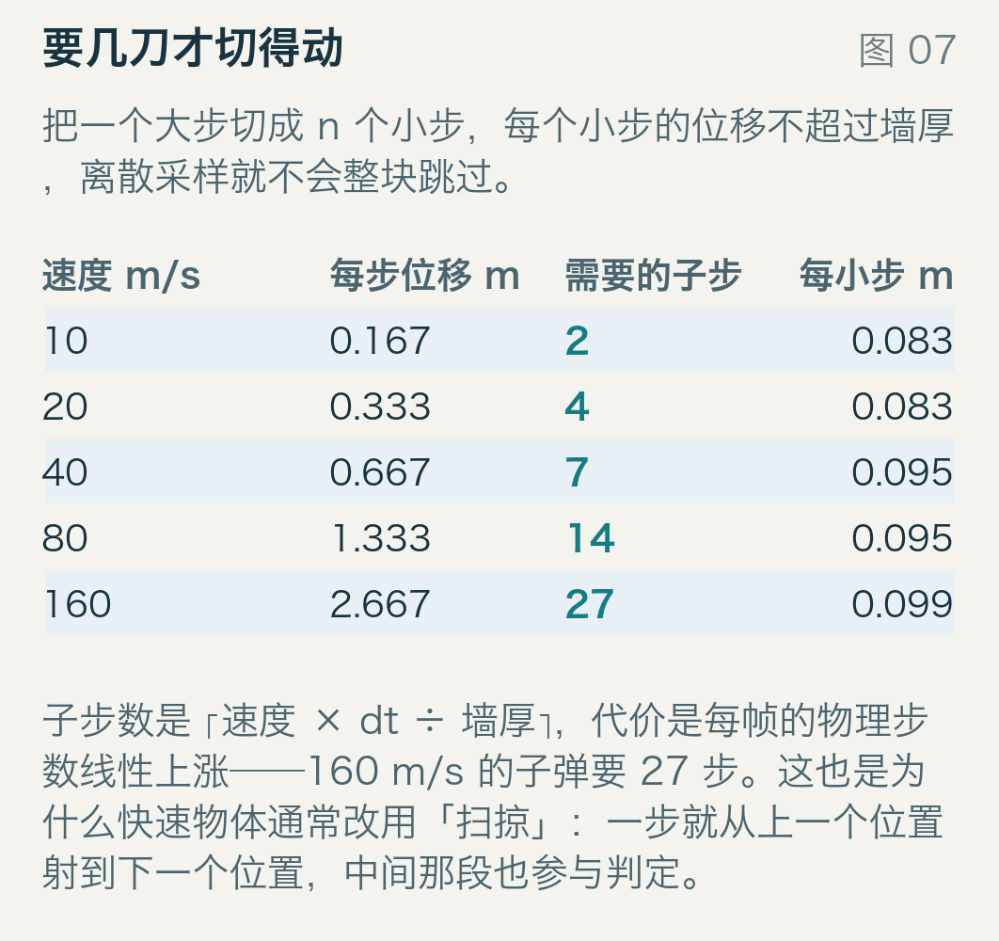

10 m/s 要 2 个子步，40 m/s 要 7 个，160 m/s 要 27 个。代价是每帧物理开销线性上涨：在 40 m/s 这个常见数值上，光为了不穿墙就要多算七倍。
第二种是让碰撞检测看「这一步走过的线段」，而不是「这一步末尾的点」。这个方向叫连续碰撞检测，Box2D 的文档是这么描述的：
> The solver advances bodies in time using discrete time steps. Without intervention this can lead to tunneling. [...] the collision algorithms can interpolate the motion of two bodies to find the first time of impact (TOI). Second, speculative collision is used to create contact constraints between bodies before they touch.

TOI 找出「第一次接触发生在这一步的第几成」，把这一步截断在那里；speculative collision 干脆在还差一点的时候就建立接触约束，让求解器提前把速度改掉。

## 积分器：dt 定下来之后，误差还有一个来源

固定 dt 只解决了「每次一样」，没解决「准不准」。同一个 dt 下，选择哪种积分器是另一个自由变量。
拿谐振子 x″ = −ω²x 当测试台：ω = 2π（1 Hz）、初始位移 1、初始速度 0，能量 E = ½v² + ½ω²x² 应该守恒。跑 10 秒，看能量偏差：

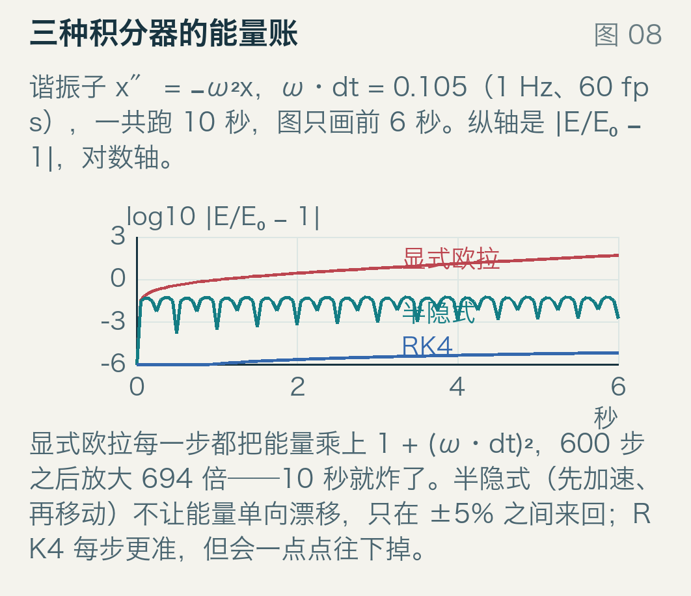

横轴是时间，纵轴是能量偏差的绝对值（对数）。红是显式欧拉，青是半隐式，蓝是 RK4。ω·dt = 0.105，也就是 1 Hz、60 fps。

显式欧拉在 600 步之后把能量放大了 695 倍，6 秒内就冲出图外。原因很干净：每一步振幅乘以 √(1+(ω·dt)²)，600 步是 (1+0.011)⁶⁰⁰ ≈ 690 倍能量，也就是 26 倍振幅。这正是 Fiedler 说的「exploding to infinity」。
半隐式先算速度、再用新速度推位置，它不再让能量单向漂移，最大偏差 5.5%；RK4 每步都准得多，但会缓慢往下掉，10 秒后是 −1.1×10⁻⁵。

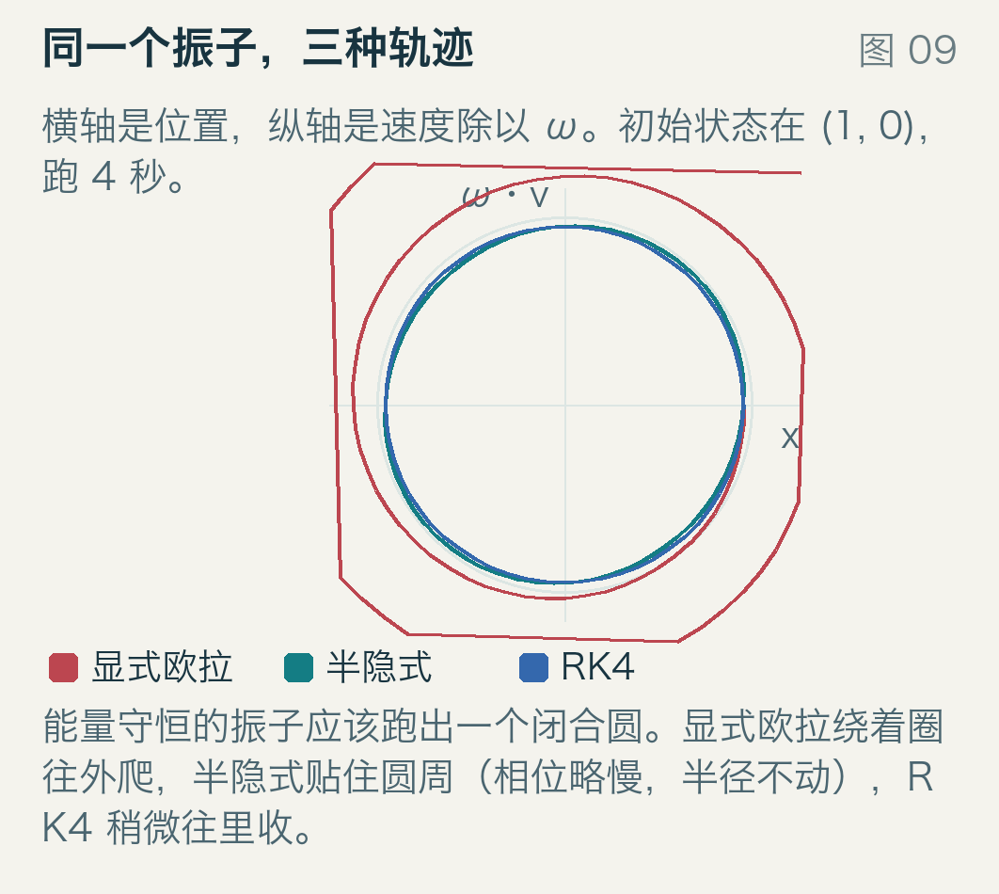

同一组参数画成相图：横轴位置、纵轴速度除以 ω，理想轨迹是半径为 1 的闭合圆。显式欧拉绕着圆心往外爬，半隐式贴着圆周（相位略慢，半径基本不动），RK4 慢慢往里收。
半隐式有一个正式名字，叫 symplectic Euler，中文写作辛欧拉。它不减小每一步的误差，但它不往系统里注入或抽走能量，所以振荡能一直振荡下去。对游戏来说，这比「每步更准、长期偏冷」的 RK4 更合适，而且只贵一次乘加。这也是为什么大多数 2D 物理引擎的默认积分器是它，而不是 RK4。

## 时间本身也在漂

还有一层：把 dt 累加起来这件事本身也不精确。
浮点加法不满足结合律：

```
(1.0 + 1e16) − 1e16 = 0.0
1.0 + (1e16 − 1e16) = 1.0
```

同一个 1.0，换个顺序加进去就没了。第一行里 1.0 先被 1e16 吃掉，因为 float64 只有 53 位有效位，1e16 的量级上最小刻度是 2，加 1 直接舍掉。
一帧一帧累加 1/60 秒也有这个问题。60 次、float64：误差 1.3×10⁻¹⁵ 秒，可以不管。60 次、float32：−3.5×10⁻⁷ 秒，也可以不管。但如果一小时的帧时间都存在 float32 里：

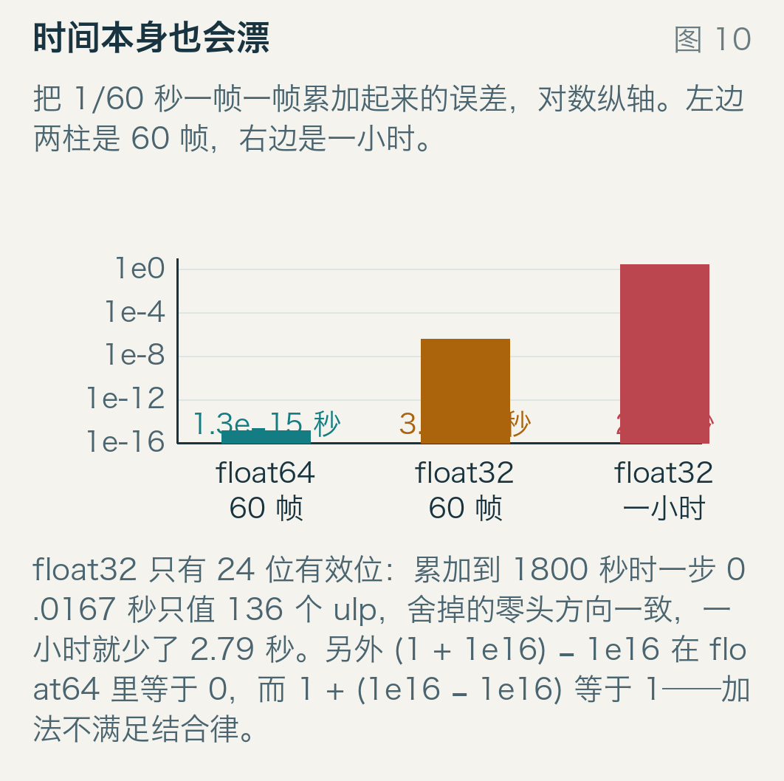

左柱 float64 的 60 帧、中柱 float32 的 60 帧、右柱 float32 的一小时，都是「累加值减去精确值」的绝对量，对数纵轴。
一小时 216000 帧之后，float32 的累加值比真实时间少了 2.79 秒。原因不是随机误差互相抵消，而是一个方向的舍入：累加到 1800 秒时，一步 0.0167 秒只能表示成 136 个最小刻度（ulp = 2⁻¹³ 秒），剩下的零头每步都被舍掉，方向一致。
两秒的偏差在游戏里就是明显的音画不同步。所以累加器要用 float64，或者干脆记整数帧号再乘 dt——后者连累加都不需要。

## 固定 dt 也不等于可复现

把上面所有事都做对：dt 固定、累加器用 float64、每步只调一次积分器。这样两台机器跑同一段输入，结果一样吗？
拿双摆试。初始角都是 2.1 弧度，只把第二个摆的第一个角多加 1e-9 弧度，大约是一弧度上 float32 的一个末位。

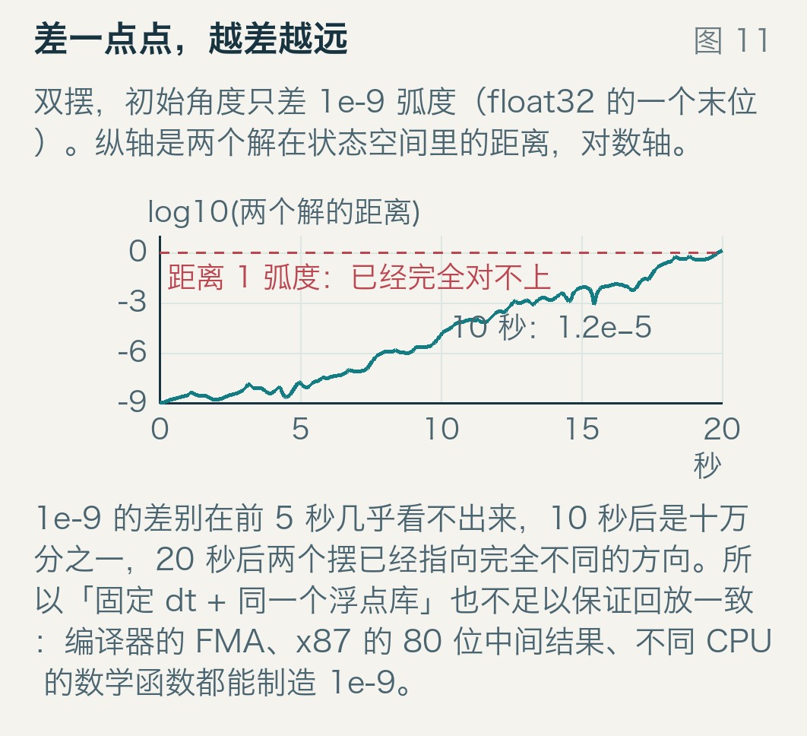

横轴时间，纵轴是两个解在状态空间里的距离（对数），红虚线是「距离 1 弧度」——两个摆已经指向完全不同的方向。
1e-9 的差别在前 5 秒几乎看不出来；10 秒是 1.2×10⁻⁵；20 秒到了 1.3 弧度。指数增长，斜率的倒数就是这套系统的李雅普诺夫时间：这里约 1.0 / 秒，距离放大 e 倍要 0.9 秒左右。

所以「固定 dt 保证可复现」只在同一个二进制、同一个浮点库、同一个 CPU 上成立。换编译器，它可能把 a*b+c 合成一条 FMA 指令（中间不落盘到 53 位）；换 CPU，它可能用 x87 的 80 位中间结果；数学函数 sin、exp 各家实现也不同，每一样都足以制造 1e-9。

要真的复现，只有两条路：要么把每帧的输入存下来重放，坏处是重放必须用同一个物理库；要么把状态存下来，坏处是存档变大，而且要处理浮点在文件里的可移植性。联机对战的确定锁步走的是第一条，英文叫 deterministic lockstep，所以它挑引擎、挑版本、甚至挑编译选项。

## 那就这么写

把上面所有取舍落到一张清单上：

- **物理用固定 dt。** 1/60 或 1/120。写死，不跟帧率走。
- **时间用累加器消费，不用「这一帧的耗时」。** 累加器存 float64。
- **给累加器一个上限。** 一帧最多补 250 毫秒（0.25 秒），或者最多 8 步。宁可让游戏变慢，也不进死亡螺旋。
- **渲染插值。** 用剩余时间除以 dt 当插值系数，在上一帧和这一帧的物理状态之间插值。不插值就会出现「物理 60 Hz、显示 144 Hz」时的抖动。
- **快速物体单独处理。** 子步或者连续检测。哪一个更便宜取决于数量：子弹少就用 TOI，子弹多就加子步。
- **想复现就别只靠 float。** 需要回放和对战一致性时，存输入加固定物理库版本，或者直接存状态。

还有一条容易被忘掉的：**屏幕上的插值代码也会依赖帧率**。下面这段是很常见的写法，镜头每帧朝目标走剩余距离的 10%：

```
x += (target - x) * 0.1
```

一秒之后走了多少？一帧走 10%，n 帧之后剩 0.9ⁿ。

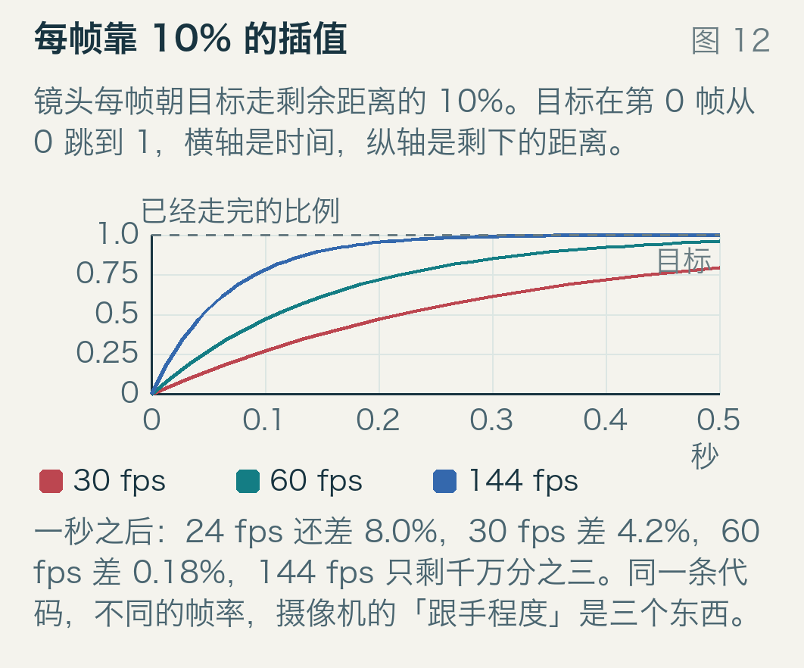

横轴时间，纵轴是已经走完的比例，三条线分别是 30、60、144 fps。
24 fps 一秒后还差 8.0%，30 fps 差 4.2%，60 fps 差 0.18%，144 fps 已经只剩千万分之一。同一条代码，摄像机的「跟手程度」是三个不同的东西。
把它换成连续时间的写法就没这个问题：每帧 10% 对应一个指数衰减速率 λ = −60·ln(0.9) = 6.32 / 秒，半衰期 0.11 秒。想保持这个手感、又要在 144 fps 下跑，每帧系数应该是 1 − exp(−6.32/144) = 0.043，而不是 0.1。

## 三句话

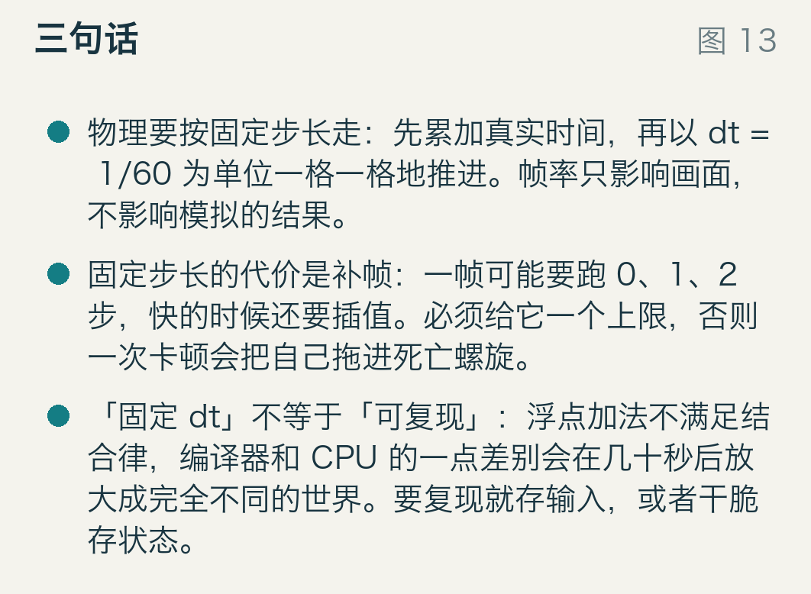

时间被切成格子，格子长度就变成了物理参数的一部分：跳跃高度、弹簧能量、插值跟手程度，全都跟着 dt 走。

固定 dt 换来的不是准确，是每次一样；代价是要补帧、要设上限、要给快东西加子步，而补帧本身可能把机器拖垮。

最后，「固定 dt」只是一层保证。浮点加法不满足结合律，编译器和 CPU 的差别会在几十秒后放大成完全不同的世界——要复现，就存输入，或者存状态。
