# 一次失败，不必从零开始

在 `abcabcabd` 里找 `abcabd`。

最直的写法试了四个窗口：从 0 开始，前五个字符都对上，第六个字符 c 对 d，不对；挪到 1，第一个字符就撞墙；挪到 2，还是撞墙；挪到 3，六个字符全中。加起来 14 次字符比较。

同一件事，KMP 比了 10 次，Boyer–Moore–Horspool 比了 7 次。它们不是手更快，而是从失败里捡回了不同的东西：KMP 捡回「已经对上的那串字符的尾巴」，Horspool 捡回「窗口最后一个字符在模式里的位置」。

要是故事到这里就结束，它就是一篇「KMP 比朴素快三成」的介绍。可惜同一批算法换个输入就翻脸：1288 个字符的英文里找一个 3 字母的词，KMP 只比朴素少做了 4% 的比较（1384 对 1445）；换到一段全是 a 的文本，Boyer–Moore 家族反倒成了最慢的那个（55958 对 KMP 的 8000）。

搜索算法的账只能按输入算。下面每个数字都来自同一份可以重跑的 Python 模型，它数的是「比较了几次字符」，不是计时——计时没做，文末会说明。

## 一、先把这个小例子数清楚

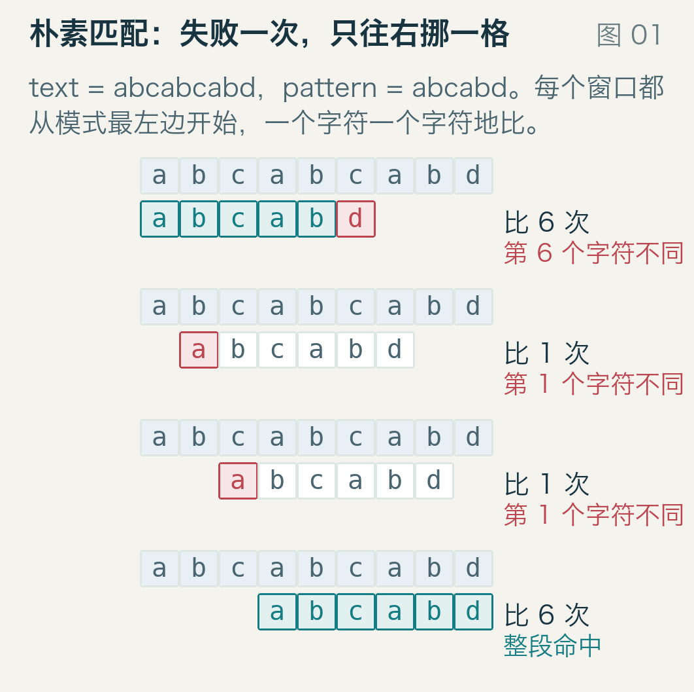

图里每一块是一个窗口：上面一行是文本，下面一行是模式按这个起点对齐后的位置；青色是这次对上的字符，红色是第一次对不上的那个，灰色是没轮到的。右边的数字是这个窗口的比较次数。

四个窗口的代价是 6、1、1、6，加起来 14。第一个窗口的 6 次里，有 5 次是「对上了」，第 6 次才失败。

这五次「对上了」在朴素算法里是纯损失：挪到下一个窗口，一切从头比。可是它们不是没有信息。窗口 0 里对上的是 `abcab`，它的后两个字符 `ab`，正好就是模式的开头两个字符。

## 二、把已经对上的尾巴记下来

`abcabd` 的每个前缀，都有一个「既是它的真前缀、又是它的真后缀」的最长子串。这个长度就是前缀函数，KMP 里叫 failure 表：

```
模式      a  b  c  a  b  d
failure   0  0  0  1  2  0
```

手算一遍就能建完这张表。到 `a`（下标 3）时，前面已经攒出的匹配长度是 0，而 `a` 等于模式的第一个字符，所以是 1；到 `b`（下标 4），拿它跟模式第 1 个字符 `b` 比，又是 1，于是 2；到最后的 `d`（下标 5），拿它跟模式第 2 个字符 `c` 比——不对，于是回退到 failure[1] = 0，再跟模式第 0 个字符 `a` 比，还是不对，所以是 0。

`failure[i]` 的含义很窄，只有一句：如果你匹配了 `pattern[0..i]` 这 `i+1` 个字符，那么其中长度为 `failure[i]` 的尾巴和开头是一样的，不用重比。

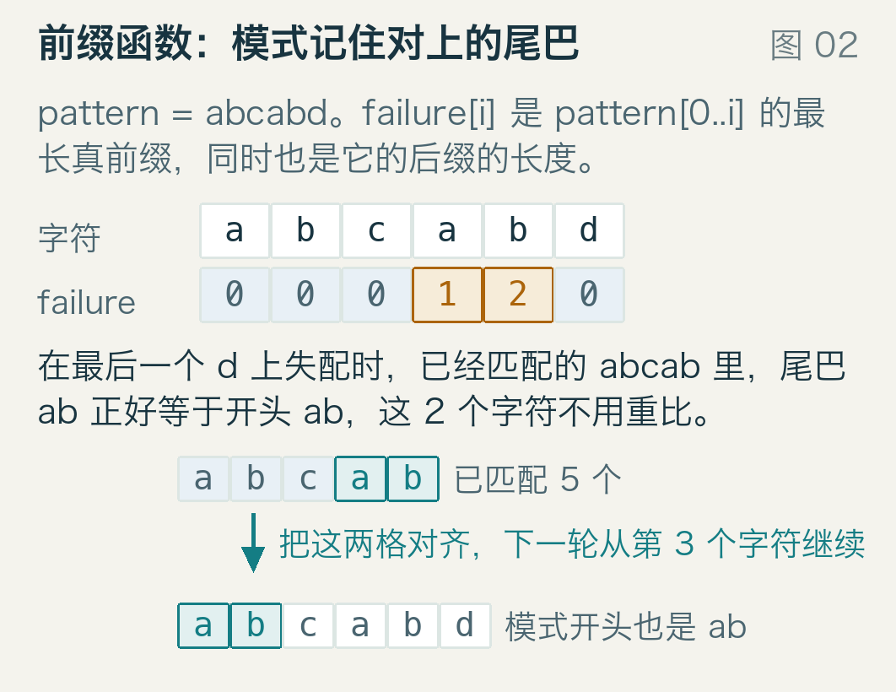

图上半是模式和它的 failure 值，填了黄色的格子是非零项。下半是那唯一一次有用的复用：把已经对上的 `abcab` 末尾的 `ab`，对齐到模式开头的 `ab` 上。

这一步省下来的量，取决于你的文本里到底有多少个「对上又断掉」的片段。英文里这个数很小，后面会看到。

KMP 的实际动作和「跳到窗口 3 重新开始」不一样，它根本不回头：

```
i 指向文本，j 指向模式
对上：i++、j++
不对：j = failure[j-1]（j 为 0 时只 i++）
j 走到头：报告命中，然后 j = failure[j-1] 继续
```

`i` 只增不减，这是它能做到「最多 2n 次比较」的全部原因：每次比较要么把 `i` 推进一步，要么把 `j` 往回拨一格，而 `j` 总共只能被推高 n 次，所以往回拨的总次数也有上界。

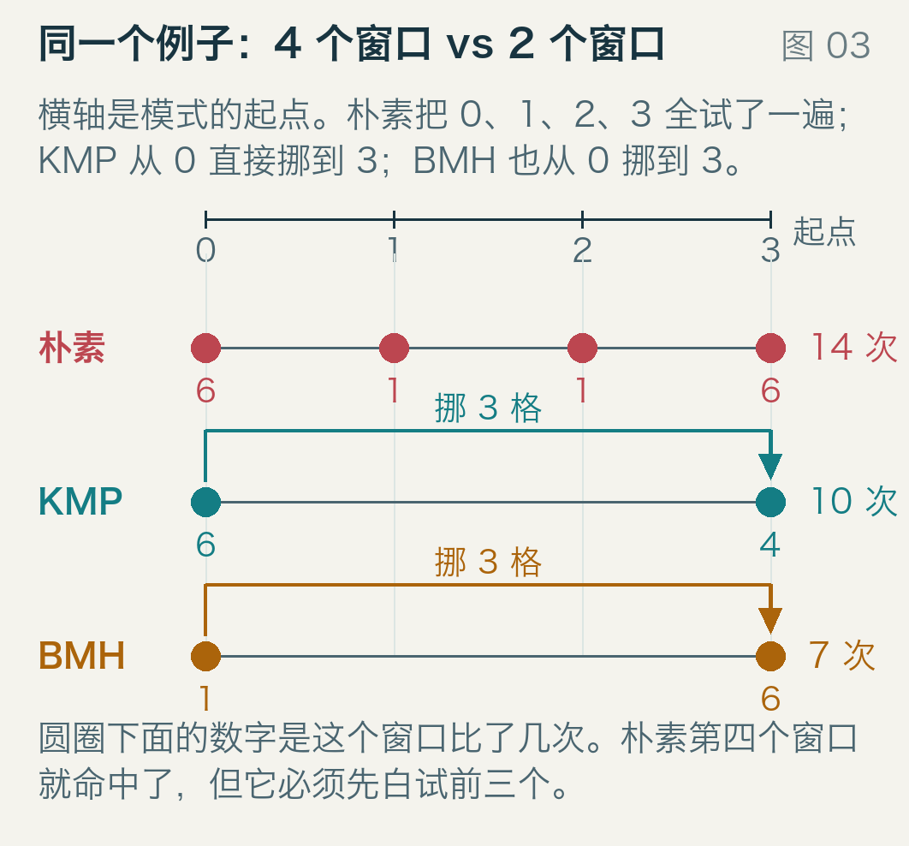

图里三条横线是三个算法的窗口轨迹，横坐标是起点，圆圈下面写着这个窗口比了几次。朴素把 0 到 3 全试了；KMP 和 BMH 都只碰了 0 和 3。

KMP 在第二段只用了 4 次比较：`c` 对 `c`、`a` 对 `a`、`b` 对 `b`、`d` 对 `d`。前两个字符是靠 failure 表「继承」来的，一次都不用比。6 加 4 等于 10，就是开头那个数。

## 三、从右往左比一次

朴素和 KMP 都从左往右比，第一个字符不对就整段作废。反过来比，先看窗口的最后一个字符，得到的是一条更粗暴但对英文特别有效的信息：这个字符在模式的最后 m−1 个位置里出现过吗？

`abcabd` 的表长这样（只用前 5 个字符建，最后一个字符自己不算）：

```
c 在模式里最后一次出现在下标 2  → 挪 5-2 = 3 格
a 在下标 3                     → 挪 5-3 = 2 格
b 在下标 4                     → 挪 5-4 = 1 格
d 没在前 5 个字符里出现         → 挪 6 格（整段过去）
```

在同一个例子里，第一次比较就是文本的 `c` 对模式的 `d`，不对；表说 `c` 要挪 3 格，于是直接跳到起点 3，第二段整段命中。

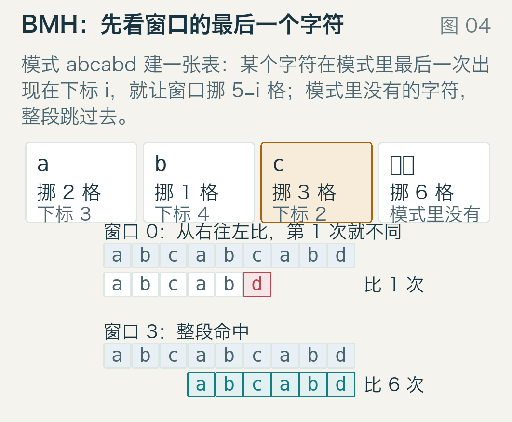

图上方四张卡是表的内容，黄色那张是这次实际用上的。下方两个窗口从右往左比：窗口 0 只比了 1 次（最右边的 `d` 就不对），窗口 3 比了 6 次，全中。

7 次比较，2 个窗口。BMH 的代价是这张表——它的大小是字母表大小，不是模式长度。英文 26 个字母还好，换成 UTF-8 的字节就是 256 项。

## 四、英文上量一遍

小例子里的 7 次有运气成分：`c` 恰好让窗口向右跳了 3 格。换一段真实的英文，收益还在不在？

我写了一段 1288 个字符的英文当语料（不是引文，就是介绍字符串搜索本身的一段话），用六个模式跑四遍：

| 模式 | 长度 | 朴素 | KMP | BMH | BM |
| --- | --- | --- | --- | --- | --- |
| `the` | 3 | 1445 | 1384 | 551 | 551 |
| `character` | 9 | 1377 | 1314 | 266 | 262 |
| `string` | 6 | 1366 | 1357 | 267 | 267 |
| `the quick` | 9 | 1484 | 1409 | 187 | 187 |
| `quicksilver` | 11 | 1280 | 1289 | 169 | 169 |
| `aaa` | 3 | 1385 | 1387 | 481 | 478 |

表里是字符比较次数。前四行在文本里出现过，`quicksilver` 和 `aaa` 不存在。最后一列 BM 是完整的 Boyer–Moore，它比 BMH 多一条「好后缀」规则，在这一节的英文数据上两者几乎一样。

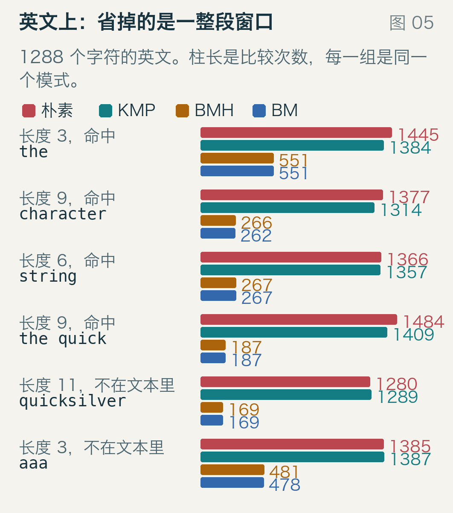

图里每四根柱子是同一个模式上的四种算法，横轴是比较次数。前三根（朴素、KMP）总是差不多长，后两根（BMH、BM）常常只有三分之一——`the quick` 那一组差了 7.9 倍。

KMP 在这里几乎没赢。原因不难找：英文文本里找一个 3 字母的词，平均匹配长度就是 1 点几，failure 表能复用的最多一两个字符，省不下什么。而在 `quicksilver` 这种「一个字符都不该匹配」的模式上，KMP 甚至比朴素多做了 9 次比较——它每次失配都要多查一次表。

真正的收益全在窗口数上。1288 个字符、模式长 3，最多 1286 个窗口：

```
朴素   窗口 1286，比较 1445  → 每个窗口 1.12 次
KMP    失配/命中 1225 次，比较 1384 次  → 1.13 次
BMH    窗口  461，比较  551  → 每个窗口 1.20 次
```

三个算法「每看一眼」的花费几乎一样，差别是 BMH 只看了 461 个窗口。KMP 没有窗口这回事，它一遍扫到底，所以那一行记的是「失配或命中的次数」——下文的表里统一叫推进次数，对另外三种算法它就是窗口数。

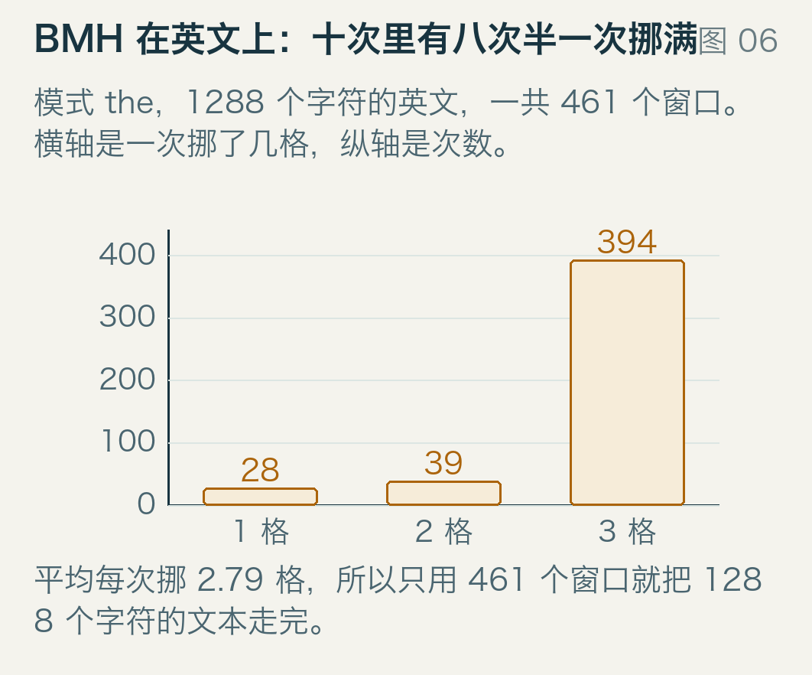

图里是那 461 次窗口移动的分布：挪 1 格 28 次、2 格 39 次、3 格 394 次。394/461 就是 85%，平均每次挪 2.79 格，正好对上 1286/2.79 ≈ 461。

这也说明了 BMH 的收益上限：位移表最大只能给 m 格，模式一长才有得挪。模式长 3，理论上最多省三分之二，实测省掉了 64% 的窗口——差的那一点是那 28+39 次短距离移动。

## 五、DNA：字母表变小，坏字符表就不够用

把语料换成 20000 个随机 ACGT（固定种子的 splitmix64 生成，可以复现），模式取长度 8 和 16：

| 模式 | 长度 | 朴素 | KMP | BMH | BM |
| --- | --- | --- | --- | --- | --- |
| `CTTATTTT` | 8 | 26542 | 24953 | 5925 | 4530 |
| `GACTGATA` | 8 | 26630 | 24983 | 10257 | 8106 |
| `CTTATTTTGAGGCTCA` | 16 | 26542 | 24953 | 8738 | 6445 |
| `ACGTACGT`（不存在） | 8 | 26580 | 25007 | 11278 | 8103 |
| `GGGGGGGG`（不存在） | 8 | 26652 | 24984 | 4543 | 3505 |

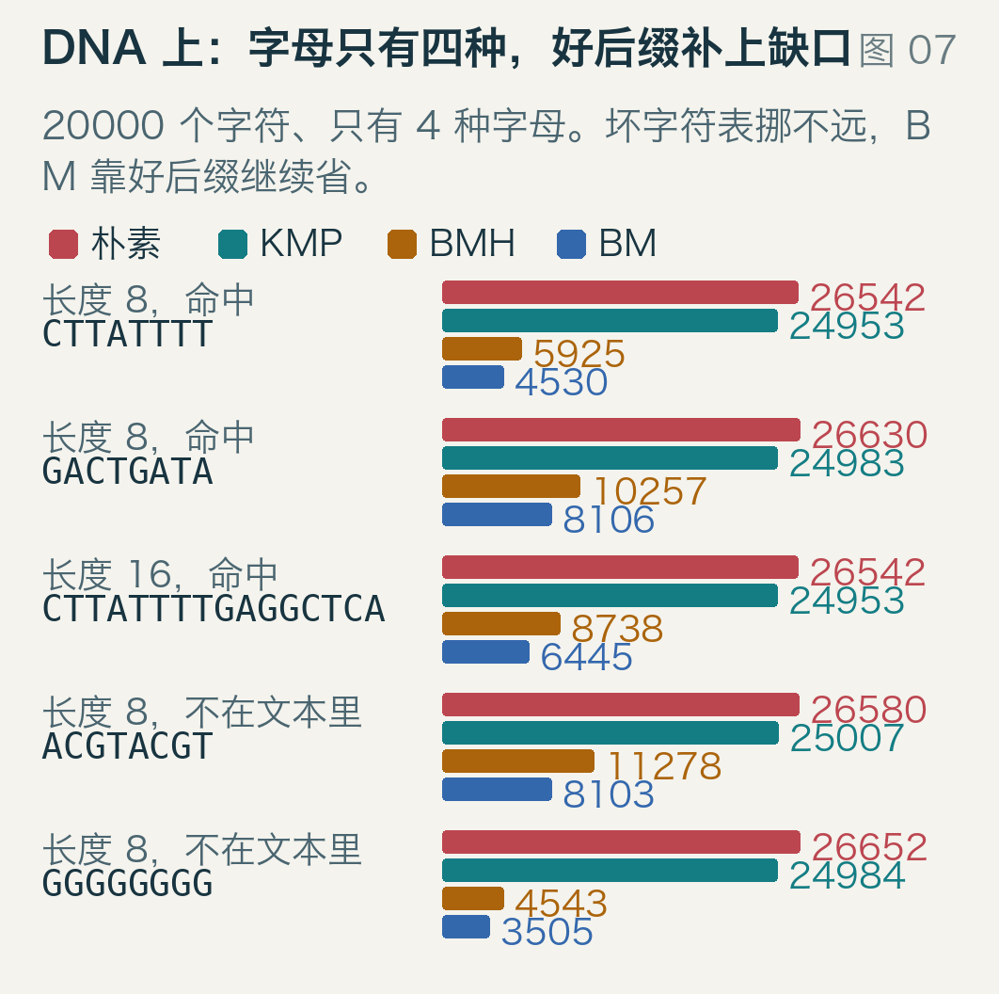

四根柱子一组，蓝色那根是完整的 BM。在 DNA 上它稳定比 BMH 少 20% 到 30%，因为字母只有四种，「最后一个字符不在模式里」这条信息没那么值钱了。

差别最大的是长度 16 那一行：BMH 8738 次，BM 6445 次。模式越长，好后缀规则能省下的越多。

## 六、省的是窗口，不是每次比较

把三组数据摊开看，会更清楚每个算法的钱花在哪：

| 语料 / 算法 | 推进次数 | 比较次数 | 每次平均 |
| --- | --- | --- | --- |
| 英文 / 朴素 | 1286 | 1445 | 1.12 |
| 英文 / KMP | 1225 | 1384 | 1.13 |
| 英文 / BMH | 461 | 551 | 1.20 |
| 英文 / BM | 461 | 551 | 1.20 |
| DNA / 朴素 | 19993 | 26580 | 1.33 |
| DNA / KMP | 18444 | 25007 | 1.36 |
| DNA / BMH | 8033 | 11278 | 1.40 |
| DNA / BM | 5762 | 8103 | 1.41 |
| 全是 a / 朴素 | 7993 | 63944 | 8.00 |
| 全是 a / KMP | 7993 | 15993 | 2.00 |
| 全是 a / BMH | 7993 | 7993 | 1.00 |
| 全是 a / BM | 7993 | 7993 | 1.00 |

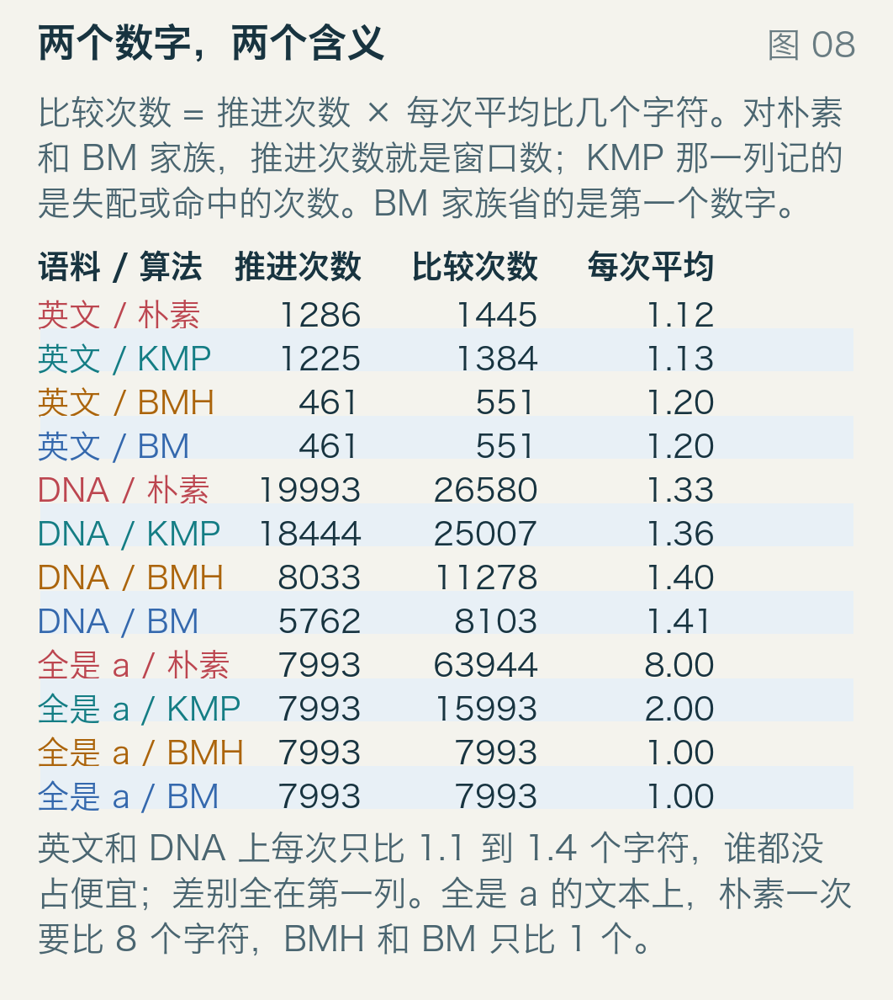

前三组里，四个算法的「每次」都挤在 1.1 到 1.4 之间，差别全在第一列。最后一组（8000 个 a 的文本，模式 `aaaaaaab`）反过来：推进次数一模一样，朴素每次要死磕 8 个字符，BMH 和 BM 一眼就看穿。

所以「哪个算法快」这句话，要拆成两个问题：它能不能少看窗口，它能不能在每个窗口里少比字符。这两件事没有哪个算法同时做到最好。

## 七、对抗输入：谁都会塌

上一节最后一行的 `aaaaaaab` 是我挑的。挑输入是理解渐进复杂度的正经办法，因为「最坏情况」不是理论家的洁癖：日志、DNA、二进制文件里连续重复的片段到处都是。

造第一个对抗输入：文本是 n 个 a，模式是 m−1 个 a 加一个 b。每一格都要比完 m−1 个 a，才知道最后一个字符不对。

让 m = n/4，窗口数是 n−m+1，比较次数就是

```
m × (n − m + 1) = (n/4) × (3n/4 + 1) ≈ 3n²/16
```

n = 64000 时，3n²/16 = 7.68 亿。模型跑出来是 768016000，一位不差。

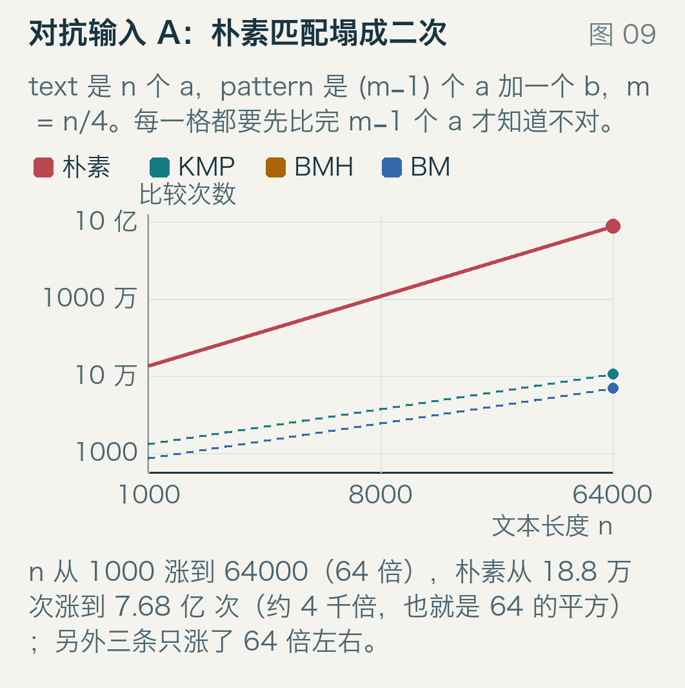

图是双对数：横轴文本长度，纵轴比较次数，四条线的颜色和前面一致。红色（朴素）的斜率是 2，n 涨 64 倍它涨 4 千倍；另外三条几乎是直线，只涨 64 倍。注意纵轴最上面那一格是 10 亿。

第二个对抗输入把角色对调：文本还是 n 个 a，模式换成 b 打头再加 m−1 个 a。这次朴素只看第一个字符就否掉，一次比较一格；BMH 却要从右边比完 m−1 个 a，然后只挪一格——它的表里 a 最后一次出现在下标 m−1，所以位移 1。

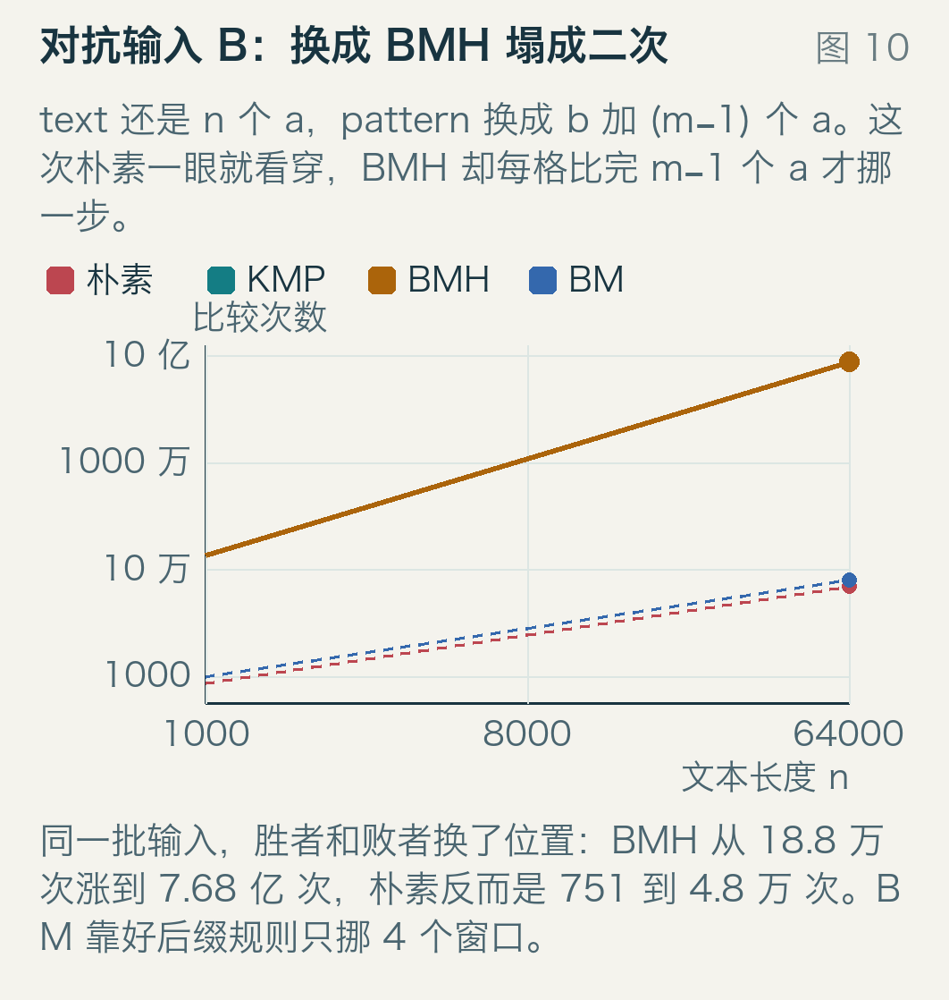

同一批输入，胜者和败者换了位置：BMH 从 187750 次涨到 7.68 亿次，朴素反而是 751 次到 48001 次。BM（蓝色）没事，它挪了 4 个窗口就收工——64000 个字符、模式长 16000，正好 4 个窗口，每个窗口 16000 次比较。

BM 凭什么能跳 16000 格？靠好后缀规则。

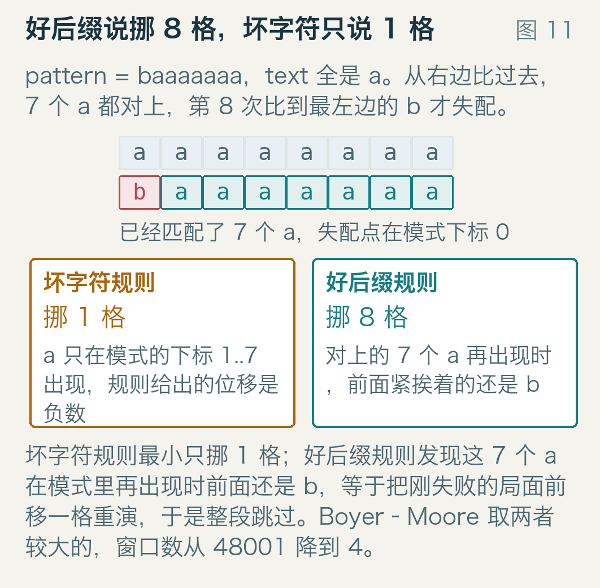

图上排是当时的局面：7 个 a 全对上，第 8 次比到模式最左边的 b 才失配。坏字符规则说 a 在模式里也出现，但都在下标 1 到 7，想把 a 对到下标 0 得往左退——规则不允许往左，最小只能右移 1 格。好后缀规则看的是已经对上的那 7 个 a：它在模式里再次出现时，前面紧挨着的还是 b，跟刚刚失配的 p[0] 是同一个字符，挪 1 格等于把刚才的失败原样重演；而这 7 个 a 在模式开头也接不上（开头是 b），两边都堵死，唯一能走的是整段跳过。

Boyer–Moore 取两条规则里大的那个，于是位移 16000，窗口数从 48001 降到 4。

## 八、全是 a 的时候，KMP 赢得最干脆

第二种对抗输入里，朴素的 48001 次是全场最少的——每格只比一个字符，谁都比不过。这不是巧合，是朴素匹配在「一撞就死」的输入上的天然优势：它没有表要查，没有额外判断。

同样，全是 a 的文本里模式也全是 a 时，命中的位置有 7994 个，KMP 只花 8000 次比较：

| 8000 个 a，模式 `aaaaaaa` | 比较次数 | 窗口数 | 命中 |
| --- | --- | --- | --- |
| 朴素 | 55958 | 7994 | 7994 |
| KMP | 8000 | 7994 | 7994 |
| BMH | 55958 | 7994 | 7994 |
| BM | 55958 | 7994 | 7994 |

KMP 在这里是 1 次比较一个窗口：每命中一次，`j` 回退 6 格，但 `i` 没动，下一个窗口的第一个字符上一轮已经比过了，直接算命中。BM 家族反而最惨，因为每个窗口都要从右往左比满 7 个字符，位移表又说「a 在最后一个位置，挪 1 格」。

四张表、四段数据放在一起，正好能拼出一句话：**每个算法都有一个让它难看、也都有一个让它好看的输入**。朴素在「一撞就死」时最好，KMP 在「长匹配反复命中」时最好，BMH 在「字母表大、模式短、最后一个字符常不在模式里」时最好，BM 在「字母表小、模式长」时最好。

## 九、标准库为什么不直接用它们

如果 KMP 有线性最坏情况，BM 也有（它得靠好后缀规则，而且线性性的证明后来被重做过），为什么 glibc 的 `strstr` 不用它们？

我读了 `string/strstr.c` 的当前版本，它的分支是这样：

```
针长 1        → strchr
针长 2、3     → 把 2/3 个字符打包成整数，逐字节比这个整数
针长 4..256   → 改良 Horspool：哈希相邻两个字符，建 8 位位移表
针长 > 256    → two_way_long_needle
```

短针的特判很好理解：两个字符的针，用 SIMD 化的 `strchr` 找第一个字符，比任何算法框架都快。

中间那段最有意思。源码注释写得很直白：把针长限制在 256 以内，位移表每项只要 8 位，预处理便宜、也几乎不吃缓存；同时这个上限让最坏情况变成线性的。也就是说，glibc 对付「BMH 会塌成二次」的办法不是换算法，而是**不让针长到会塌的规模**。

针超过 256 字节才上 Two-Way。Two-Way 是 Crochemore 和 Perrin 1991 年的算法，特点是最坏线性、额外内存是常数（不像 KMP 要 m 个整数，也不像 BM 要一张字母表大小的表），做法是把模式切成两段，从较长那段的某个位置开始向右扫，失配时按周期挪。

Rust 标准库的 `str::find` 用的也是 Two-Way，源码注释直接写着出处（Crochemore 与 Perrin，JACM 1991），并推荐 Crochemore 和 Rytter 的《Text Algorithms》第 13 章。这两处我核对过源码，但**没有测过它们的速度**：真实库的性能取决于 SIMD、缓存、分支预测，那不是我这份 Python 模型能回答的事。

还有一层原因：真实库要处理的是字节而不是「字符」，还要处理针是空的、针比文本长、文本中途不可读（`strstr` 只保证读到第一个命中附近）这类情况。算法课上的漂亮结论，落到 `strstr` 的接口上要先让位给这些问题。

## 十、字节、字符和偏移

`strstr` 按字节工作，这件事在 UTF-8 上有个干净的后果。

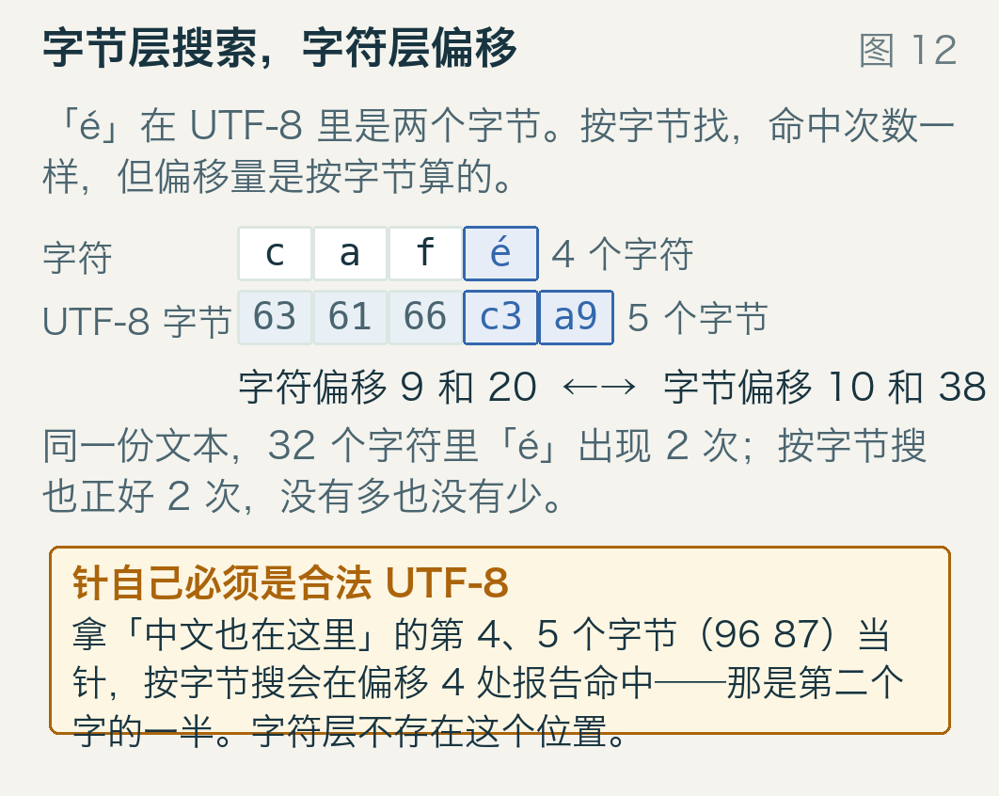

图上半是同一段文本的两层：字符层 4 个格，字节层 5 个格，`é` 占了 `c3 a9` 两个字节（蓝色）。下半是另一件事：拿「中文也在这里」里某个字的第 2、3 个字节（`96 87`）当针，字节层会在偏移 4 报一次命中——那是第二个字的一半，字符层根本没有这个位置。

所以，「在 UTF-8 文本里按字节搜」这件事成立，前提是针本身是合法 UTF-8。合法针的首字节是 ASCII（0x00–0x7F）或前导字节（0xC2–0xF4），而字符内部只可能出现续字节（0x80–0xBF），两者的取值范围不重叠，所以字节匹配不会切在字中间。针一旦非法，这条保证就没了。

同一个实验里还有一组数：32 个字符的文本里，`é` 在字符层出现 2 次（偏移 9 和 20），在字节层也出现 2 次（偏移 10 和 38）。次数一样，偏移不一样——凡是把搜索结果当字符下标用的地方，都得先换算。

另外两件容易被忽略的事：

- 重叠命中。`aaaaa` 里找 `aa`，有 4 次命中，位置 0 到 3。朴素的 4 个窗口全中（8 次比较），KMP 5 次比较就数完了（每命中一次只回退 `j`，`i` 不动）。很多语言的高层接口（比如 Python 的 `str.count`）默认不数重叠，那是接口的约定，不是算法的能力。
- 归一化。`é` 可以是一个码位 U+00E9，也可以是 `e` 加 U+0301 组合符。这两种写法在字节层完全不同，直接搜会漏。要按「用户看到的字符」搜，得先做 NFC 归一化，那是另一个问题。

## 十一、三句话

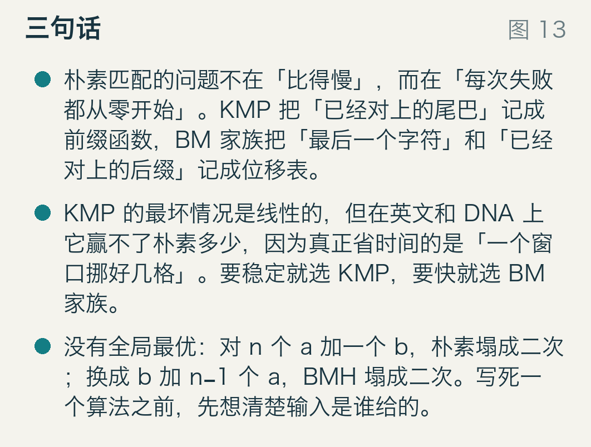

朴素匹配的问题不是「比得慢」，是「每次失败都从零开始」。KMP 把已经对上的尾巴记成前缀函数，BM 家族把最后一个字符和已经对上的后缀记成位移表——三种做法都在把上一次失败的结论留下来。

在英文和 DNA 这种真实文本上，赢的是「一个窗口挪好几格」，不是「每个窗口少比几个字符」；KMP 的线性上界在平均情况下换不来多少东西。要保证最坏情况，选 KMP；要平均快，选 BM 家族。

没有全局最优。对 n 个 a 加一个 b，朴素塌成二次；换成 b 加 n−1 个 a，BMH 塌成二次。写死一个算法之前先想清楚输入是谁给的——如果输入是攻击者给的，那它一定会挑那个让你塌的。
