# A* 为什么会白忙一场

游戏组的走廊里，「用 A*，比 Dijkstra 快」这句话几乎不用解释。
那就先看一张空地。6×6，四方向，每步 1，从左上角走到右下角。Dijkstra 展开 36 个格子：整张图一共 36 个，一个不落。A* 也展开 36 个，连先后顺序都一模一样。

这不是实现写错了。空地上一共有 36 个格子，每个格子的 f 都等于 10。启发式没有坏，是这张地图上它确实没有信息。

A* 的 f 是两笔账相加：`g` 是已经付过的路，`h` 是还欠着的估计。它省不省，不看算法名字，看这两笔账能不能把格子排出高下。下面用六张地图、四种 h、一个 w 的取值范围，把这句话拆开算。数字全部来自同一份可以重跑的 Python 模型（标准库，无依赖），数的是「弹出来处理过几次」和「走出来的路有多长」，不是计时——计时没做，末尾会说明。

## 一、f = g + h，六个格子

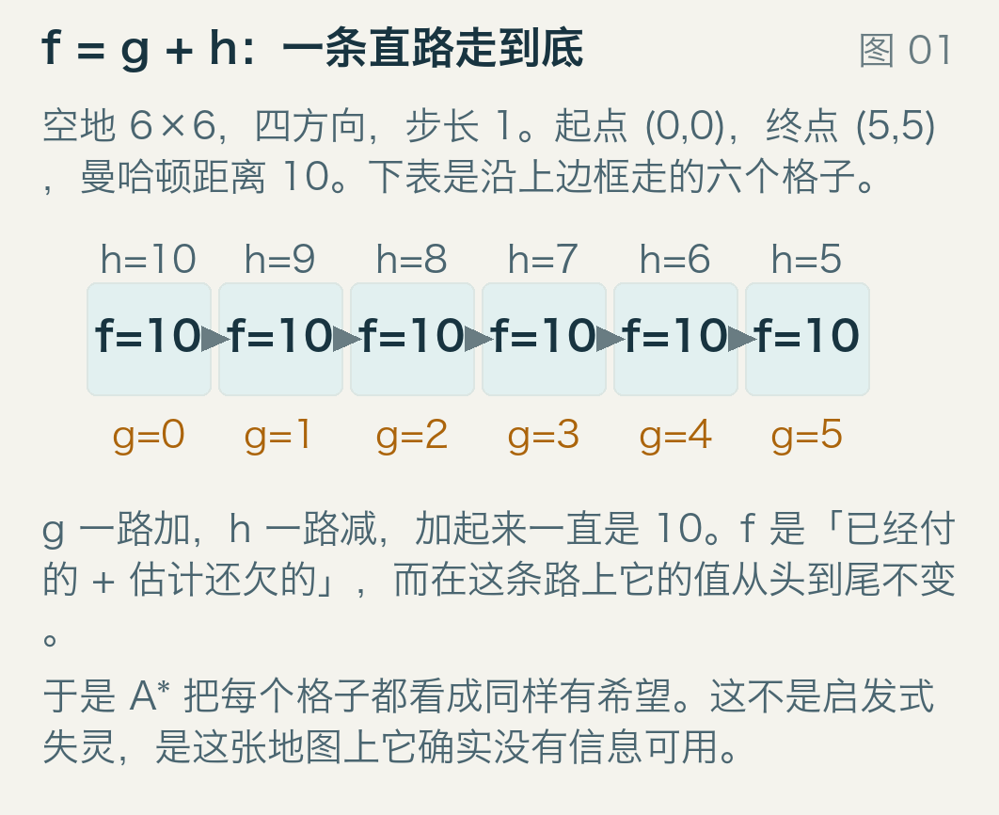

图里是空地上沿上边框走的六个格子。第 i 个格子，从起点走了 i 步，所以 `g = i`；剩下要走到右上角的水平距离是 5−i，竖直距离还是 5，所以 `h` 是 10−i。加起来 `f = 10`，一路都是 10。

`g` 是事实，`h` 是猜测。A* 每步弹出 f 最小的那个格子，它相信「派头最小的人最可能先到终点」。这个信念在一种情况下是对的：只要 h 永远不高估，第一个被弹出的终点就是最优的。

空地上这个 h 不但不高估，而且完全精确：从第 i 个格子到终点的真实剩余代价就是 10−i。精确到一格不差，可这六个格子的 f 仍然全是 10。精确与有用是两件事：h 的作用是把格子分开，如果它给每个格子都加同一个数，它就只是一个常数，等于零。

## 二、空地上，36 个格子全同分

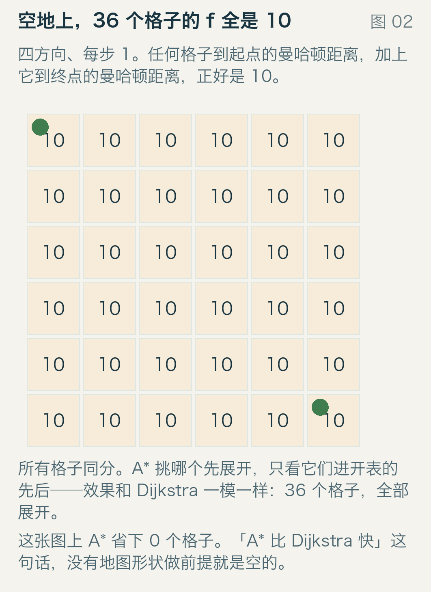

把这句话推到底。横 x 竖 y 的格子，从起点走过来是 `g = x + y`，到终点的曼哈顿距离是 `5−x` 加上 `5−y`，两者相加恰好等于 10，与这个格子在哪无关。
所以整张图的 f 只有一个值，A* 的堆里所有条目同键。谁先弹出，取决于谁先被塞进去，而「先被塞进去」取决于邻居的遍历顺序，那是一个纯粹的实现细节。我对比过两个算法的展开序列，36 个格子，顺序完全一致。

Dijkstra 是 1959 年那篇三页的短文里给出的做法，每次只按 g 弹最便宜的。A* 是 1968 年 Hart、Nilsson、Raphael 把 h 加进去的结果，h 取 0 时就退回 Dijkstra。也就是说，A* 是在 Dijkstra 上面加了一项信息；信息为零的时候，它就是你原本想省掉的那个东西。

## 三、同分时先展开谁

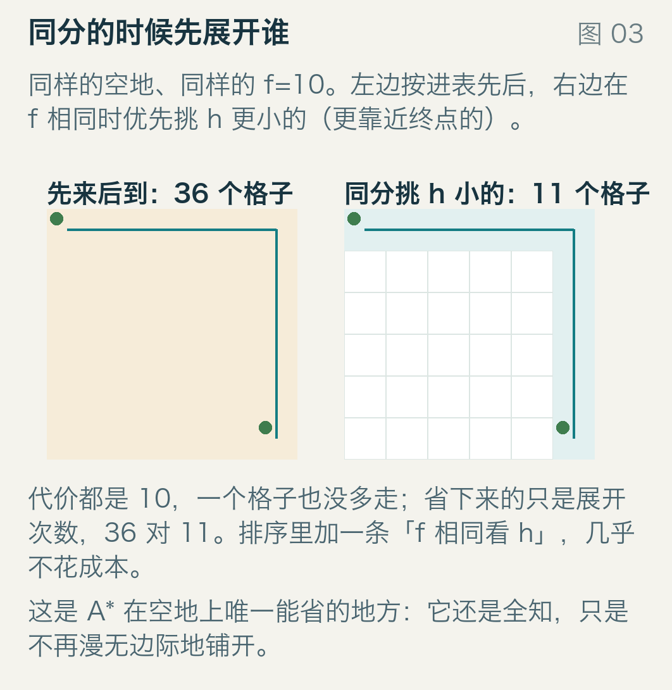

既然所有格子同 f，排序里还能加一条：f 相同时，先展开 h 更小的（离终点更近的）。图左边是「先来后到」，36 个格子；右边加了这一条，11 个。代价都是 10，一个格子没多走。

这一条在工程上几乎不要钱：堆的键从 `f` 变成 `(f, h)`，只是多存一个数。代价是它在有障碍的地图上帮不上什么忙：33×33 那张 18% 障碍的图上，278 变成 273；25% 障碍那张，445 变成 443。有障碍时不同格子的 f 本来就分得开，不需要再拆同分。
所以「A* 快不快」要分两件事：一是 h 能不能把格子排出高下（地图给的），二是同分时你按什么顺序处理（你写的）。

## 四、八方向：h 第一次有用

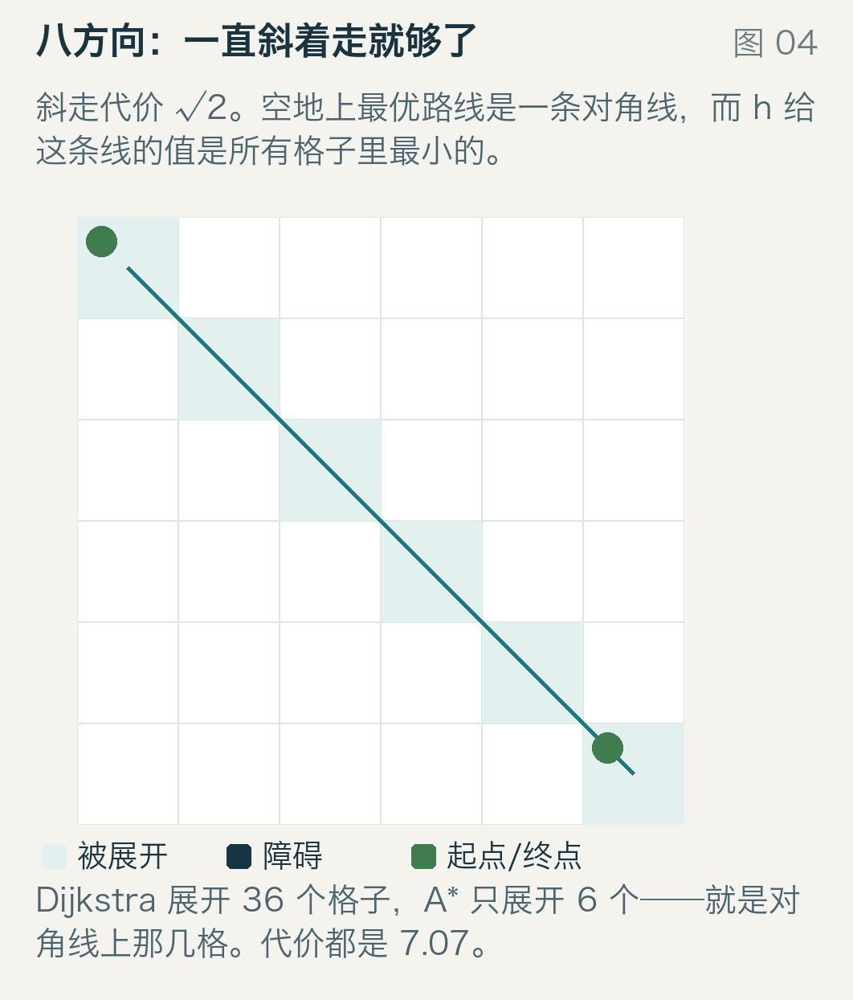

四方向走路只能横竖，斜着走的思路被浪费了。改成八方向，斜走代价 √2，h 换成八方向距离 `octile`（先斜着走 `min(dx, dy)` 步，再直着走剩下的）。

对角线上的格子横竖坐标相等：`g` 是 `√2` 乘 x，`h` 是 `√2` 乘 5−x，加起来 `f = 5√2 ≈ 7.0711`，一路不变。而这回别的格子吃亏了：偏一格，f 就要多出一点。于是 A* 只展开 6 个格子，正好是那条对角线，而 Dijkstra 还是老老实实 36 个。走出来的代价 7.0711，就是 5√2。

同一张空地，同一个算法，从「一个不省」变成「省 30 个」。变化的是地图和 h 的形状，不是代码。

## 五、一道墙，两种走法

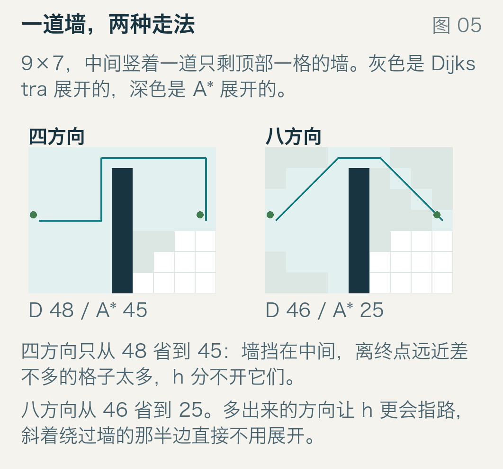

空地太客气了。来一道墙：9×7，中间竖着一列，只剩顶部一格能过。起点在左边中间，终点在右边中间。

四方向：Dijkstra 展开 48 个，A* 45 个，只省 3 个。最优路要走 14 步，得先往上绕到墙顶的缺口，再下来。墙左边和墙右边的格子，到终点的曼哈顿距离看起来都很近，h 分不开「已经在墙这边」和「已经在墙那边」——它们都得先往上走。
八方向：46 个对 25 个，省掉将近一半。这一次 h 拿到了一点真信息：斜着走能更快贴近终点，墙右边那些「只能再绕远」的格子 f 立刻变大，直接不展开。

规律在这里第一次露头：h 的强弱不在它算得准不准，而在它能不能看出「从这儿走，剩下那段会变难」。

## 六、33×33：A* 展开的是 Dijkstra 的子集

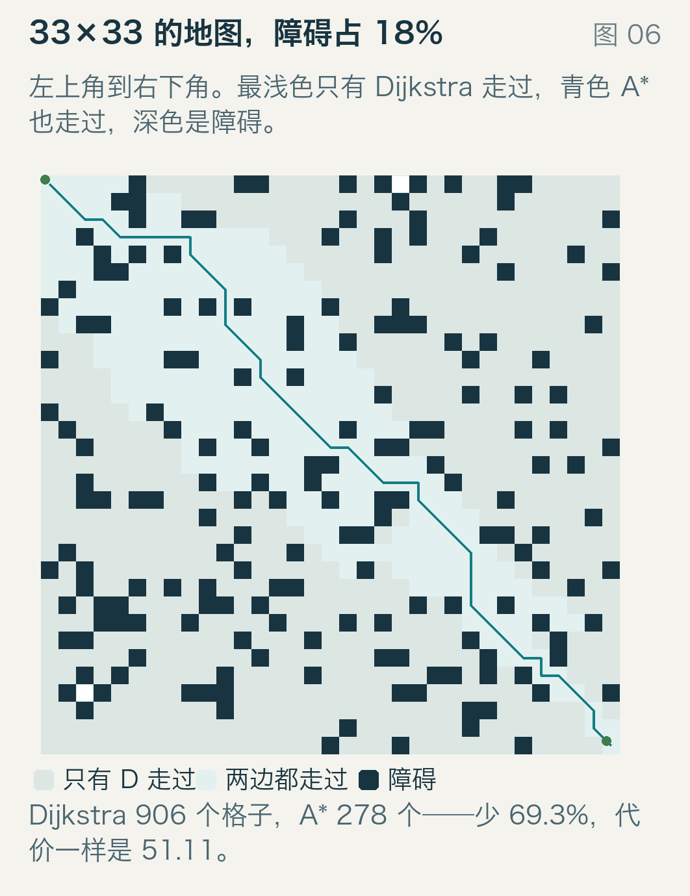

换成更像关卡的东西：33×33，随机撒 181 个障碍（18%），左上去右下。浅色是只有 Dijkstra 走过的格子，青色是两边都走过的。
Dijkstra 展开 906 个，占全部 1089 个格子的 83.2%。A* 展开 278 个，25.5%。少 69.3%，代价都是 51.1127。

我检查过集合关系：A* 展开的 278 个格子全在 Dijkstra 的 906 个里面。被省掉的那 628 个，全都是「往终点那个方向看一眼就知道不划算」的格子。两条路径不完全一样（同代价的路不止一条），但长度一致。另外 183 个格子两个算法都没碰过——被障碍封死的死角。

这 628 个格子在哪，能说明 A* 到底在干什么。量一下它们到「起点连终点」这条直线的距离：平均 10.14 格。而被展开的 278 个，平均只有 2.33 格。A* 展开的是一条走廊：沿着大方向铺开，两侧远一点的地方直接不管。Dijkstra 没有方向，它按 g 从小到大铺，像水一样漫过去。

这里有一笔账容易忽略，就是开表峰值：堆里同时有多少条待处理的记录：Dijkstra 52，A* 125。A* 一次把邻居全塞进去，堆比对方高出一倍多。省下的是弹出次数，花掉的是内存。Korf 在 1985 年干脆拿掉开表，用反复重算换内存，那是另一条路。

## 七、障碍多到 25%，h 的收益缩水

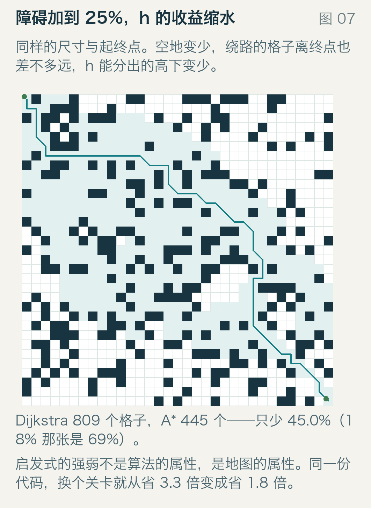

同样的 33×33、同样的起终点、同样的代码，只把障碍密度从 18% 提到 25%：Dijkstra 809 个，A* 445 个，省 45.0%。上一张是 69.3%。
原因还是那句话：障碍越密，绕路越多，能走的格子离终点的距离也越趋同，h 能给它们排出的高下越少。到了最后，A* 只能靠 g 的差别来排序，那就是 Dijkstra。

走廊也变宽了。被省掉的 364 个格子平均离直线 11.28 格，被展开的 445 个平均 4.70 格，上一张图是 10.14 对 2.33。障碍多了，A* 不再只走一条窄路，而是把整片「可能要绕」的区域都翻了一遍。
同一份实现，换个关卡，收益从 3.3 倍掉到 1.8 倍。任何「A* 比 Dijkstra 快 N 倍」的说法，都必须跟着地图一起说。

## 八、把 h 乘个 w

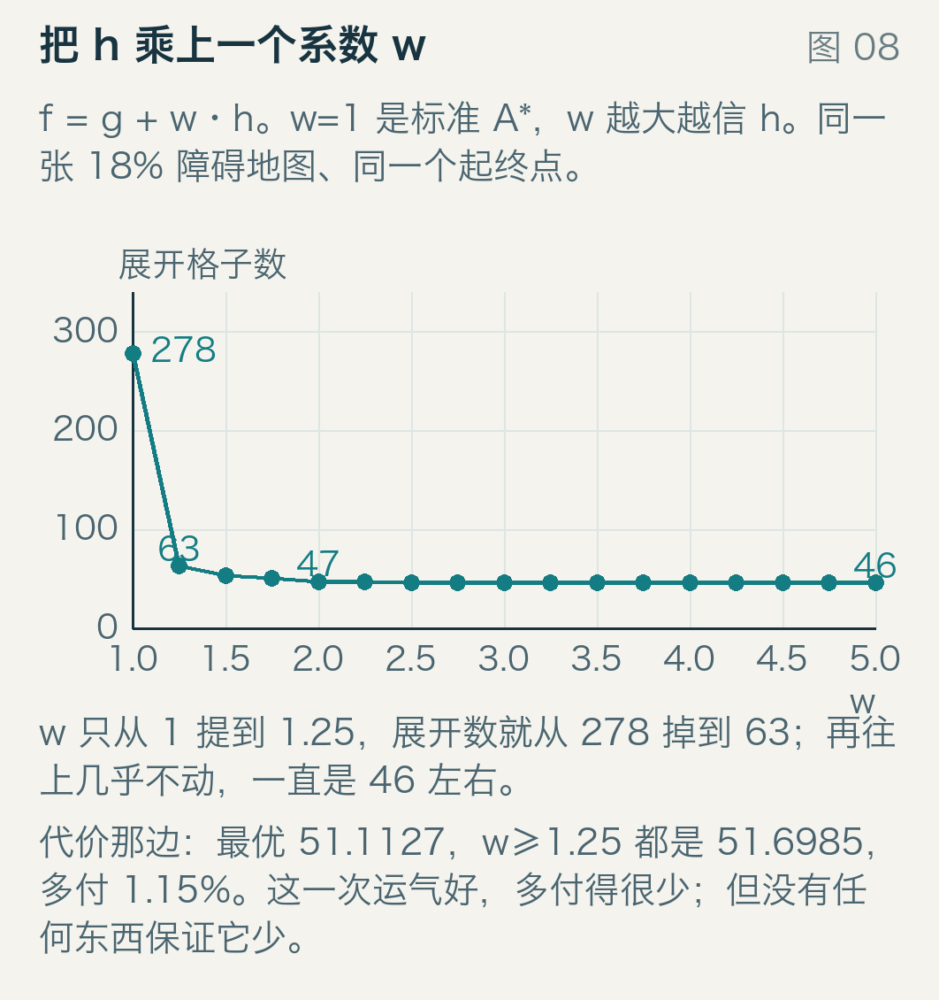

既然 h 只是估计，可以故意夸大它：`f = g + w·h`，w 大于 1。h 被放大以后，A* 更愿意往终点的方向钻，代价是可能错过最优路。
还是那张 18% 障碍的地图。w=1 时 278 个格子，w=1.25 时 63，w=2 时 47，w 到 2.5 以后稳定在 46，再往上加也不动了——地图能给的排序能力就这么多。

代价那边：最优 51.1127，从 w=1.25 起都是 51.6985，多付 1.15%。这一次很划算：4.4 倍少的展开（278 → 63）换 1.15% 的绕路。但 25% 障碍那张图没这么好说话：

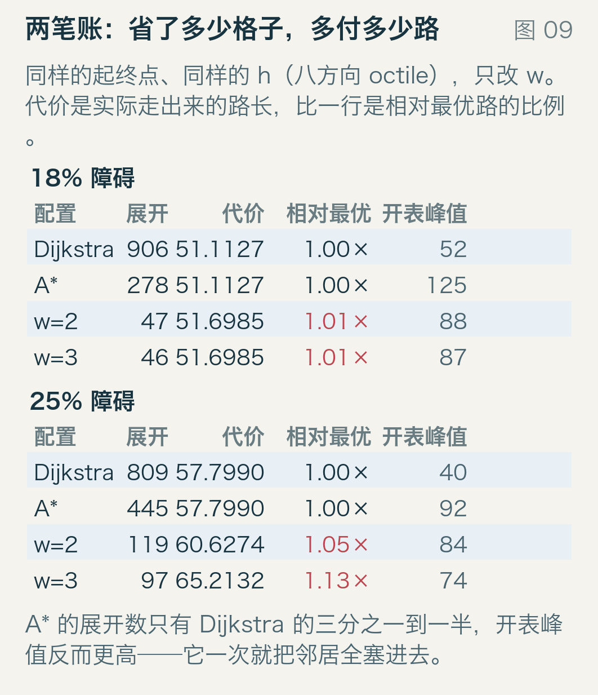

同样的 w=2，代价从 57.799 变成 60.6274，多付 4.89%；w=3 是 65.2132，多付 12.83%，换来的是 97 个格子对 809 个。

上界是有的。Pohl 在 1970 年把 h 乘上系数写进 f，代价不超过 `w·C*`，C* 是最优代价。表里 1.0115 ≤ 2、1.1283 ≤ 3，都在这条界里面。只是这条界很松：它保证不会错得离谱，不保证错得可接受。

表里还有一列值得看：开表峰值。A* 是 125，w=2 是 88，Dijkstra 是 52。加大 w 让堆变矮了，可它仍然比 Dijkstra 高——省时间和省内存不是一个旋钮。

## 九、高估一步，错到底

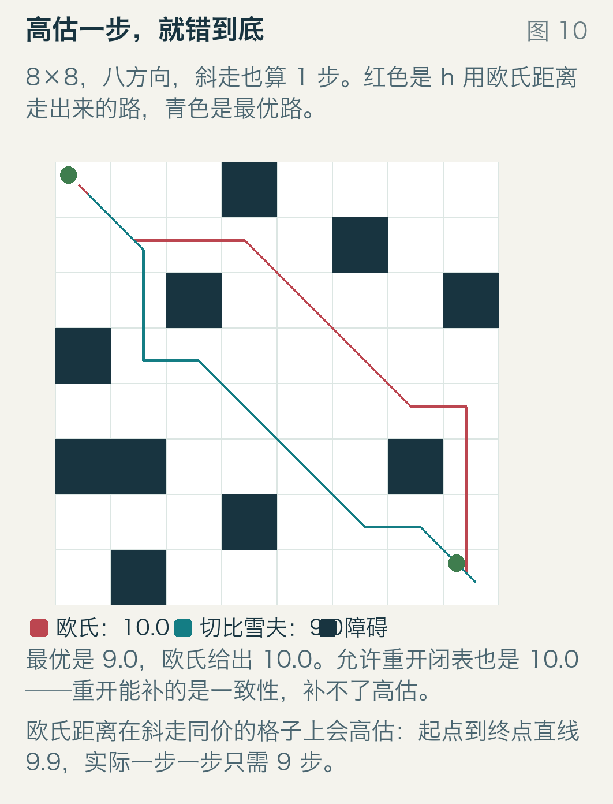

前面说过：h 不高估，第一个弹出的终点才是最优。不成立的时候会怎样，值得看一个具体的地图。
8×8，八方向，斜走也算 1 步（很多游戏就这么写：八个方向同价）。这种图上，从左上角斜着走到右下角是 7 步，欧氏距离却是 9.899——欧氏距离默认斜走更贵，而这里不贵。

红色是 h 用欧氏距离走出来的路，长度 10。青色是 h 用切比雪夫距离（八方向同价时它就是精确距离）走出来的路，长度 9。顺手把表里另外两行读了：让闭表允许重开，欧氏还是 10；换成 octile（同样假设斜走更贵）也是 10。切比雪夫花 28 次扩展换来 9，欧氏 15 次扩展给出 10。

高估不是「排序不准」这种小毛病，它让 A* 在弹出终点的那一刻就停止了搜索，而那一刻的终点可能不是最优的。重开闭表能修的是「同一个格子被更便宜地再次发现」，修不了「h 把好路说成坏路」。
这个现象不是精心构造的孤例。300 张小地图（6×6 到 9×9，20% 障碍，种子 20270308），欧氏距离给出次优解的有 3 张；允许重开之后仍然有 2 张；最大差 1.0。

## 十、一致性：h 掉下去不能比一步还快

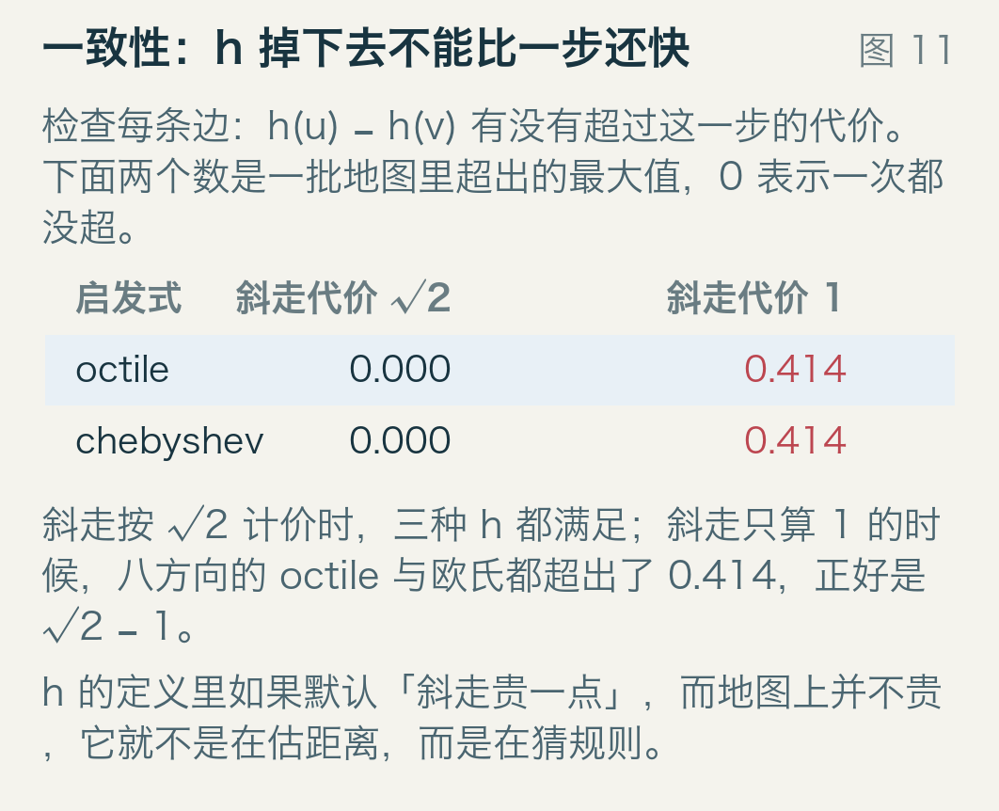

比「不高估」更细的一条要求叫一致性：对每条边 u→v，`h(u) − h(v) ≤ c(u,v)`。意思是 h 沿着一条边往下掉的速度，不能超过这一步本身的价格。
图里是两种斜走定价下的实测。斜走按 √2 计价时，octile、切比雪夫、欧氏三种 h 的最大超出量都是 0.000，全部满足。斜走只算 1 的时候，octile 和欧氏都超出 0.4142，正好是 √2 − 1，就是「h 以为斜走贵 0.414，实际上一分没贵」。

一致性换来的是一个便宜的优化：每个格子第一次被弹出时，它的 g 已经是最优的，于是闭表可以永不重开。没有这条性质，这个优化就是在赌。

第九节那 300 张随机小图正好把赌输的后果摆出来了。欧氏距离在斜走同价的图上既不一致也高估：不重开闭表时 3 张给出次优，允许重开降到 2 张。重开能救回一部分，被「更便宜地重新发现」的那种错，它修得了；被 h 直接说成坏路的那种错，它修不了。这两个数字混在一起，没法拆开各自贡献多少，我没做这个拆解。

想要一个「不一致、但不高估」的干净反例，得手写 h 值（Russell 与 Norvig 第 3 章给的就是这种图，不是地图）。这类从几何量推出来的 h 只要不高估，往往也一致，所以本文这批地图上没有单独出现这种病。
至于引擎，它只把两个钩子交给你。Godot 的 `AStar2D` 里，`_compute_cost` 决定 g 怎么加，`_estimate_cost` 决定 h 怎么算，文档要求 `weight_scale` 不小于 0，却一个字都没说 h 不能高估。检查是你的活。

## 十一、三句话

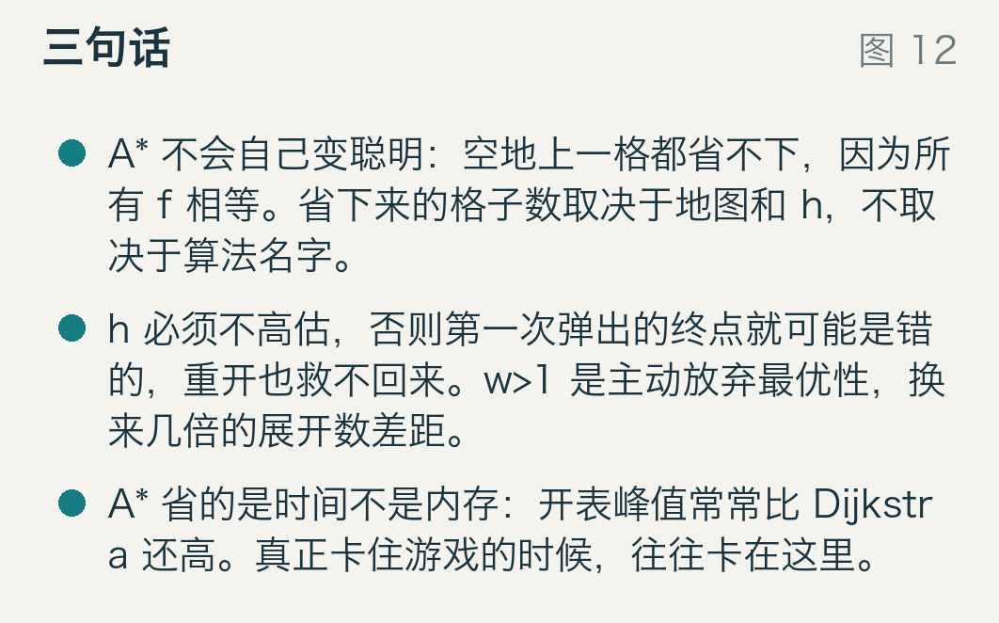

A* 不会自己变聪明。空地上它一个格子都省不下，所有格子的 f 都是同一个数。省下多少取决于地图的形状和 h 的形状，不取决于算法名字。

h 必须不高估，否则第一个弹出的终点就可能是错的，重开闭表也救不回来。加大 w 是主动放弃最优性，换来的是几倍的展开数差距和百分之几到十几的绕路。

A* 省的是时间，不是内存。开表峰值常常比 Dijkstra 还高——真卡住的时候，卡在这一列上。
