# 深度缓冲只记得住 48 厘米

一堵墙，离相机 900 米。前面 30 厘米再放一堵。两堵墙都进了深度缓冲，可这一对谁在前谁在后，有时算得出来，有时两个深度值落在同一个格子里，于是它们开始闪。

48 厘米是这块缓冲在 900 米处的格距——1677 万个格子里最靠边的那一段，一格有这么宽。30 厘米的间隙比一格窄，两个面落在格子的哪一侧全凭位置：跨在格边两侧就分得开，落在同一格就合成一个值。

换到 100 米处，一格 6 毫米；换到 1 米处，0.6 微米。三个数字出自同一个除法，中间没有坏掉的零件。

下面用一个能手算的映射、一份 Python 模型和一篇 2015 年的博客，把这件事拆开：格子是按什么铺的，哪个参数说了算，以及为什么把深度反过来存就能治好它。

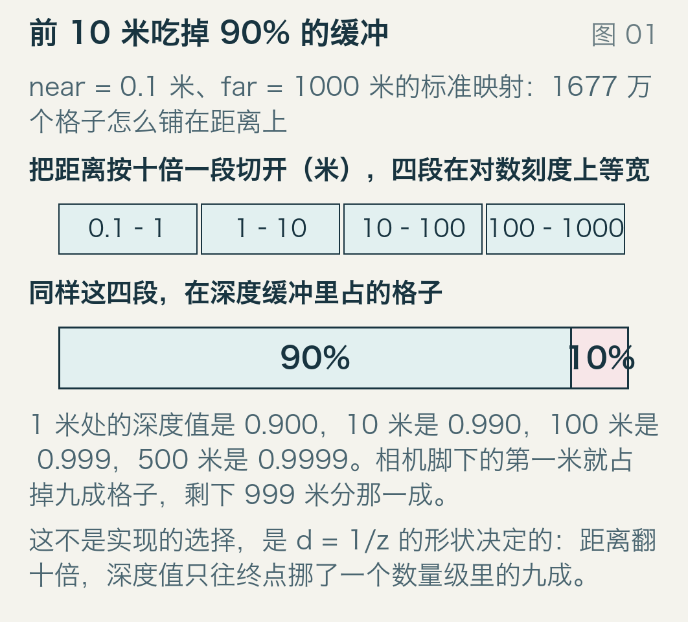

## 一、前 10 米吃掉 90% 的缓冲

模型的设置：near = 0.1 米，far = 1000 米，24 位定点深度。2 的 24 次方是 16777216，也就是 1677 万个格子，从 0 排到 1。

看图上面那排：距离按十倍一段切开，四段在对数刻度上等宽。下面那排是同样的四段在深度缓冲里占的地方——第一段（0.1 到 1 米）就吃掉 90%，剩下 990 米分那 10%。

具体数字：1 米处的深度值是 0.900，10 米 0.990，100 米 0.999，500 米 0.9999。也就是说相机脚下第一米用掉九成缓冲，最后 500 米加起来用掉万分之一。

这不是谁偷懒。深度缓冲存的不是距离，是 1/z 的一次重映射，而 1/z 天生就往近处堆。

## 二、d 到底是什么

标准映射（D3D 风格，映射到 [0,1]；OpenGL 的 [−1,1] 版本只是把这段线性拉伸，格子数不变）写出来是一行：

```
d(z) = f/(f−n) · (1 − n/z)
```

n = 0.1、f = 1000，前面的系数是 1000/999.9 = 1.0001，于是 `d = 1.0001 · (1 − 0.1/z)`。三个数可以手算：

- z = 1：`1 − 0.1 = 0.9`，乘 1.0001 得 0.90009
- z = 100：`1 − 0.001 = 0.999`，得 0.9990999
- z = 500：`1 − 0.0002 = 0.9998`，得 0.9999

模型里也是这三个数。

因为 d 是 1/z 的仿射函数，一个格子对应的距离间隔可以直接求导：Δz = Δd · (f−n)z² / (n·f)。Δd 就是 2 的 −24 次方 = 5.9605e-8，(f−n)/(n·f) = 999.9/100 = 9.999，所以

```
Δz ≈ 5.96e-7 · z²    （米）
```

还是手算三行：z = 1 给 0.6 微米，z = 100 给 5.96 毫米，z = 900 给 0.483 米。模型里这三个数分别是 5.96e-7、5.96e-3、0.48275 米。平方项，这是全部问题的根源。

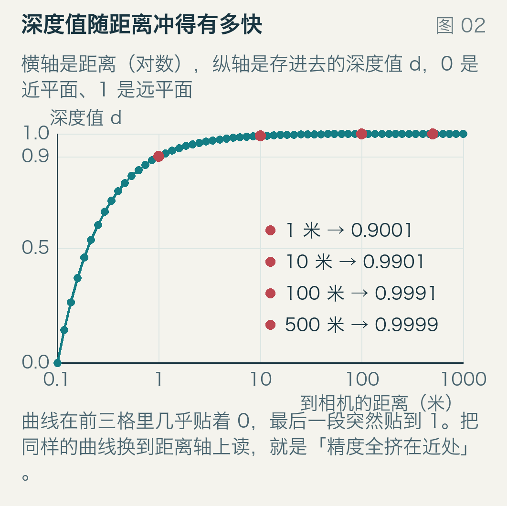

图二是同一件事换一种画法：横轴距离、纵轴深度值。曲线在前面几格里几乎贴着 0，最后一段突然贴到 1。把这条曲线倒过来读——「深度值每往前走一格，距离走了多远」——就是图里那些数字。

## 三、三条曲线，只差近平面

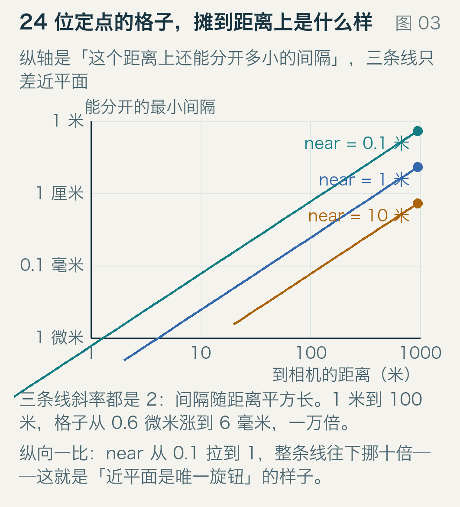

图三把 near 取 0.1、1、10 三个值，各画一条 Δz 曲线，双对数刻度。三条线平行，斜率都是 2——平方关系没变，变的是整条线的位置：near 每放大十倍，同一点上的间隔缩小十倍。近平面离相机越近，同一距离上的格子越粗。

这也是「近平面是唯一的旋钮」这句话的来源。1 米到 100 米，格子从 0.6 微米涨到 6 毫米，一万倍；这是距离项干的，动 near 只是把这个过程整体平移。

## 四、挪一倍，好一倍

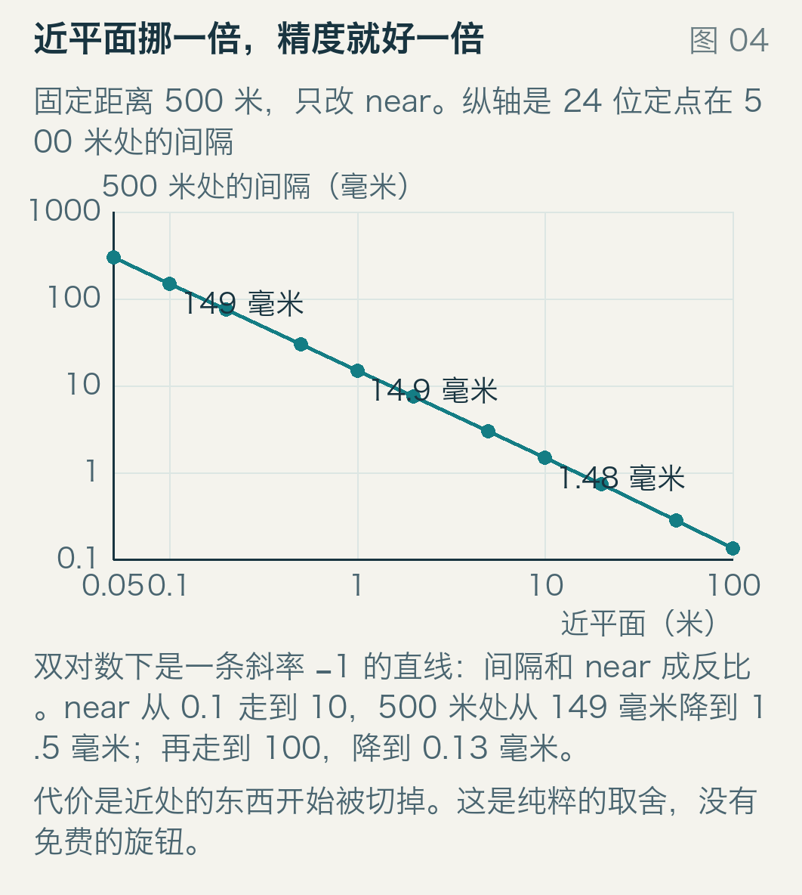

固定 z = 500 米，把 near 从 0.05 一路扫到 100。双对数下是一条斜率 −1 的直线，间隔和 near 成反比：

| near（米） | 0.05 | 0.1 | 0.5 | 1 | 10 | 100 |
| --- | --- | --- | --- | --- | --- | --- |
| 500 米处间隔（毫米） | 298 | 149 | 29.8 | 14.9 | 1.48 | 0.13 |

near 从 0.1 抬到 1，500 米处的精度好十倍；抬到 10，好一百倍。代价在另一头：near = 10 意味着镜头前 10 米以内的东西全被切掉。游戏里 near 敢写成 0.1 而不写 1，往往是为了让主角贴墙时不穿帮，这一条就是远处墙面闪的账单。

## 五、远平面几乎不参与

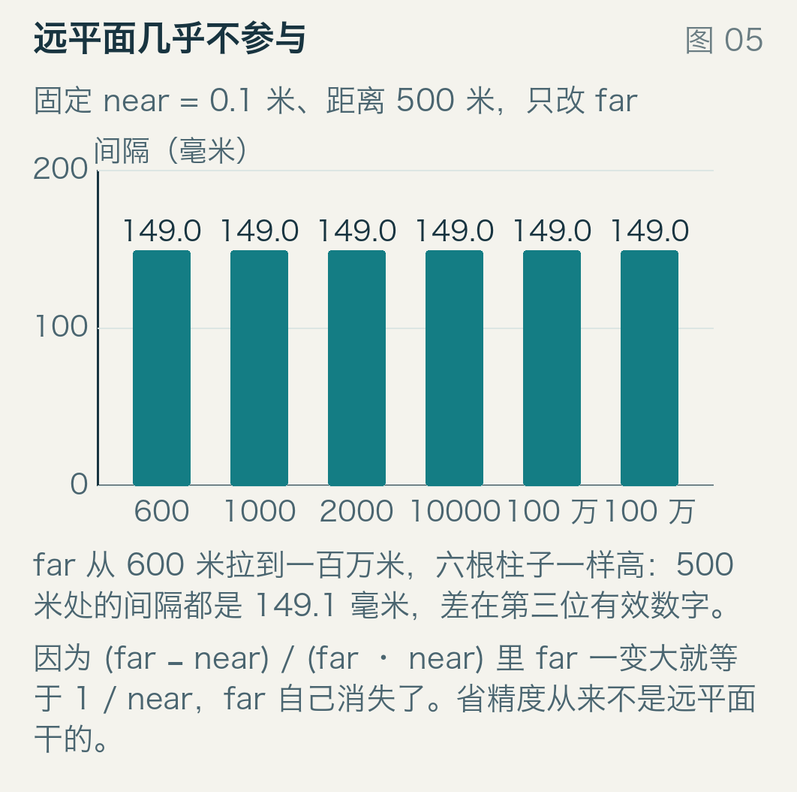

近平面这么管用，直觉会让人以为远平面也一样。固定 near = 0.1，far 从 600 米拉到一百万米，六组数字是：

0.148987、0.148997、0.149004、0.149010、0.149011、0.149012

也就是 148.987 毫米到 149.012 毫米——差在第三位有效数字上，几十微米。

原因在那行公式里：整个映射对 far 的依赖只有 `(f−n)/(n·f)` 这一个因子，f 一大它就趋近 1/n，far 自己消掉了。所以「把远平面拉近一点省精度」在标准映射下基本是白费力。真正改得动的是分母上的 near。

## 六、换成 float32，还是一模一样

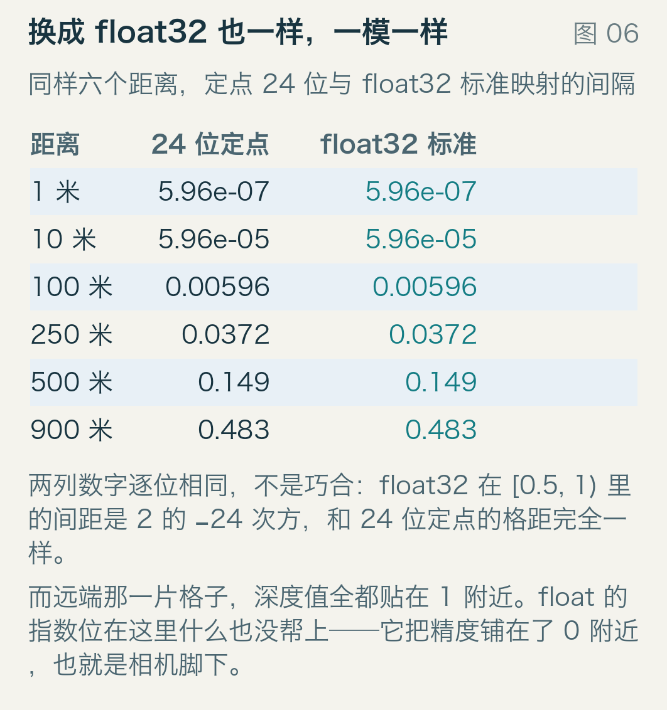

一个常见的印象是浮点深度比定点好，因为它「越靠近 0 越密」。表里是同样六个距离，24 位定点和 float32 逐个对比：

| 距离（米） | 1 | 10 | 100 | 250 | 500 | 900 |
| --- | --- | --- | --- | --- | --- | --- |
| 24 位定点 | 5.96e-7 | 5.96e-5 | 5.96e-3 | 0.0372 | 0.149 | 0.483 |
| float32 标准 | 5.96e-7 | 5.96e-5 | 5.96e-3 | 0.0372 | 0.149 | 0.483 |

一个不差。float32 在 [0.5, 1) 里的间距是 2 的 −24 次方，和 24 位定点的 5.9605e-8 是同一个数，格子落在完全相同的位置上；而远端那一片的深度值全都贴在 1 附近，正落在这个区间里。指数位在这里帮不上忙——它把精度铺在 0 附近，也就是相机脚下，那里本来就不缺精度。

## 七、把镜子翻过来

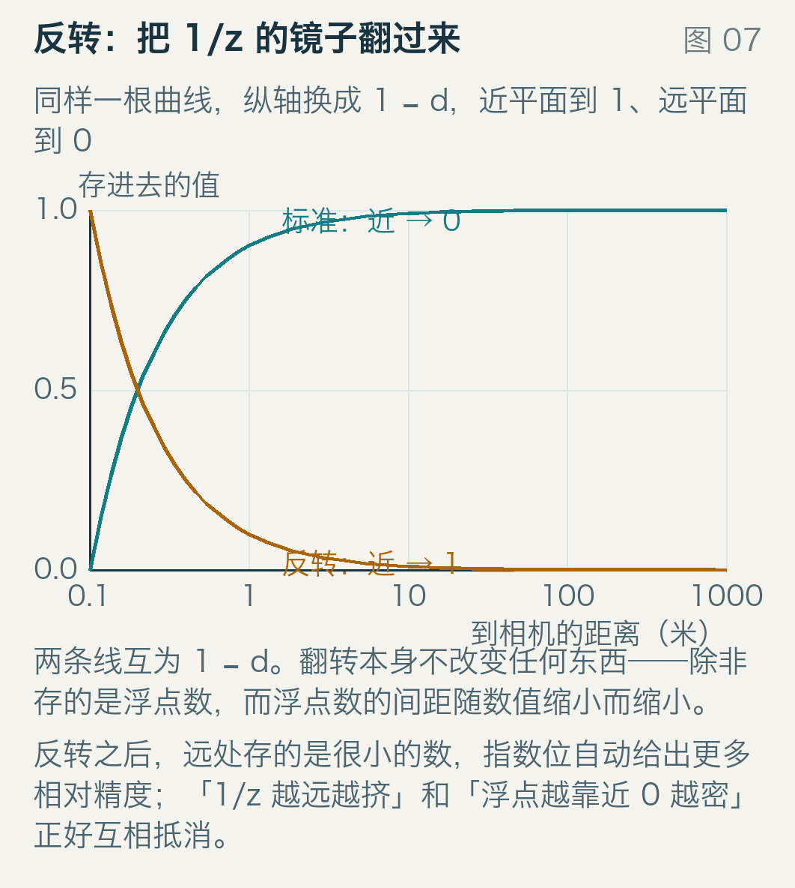

反转深度（reversed-Z）做的事很简单：存 1 − d 而不是 d，近平面存 1、远平面存 0。

对定点来说这是换汤不换药，格子还是均匀的。但 float32 的间距随数值变小而变小，而 1 − d 在大距离处正好是个很小的数——两个趋势对上了。

Lapidous 与 Jiao 在 1999 年一篇硬件论文里讨论过各种深度缓冲布局，反转也在其中；Upchurch 与 Desbrun 在 2012 年把它的精度误差写成了闭式。它后来变成默认写法，原因很朴素：不需要额外硬件，只要把投影矩阵里的 z 翻过来。

## 八、反转之后，锯齿

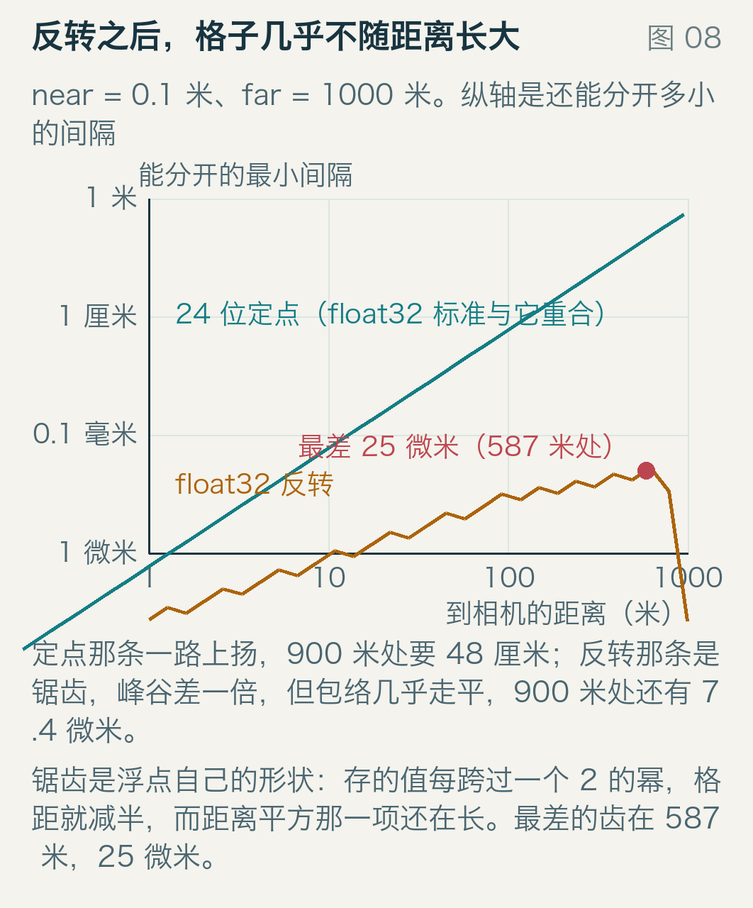

模型里反转映射在同样的六个距离上给：74.5 纳米、0.93 微米、5.82 微米、18.2 微米、18.2 微米、7.37 微米。

900 米处 7.37 微米，比定点的 48 厘米好了六万五千倍。

那条线不是平的，是锯齿。原因不在 1/z，在 float：存的值每跨过一个 2 的幂（也就是每走一个「八度」），格距就减半，而距离平方那一项还在长，于是两条趋势打架，扯出一排齿。模型的 40 点扫描里，最差的齿在 587 米，25.1 微米。

齿的幅度是两倍，包络却几乎水平：从 1 米的 74 纳米到最差那个齿的 25 微米，涨了 340 倍；定点在同一段里涨了 80 万倍。这就是反转能救人的全部原因——它把「越远越稀」换成了「越远越细」，代价是精度分布变成非单调的。

## 九、1 厘米的间隙，129 米

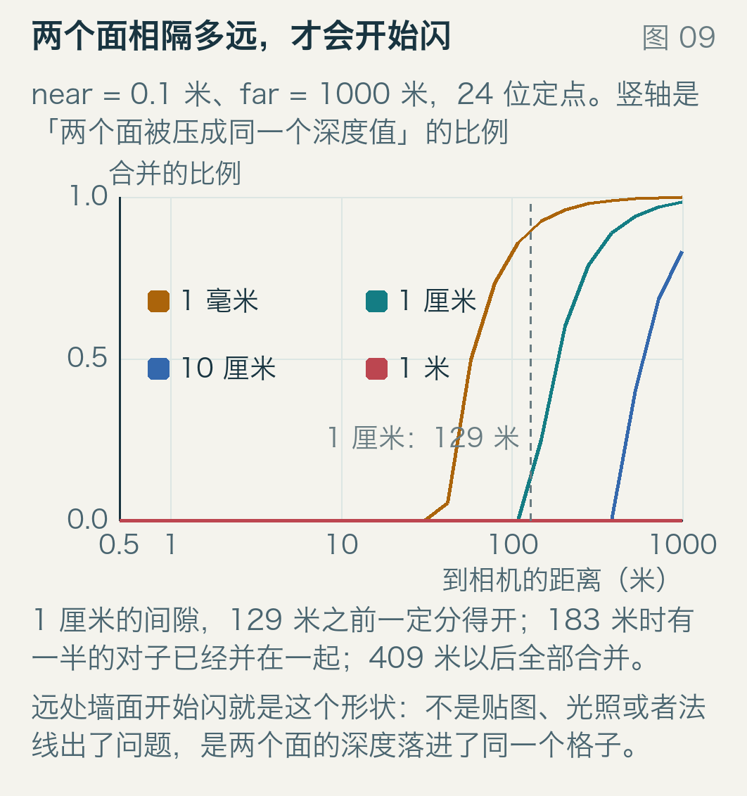

回到开头的墙。两个面差 1 厘米，多远以外就不保险了？

图九画的是「两个面落进同一个深度值」的比例，四条线对应四个间隙。1 厘米那条在 129.5 米之前一直是 0，183 米时到一半，409 米以后是 1——到那里，中间的深度值只剩一个。

129.5 米这个数也能手算：让 `5.96e-7 z² = 0.01`，得 z² ≈ 16778，z ≈ 129.5。

再回头看开头那两堵墙：差 30 厘米，900 米处格距 48.275 厘米，比例是 1 − 0.3/0.48275 = 0.378。同一对墙，整体挪几厘米就能从「合成一个」变成「分得开」，这就是那一刻在画面上表现为闪烁的原因。

那为什么不是 129 米整整齐齐地一刀切？因为「分不分得开」还取决于两个面落在格子的什么位置：间隙比一格窄的时候，恰好跨在格边两侧就分得开，落在同一格中间就合。比例从 0 到 1 缓过去，就是图上那段斜坡。

近平面在这件事上仍然是唯一的旋钮。同样 1 厘米，near = 1 时保证到 409 米，要到 579 米才过半；near = 10 时整段 1000 米都有保证。

## 十、两万个点，66 对

再换个角度看同一件事。在 0.1 到 1000 米之间按对数取两万个点，把相邻的两两拿出来比深度值：

- 24 位定点：66 对被压成同一个值，0 对颠倒
- float32 标准：66 对，0 对
- float32 反转：0 对，0 对

66 对全在最远那一段，第一个出现在 795 米，中位数 927 米。这跟公式对得上：对数取点让相邻两点的间隔随距离线性增长（1000 米处约 0.46 米），而格子宽度按平方增长（900 米处 0.48 米），两条曲线在 800 米附近交叉，交叉之后相邻点就开始合并。

反转映射一对都没合并。两万个点在整个量程里都还分得开。

## 十一、「算完再减 1」会把好处丢掉

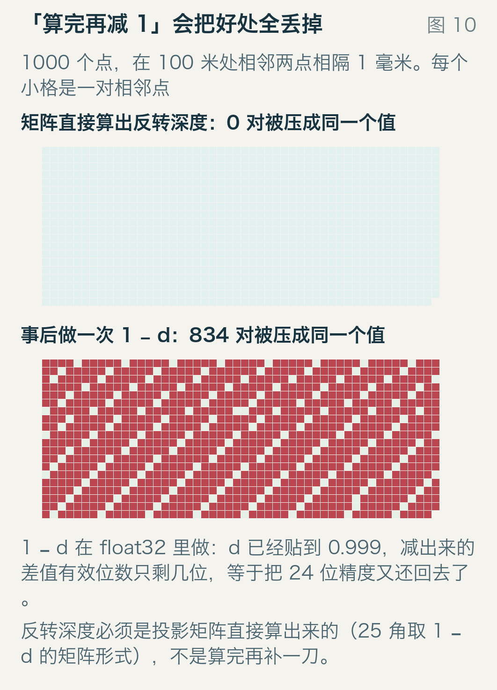

反转深度的公式看起来太简单，容易写成两行：先算标准深度，再减 1。图十是这么干的后果。

场景：相机在原点，100 米处横着一千个点，相邻间隔 1 毫米，远平面 10000 米。矩阵里直接算出的反转深度，一千对相邻点一对都没错。把标准深度算完再做一次 `1 − d`，834 对被压成同一个值——只剩 165 对还站得住。

因为 `1 − d` 是在 float32 里做的：d 已经贴到 0.999，减出来的差值有效位数只剩几位，等于把 24 位精度又还了回去。反转必须写进投影矩阵（把 z 的符号和偏移量一起翻），而不是事后补一刀。

顺手说一句插值。深度在屏幕空间里是 1/z 的线性插值，这是硬件一直在做的事，Reed 的文章引了 Emil Persson 的一份笔记；正因为线性的是 1/z 而不是 z，才有上面这一整套账。

## 十二、相机离原点很远时，还有一个坑

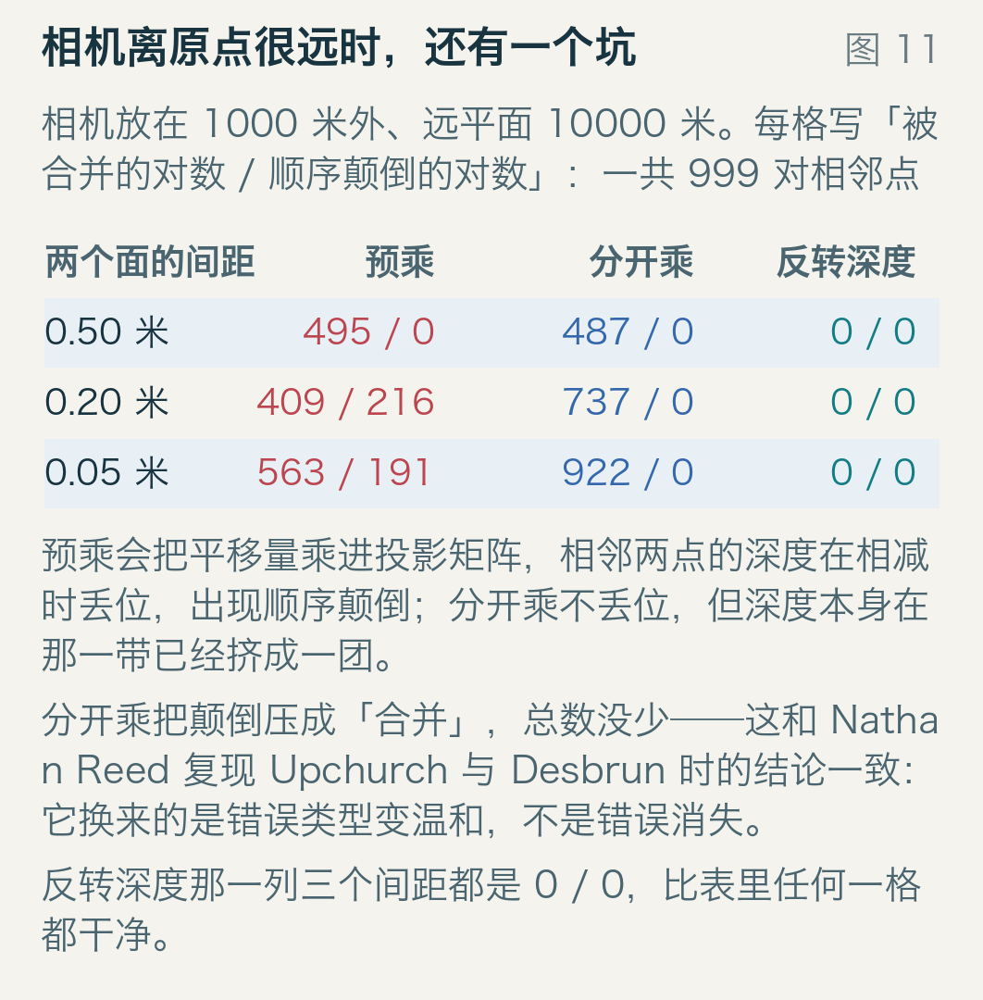

还有一种更隐蔽的写法。为了省一次矩阵乘法，很多引擎把 view 和 projection 预乘成一个矩阵，顶点一次变换就完事。相机离世界原点近的时候看不出毛病；放远了，平移量那一项会吃掉深度里的有效位。

模型里相机放在 1000 米外、远平面 10000 米，999 对相邻点：

| 两个面的间距 | 预乘：合并 / 颠倒 | 分开乘：合并 / 颠倒 | 反转深度 |
| --- | --- | --- | --- |
| 0.50 米 | 495 / 0 | 487 / 0 | 0 / 0 |
| 0.20 米 | 409 / 216 | 737 / 0 | 0 / 0 |
| 0.05 米 | 563 / 191 | 922 / 0 | 0 / 0 |

预乘会把平移量乘进投影矩阵，相邻两点的深度在相减时丢位，出现顺序颠倒——不是并成同一个值，是把前后关系搞反，画面上就是该遮的没遮住。

分开乘不丢位，颠倒清零，可合并从 409 涨到 737：算上颠倒的 216，错的对子从 625 变成 737，还多了 18%。这正是 Reed 复现 Upchurch 与 Desbrun 那条结论时说的话——它不降低错误率，它把颠倒换成合并。

反转深度那三行全是 0 / 0。它连这个问题一起躲过去了——因为远处存的是很小的数，减的时候不丢位。

## 十三、三句话

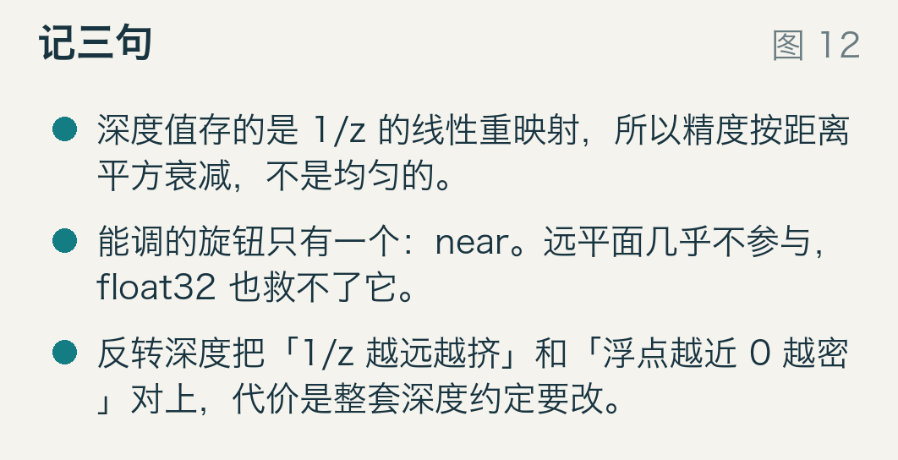

深度值存的是 1/z 的线性重映射，所以精度按距离平方衰减。900 米处一格 48 厘米，比场景里任何贴图细节都粗。

能调的旋钮只有一个：near。远平面几乎不参与（拉到一百万米，500 米处还是 149 毫米），float32 也救不了标准映射——它在远端和 24 位定点逐位相同。

反转深度把「1/z 越远越挤」和「浮点越小越密」对上，代价是整套深度约定要改：投影矩阵、清屏值、比较函数、以及所有默认「深度小就是近」的假设。
