# 多给几个点，为什么反而更歪

1901 年，Carl Runge 在《Zeitschrift für Mathematik und Physik》第 46 卷上给了一个例子（224–243 页）：在 −1 到 1 之间等距离地取点，用穿过这些点的多项式去逼近 1/(1 + 25x²)，加节点并不让误差变小。

这不是数值误差，也不是浮点问题。就算用纸笔、用精确的有理数算，结论一样：11 个等距点插出来的曲线最大偏差 1.92，30 个点 334。函数本身的值始终在 0 到 1 之间。

这篇从一条能笔算的抛物线开始，把「为什么」拆成两个可以分别量出来的因子，再说明节点该往哪儿挪、挪了之后还剩什么没解决。

## 三个点

最简单的版本：只取 x = −1、0、1 三点。

f(−1) = 1/26 ≈ 0.0385，f(0) = 1，f(1) = 1/26。三个点定一条抛物线。设 p(x) = A + Bx + Cx²，对称性让 B = 0，剩下两条方程：A + C = 1/26，A = 1，于是 C = −25/26。

p(x) = 1 − (25/26)x²

在 x = 0.5 处，p 给 1 − (25/26)(0.25) = 0.7596。真值 f(0.5) = 1/7.25 = 0.1379。差 0.62——比真值本身大四倍半。

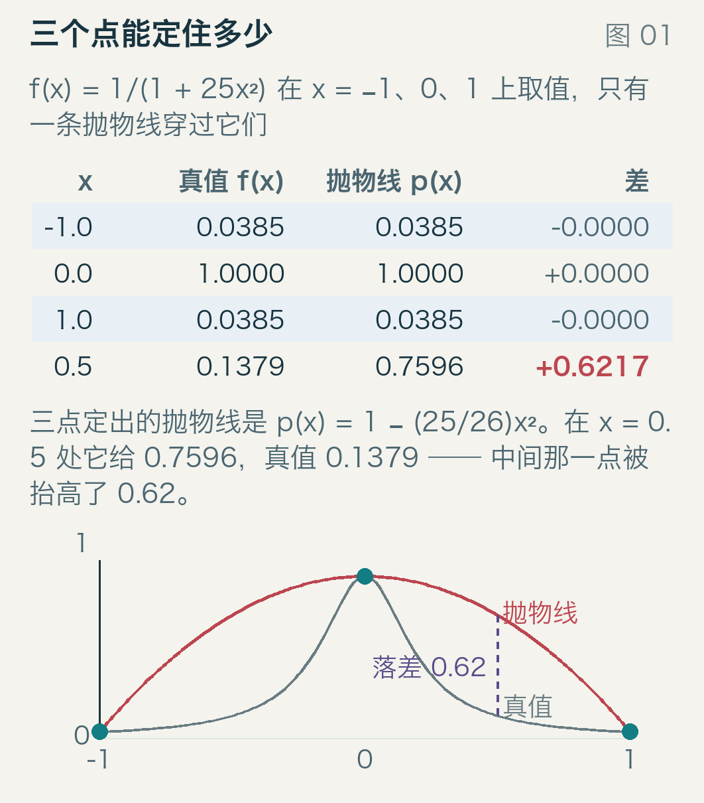

图里上半部分是三个节点和 x = 0.5 这一点的对照表，下半部分是那条抛物线和真实函数。灰虚线是 f，红实线是 p，蓝点是三个节点，紫色竖虚线是 0.5 处的落差。两个端点被钉死了，中间却抬得老高：抛物线的形状跟这条件对不上。

这一步没有任何计算错误。它只是说明，三个点提供的信息太少，而「太少」会以什么方式变坏。

## 十一个点

保持等距，取 11 个点：−1、−0.8、…、0.8、1。跑一遍，最大偏差 1.92，出现在 x = −0.94 附近。

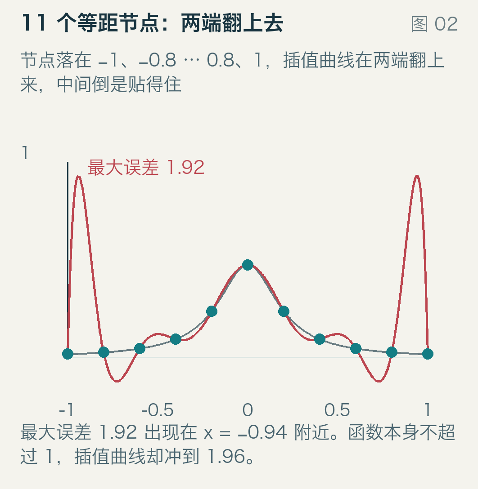

红实线在两端翻了上去，最高 1.96，而函数本身不超过 1。中间那一段，两条线几乎重合——误差不是均匀分布的，它挤在两端。

同一批 11 个点，只把位置换一下：不取等距，取切比雪夫节点（下一节说这是什么）。同一个函数，同一条计算方法：

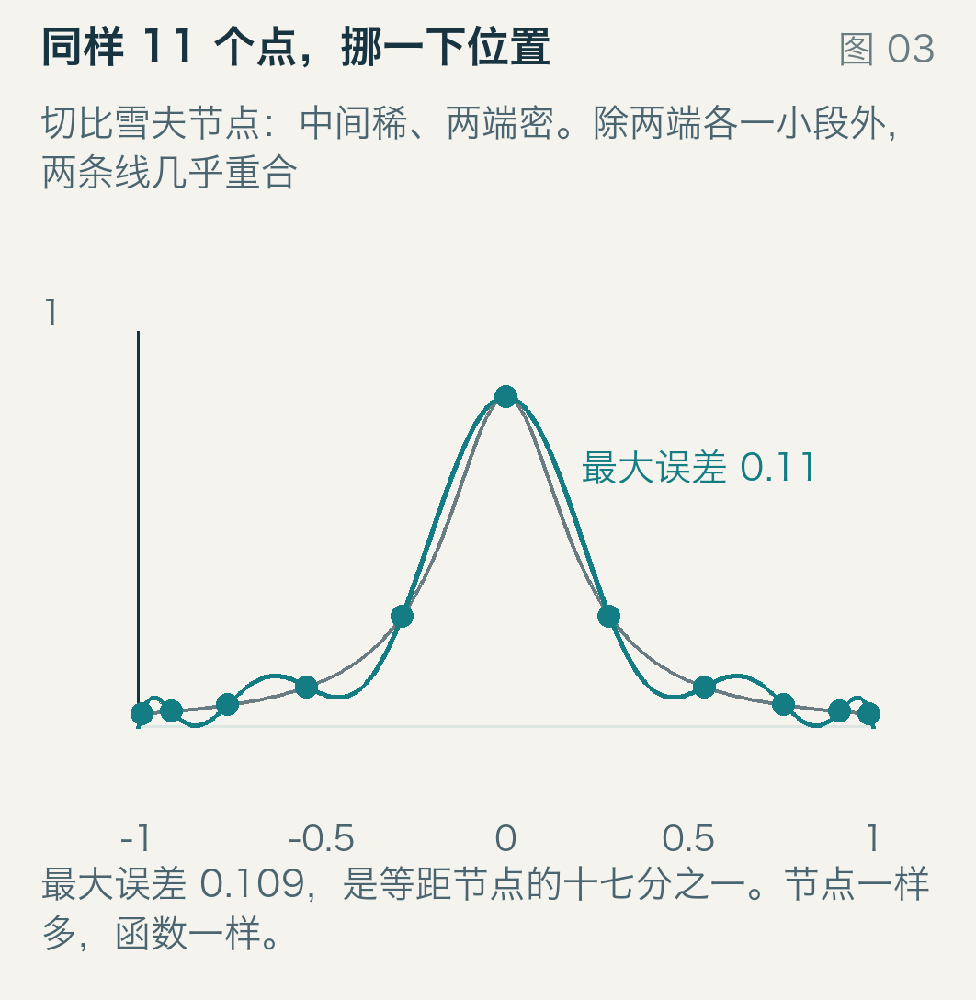

最大偏差 0.109，是刚才的十七分之一。图上两条线只在两端差得出来一点，中段几乎重合。

节点个数一样，函数一样，算的方法一样。差别只在「点在哪儿」。

## 一张表：点越多越歪

把节点数从 2 加到 30，每加一个都量一次最大偏差：

| 节点数 | 3 | 5 | 8 | 11 | 15 | 21 | 25 | 30 |
| --- | --- | --- | --- | --- | --- | --- | --- | --- |
| 等距 | 0.65 | 0.44 | 0.25 | 1.92 | 7.19 | 59.8 | 257 | 334 |
| 切比雪夫 | 0.60 | 0.40 | 0.39 | 0.109 | 0.0466 | 0.0153 | 0.00695 | 0.00516 |

前面几个 n 还在变好，8 个点的时候误差 0.25，看着挺有希望。9 个点开始翻脸，11 个点就坏了，21 个点差 60，30 个点差 334。

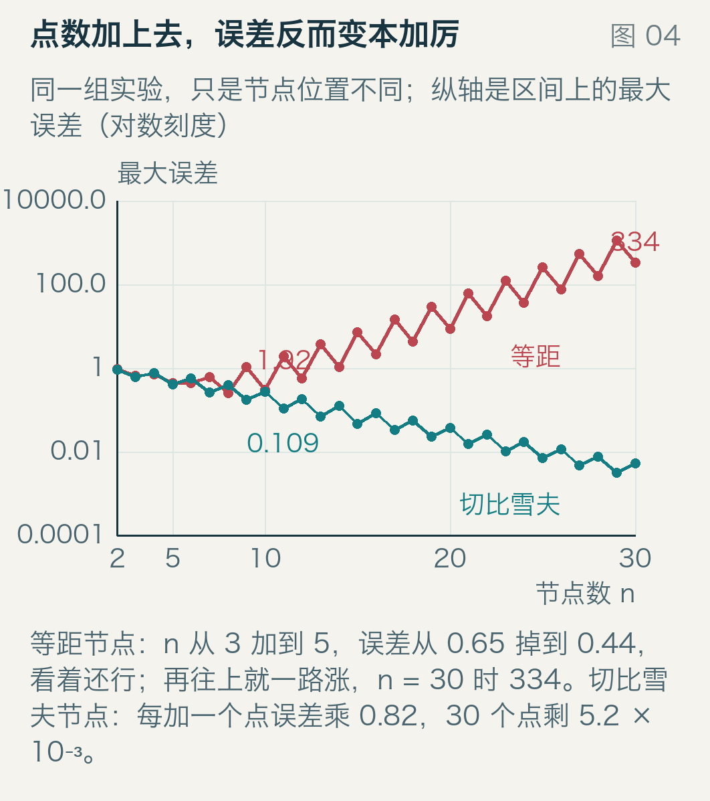

图里横轴是节点数，纵轴是最大误差，对数刻度（每个刻度乘 10）。红线是等距，从 10⁰ 附近一路爬到 10³ 附近；蓝线是切比雪夫，从 10⁰ 附近一路滑到 10⁻³。

红线不是单调的：相邻两个 n 之间会来回跳（n = 29 时 1130，n = 30 时 334）。这种奇偶交替这篇没有深究，但两条包络都在往上走，平均每加一个点误差乘 1.3。

顺带说清楚这里量的是什么：在 −1 到 1 上取 2001 个均匀的点，逐个算 |f(x) − p(x)|，取最大值。不是节点上的误差（节点上恒为 0），是整个区间上的最大偏差。

## 误差的两个因子

插值误差有个标准的不等式：

|f(x) − p(x)| ≤ (1 + λ_n) · E_n

E_n 是「用 n 次多项式去逼近 f，最好能做到多好」。它跟你怎么选点无关，只跟函数本身有关：函数越像多项式，E_n 越小。（下面几张表里的 n 是节点数，对应的多项式次数是 n − 1。）

λ_n 叫 Lebesgue 常数，只跟节点位置有关。它的意思是：如果每个节点上的函数值都被扰动了一个 ε，那插值曲线在区间内最多被放大到 λ_n · ε 倍。误差的「输入」被放大成了「输出」。

两个因子乘起来，才是你看到的误差。E_n 由函数决定，你怎么选点都动不了它；能动的只有 λ_n——等距节点把这个因子推到了最大。

量一遍：

| 节点数 | 3 | 11 | 15 | 21 | 30 |
| --- | --- | --- | --- | --- | --- |
| 等距 λ | 1.25 | 29.9 | 283 | 1.10×10⁴ | 3.45×10⁶ |
| 切比雪夫 λ | 1.67 | 2.49 | 2.69 | 2.90 | 3.13 |

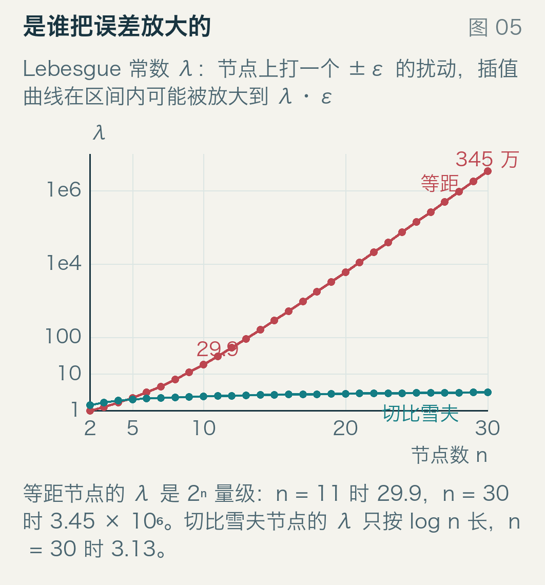

横轴节点数，纵轴 λ，双对数刻度。红线（等距）几乎是竖直往上冲，30 个点时 345 万；蓝线（切比雪夫）几乎是平的，只从 1.67 走到 3.13。

所以「点越多越歪」不是玄学：E_n 确实在变小（那个 30 点的插值曲线，在函数平坦的中段贴得比 3 点时好得多），但 λ_n 变得更快，快到把 E_n 的改善整个吞掉还倒欠。

## 放大倍数长什么样

拉格朗日插值写成 p = Σ f[i] × L[i]，其中 L[i] 是第 i 个基函数：在节点 x[i] 上等于 1，在别的节点上等于 0。于是节点上的一个误差，会乘上 L[i] 在别处的值，散布到整个区间。

对 11 个节点，逐个量 |L[i]| 在区间上的最大值：

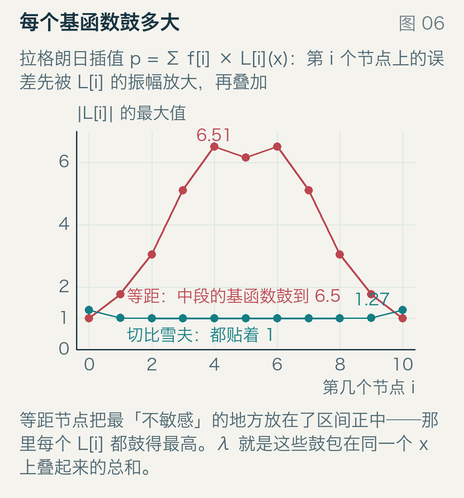

横轴是第几个节点，纵轴是 |L[i]| 的最大值。红线（等距）在中间鼓起一个大包，最高 6.51；蓝线（切比雪夫）平得像一条线，只在两端抬到 1.27。

这就回答了为什么等距节点最坏：它把间距均匀地花在了整个区间上，代价是中间的基函数被拉得很长。那些 L[i] 在别处鼓到 6.5 倍，11 个同号叠在一起时 Σ|L[i]| 就冲到 29.9——这正是 λ 的定义。

切比雪夫节点的基函数全都落在 1 到 1.28 之间，n 加到 40 也只到 1.273（差不多就是 4/π）。单个不涨，涨的是它们的和，所以 λ 只按 log n 慢慢爬。

## 把节点挪到两端

切比雪夫节点的定义是一行：

x[i] = cos((2i + 1)π / (2n))，i = 0, 1, …, n − 1

余弦把等角度的点压到弦上，越靠两端越密。

手算两个：n = 11 时，i = 0 给 cos(π/22) = 0.98982，i = 1 给 cos(3π/22) = 0.90963，相距 0.0802；而中央的两个，cos(9π/22) = 0.28173 和 cos(11π/22) = 0，相距 0.28173。最密的间距是最疏的 3.5 分之一。

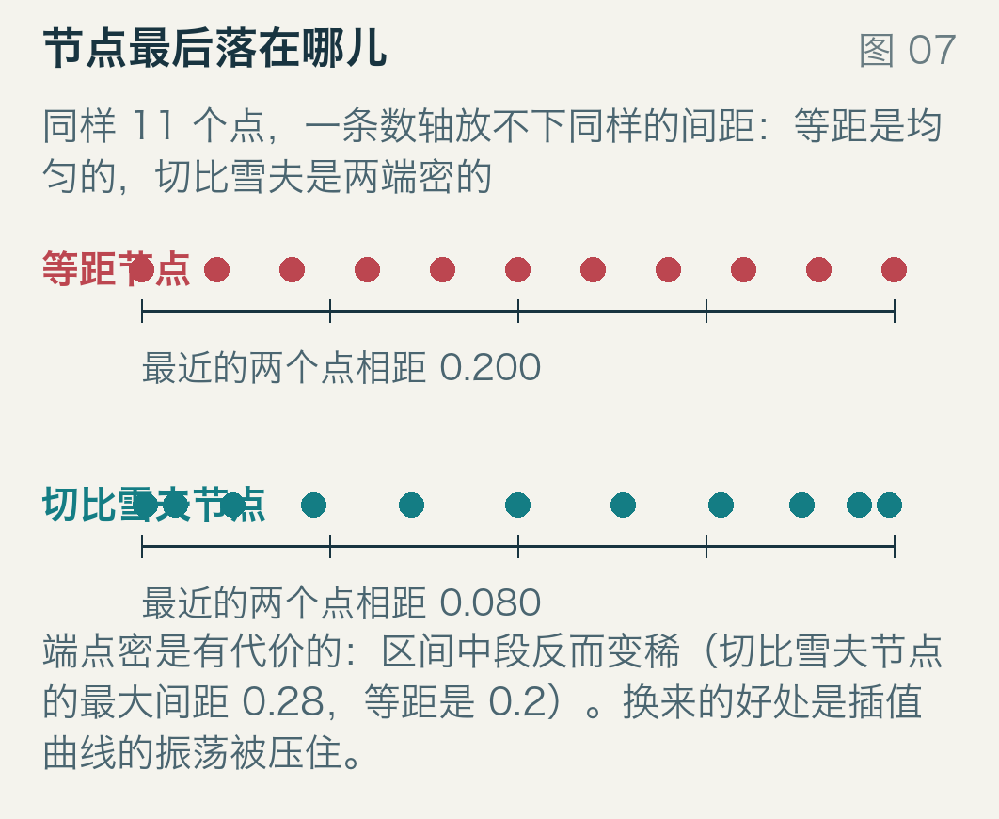

两条数轴，上面一行是 11 个等距节点（均匀的梳齿），下面一行是 11 个切比雪夫节点（两端挤在一起）。点画在数轴上方，短刻度线穿过数轴，每行下面写着最近的两个点相距多远。

代价是清楚的：中段变稀了。如果函数在中段变化剧烈，这份「疏松」会变成一个短板——切比雪夫节点不是万能的，它只是把节点按函数的「难度」重新分配了一下，默认函数在端点附近更难。

把两种节点的误差画在同一张地图上，能看出它们各自把误差扔在哪儿：

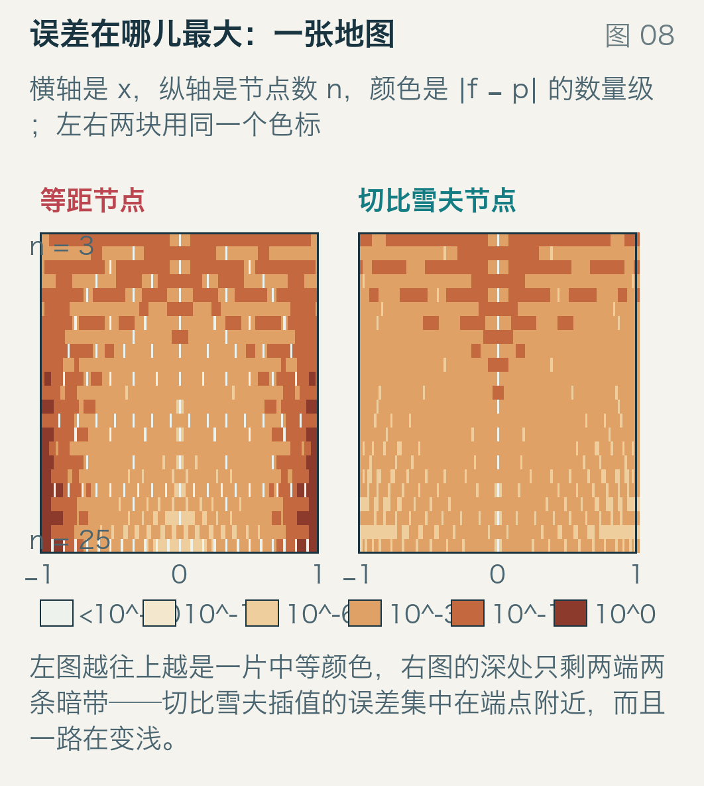

横轴是 x，纵轴是节点数（从 3 到 25），颜色是 |f − p| 的数量级：浅色小，深色大，一共六档，左下角有对应的色块。左边那块（等距）越往上越是一片中间色调，误差摊在整个区间上；右边那块（切比雪夫）的深色只剩两条竖带贴着 ±1，中段一直是浅的，而且越往上的竖带颜色越浅。

## 收敛率由极点决定

换成切比雪夫节点之后，误差稳定地掉，但掉多快？

看三个函数：1/(1 + x²)、1/(1 + 5x²)、1/(1 + 25x²)。它们的区别只在极点的位置：分母为零的地方在 x = ±i、±i/√5、±i/5，复平面上的距离分别是 1、0.447、0.2。

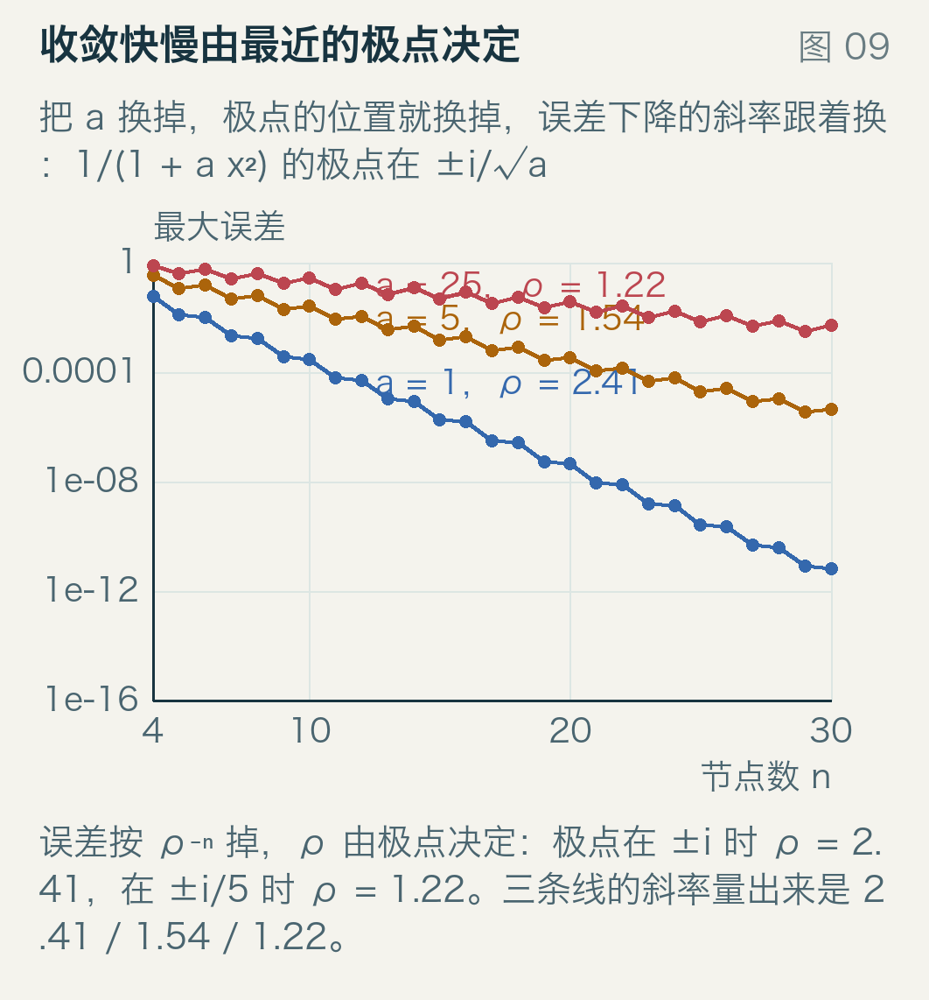

横轴节点数，纵轴最大误差，对数刻度（每个刻度 10 倍差）。三条线在对数图上都是直线——直线就是指数衰减，误差按 ρ⁻ⁿ 掉。把斜率换算回 ρ：a = 1 是 2.41，a = 5 是 1.54，a = 25 是 1.22。

ρ 有个几何意义：把极点画在复平面上，经过它的那个「以 ±1 为焦点的椭圆」决定 ρ。极点离区间越近，椭圆越扁，ρ 越接近 1，误差掉得越慢。极点落在实轴上（ρ = 1）时，这条通路完全断掉。

a = 25 时 ρ = 1.22，也就是每加一个节点误差乘 0.82。这个数不是量出来的巧合：理论值 1.2198，量出来 1.2180，相对差 0.15%。

## 1.22 意味着多少个点

拿实测的 0.82 当乘数往前推：30 个点误差 0.00516，要压到 10⁻⁶ 得把 0.82 自乘到只剩 1/5156，k = ln(5156)/ln(1/0.82) ≈ 43。也就是还要 43 个点，一共 73 个。

作为对照，a = 1 那条件（ρ = 2.41，每个点乘 0.41）只要 17 个点就到 10⁻⁶。

这就是「慢」的精确含义：不是不收敛，是收敛的速率被极点钉死在 1.22。想让 ρ 变大，只能改函数（把区间缩短、或者先做变量替换把奇点推远），改节点改不动它。

## 一个反例：|x|

切比雪夫节点也不是万灵药。看 |x|：它没有极点，但也不是解析函数（在复平面上处处不可导），只是在 0 处有个尖角。

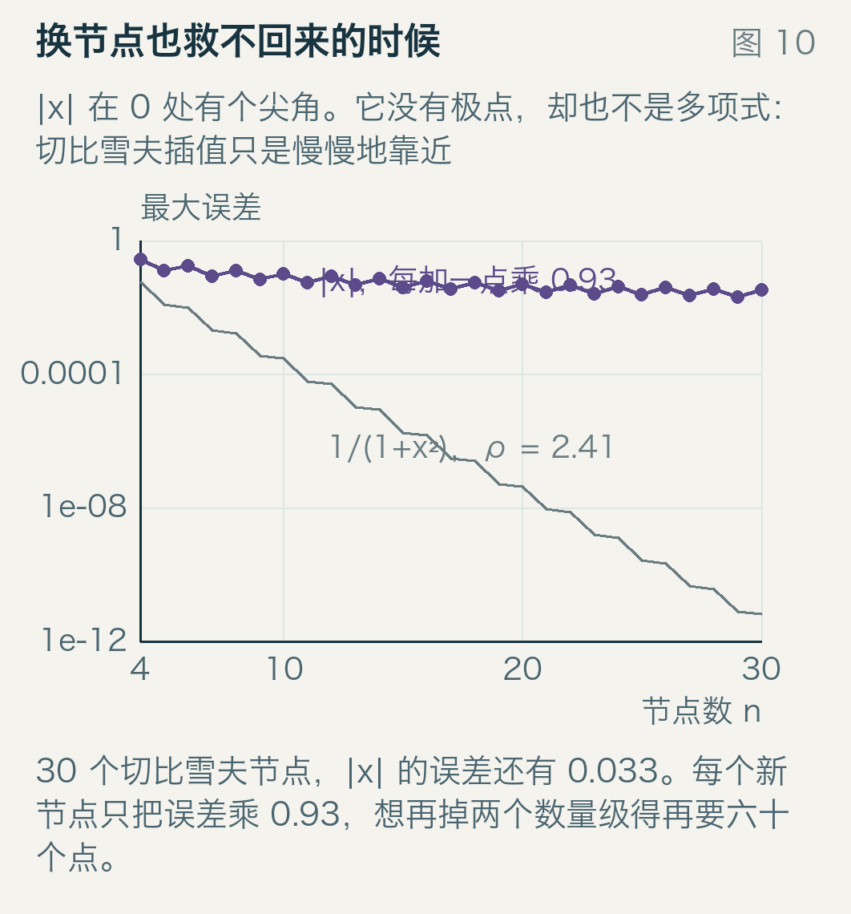

紫线是 |x|，30 个切比雪夫节点的误差还有 0.033，每加一个点只乘 0.93。要再掉两个数量级，得再加六十多个点。灰线是 1/(1 + x²) 作对照，它按 0.41 掉，早就贴到 10⁻¹² 了。

原因在上一节的框架里：E_n 掉得慢。|x| 在 0 附近是折线，任何多项式在那里都不好使——Bernstein 1914 年在《Acta Mathematica》第 37 卷（1–57 页）算的就是这件事，最佳逼近的误差只能按 1/n 掉。λ 再小也没用，乘出来还是 1/n 量级。

再往上一层，有 Faber 的结论（1903 年，《Mathematische Annalen》第 57 卷 389–408 页）：不管你怎么选节点，总存在一个连续函数，插值多项式在它上面不收敛。切比雪夫节点把这块地盘划得很大，但仍然没能划满。

## 这段历史

Runge 1901 年的文章标题是《Über empirische Funktionen und die Interpolation zwischen äquidistanten Ordinaten》——「论经验函数与等距纵坐标之间的插值」。他给的就是 1/(1 + 25x²) 这个例子，而这个名字流传下来的原因是：它推翻了一个当时相当自然的假设，即「采样越密，重建越好」。

几何的那一半——极点、椭圆、ρ——是随后十几年补上的：Faber 1903 年给出不可能定理，Bernstein 1914 年把 |x| 的最佳逼近率算准。「误差按 ρ⁻ⁿ 掉」这条，后来成了逼近论与谱方法的标准结果。

再往后，这套东西成了谱方法的基本功：解微分方程时，人们用切比雪夫节点做配点，正是因为 λ 只按 log n 涨，端点处的聚点能压住边界层。

今天你在 numpy 里调 `Chebyshev.fit`、在频谱分析里看到切比雪夫窗、在有限元里看到 Gauss–Lobatto 节点，用的都是同一个道理：把点放到难的地方去。

## 三句话

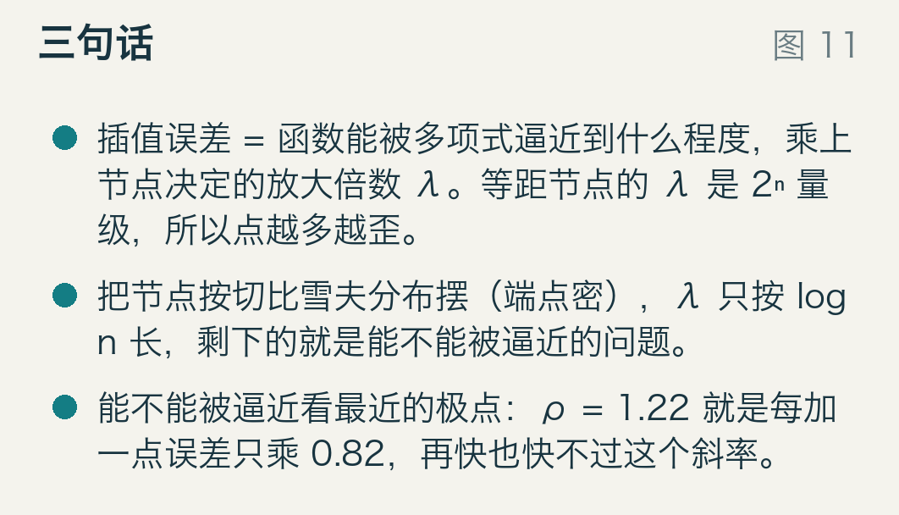

插值误差 = 函数能被多项式逼近到什么程度，乘上节点决定的放大倍数。等距节点的放大倍数是 2ⁿ 量级，所以点越多越歪。

把节点按切比雪夫分布摆（端点密、中间疏），放大倍数只按 log n 长，剩下的就只是函数本身好不好逼近。

好不好逼近看最近的极点：ρ = 1.22 就是每加一个点误差只乘 0.82，上限在那儿，再多节点也快不过这个斜率。

---

全部数字来自 `examples/` 下的两个脚本：`run_model.py` 生成 `results.json`（276 138 字节），`build_figures.py` 只读它、不重算。双精度、无随机数，重跑两次逐字节相同。
