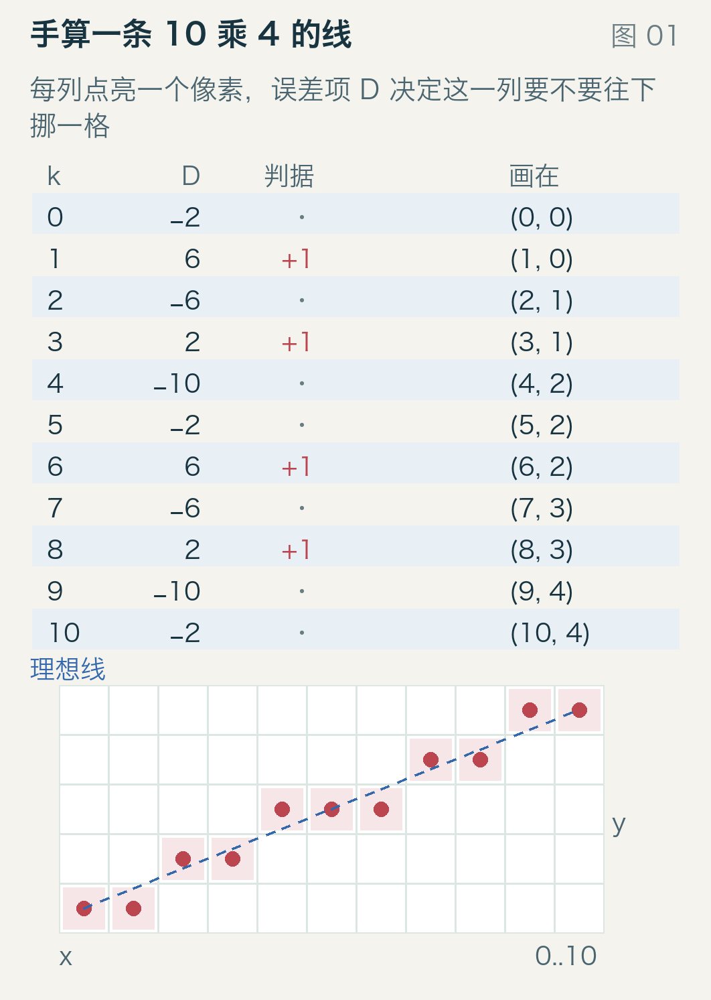
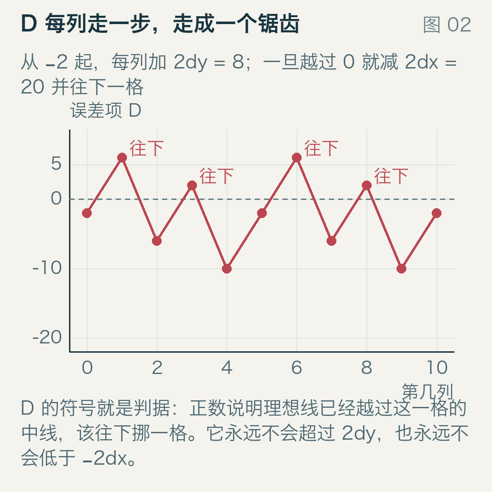
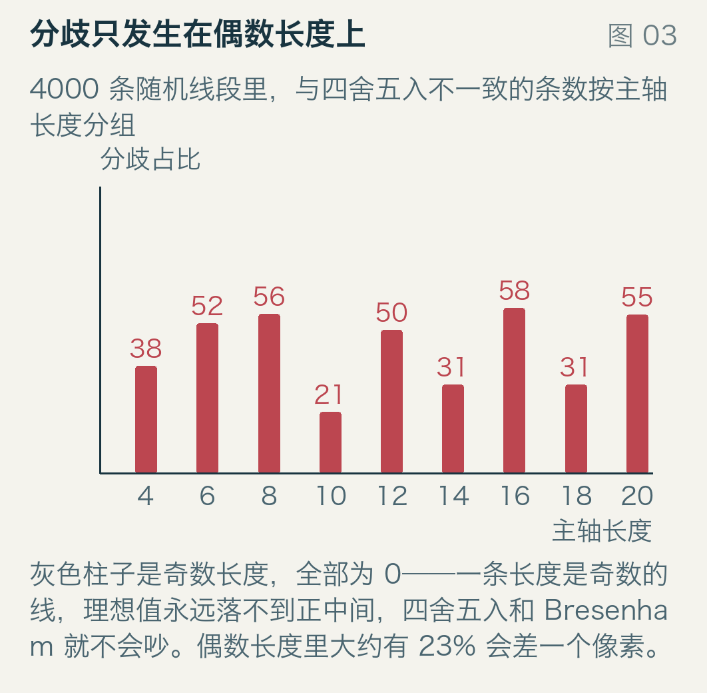
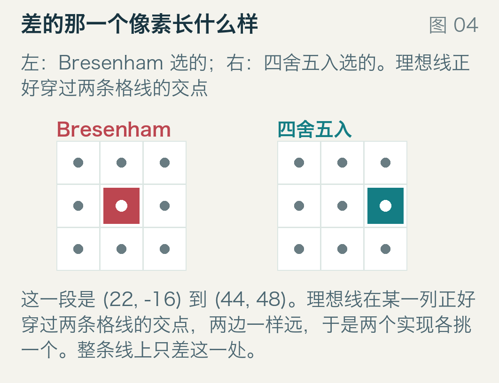
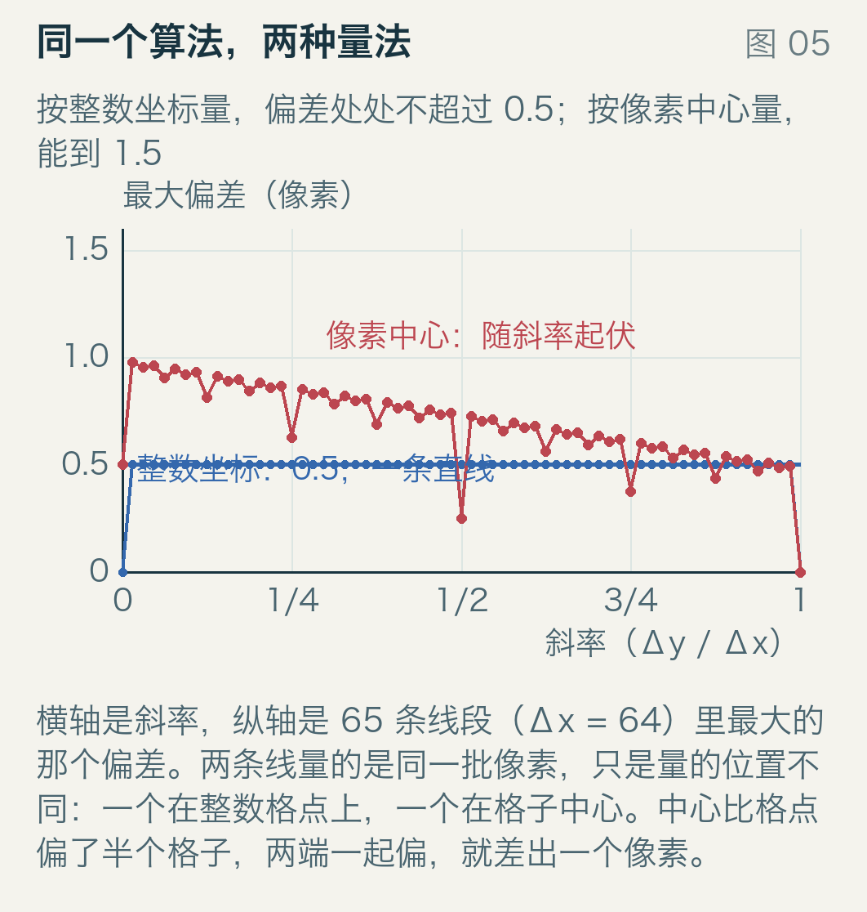
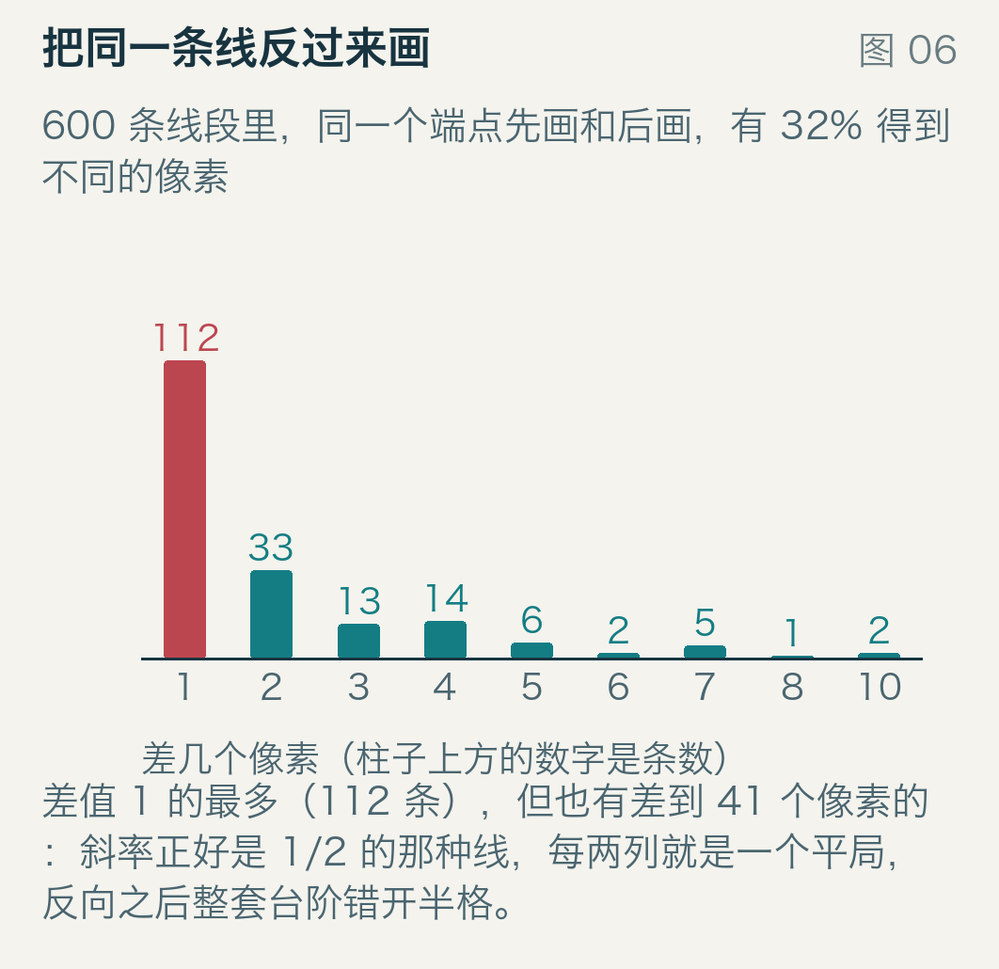
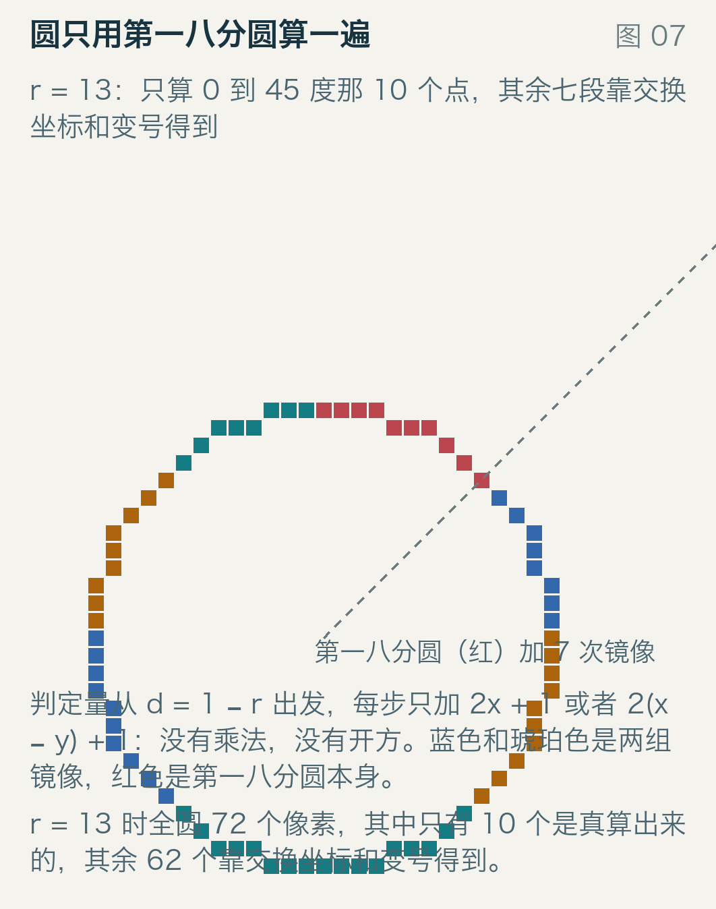
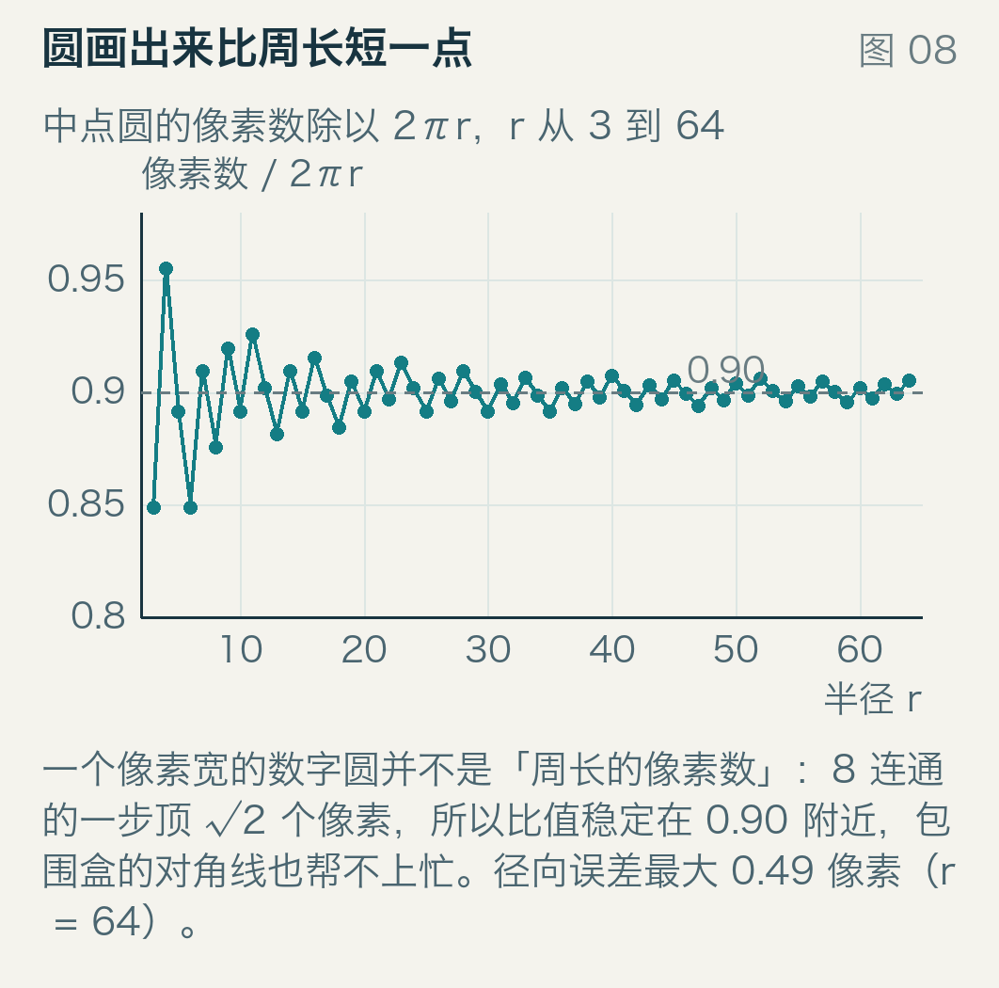
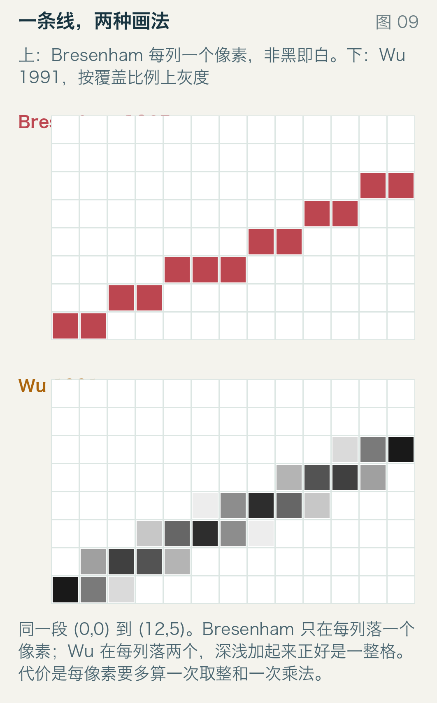
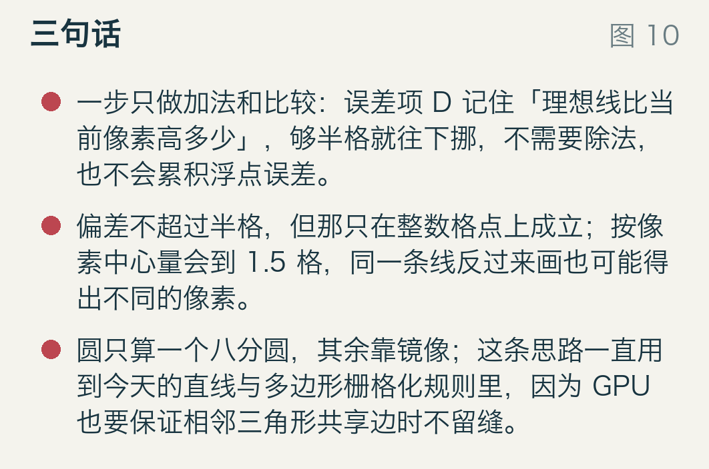

# 一条斜线里，半个像素算谁的

一块屏幕上画一条斜线，每一列都得做一个选择：这一列点亮哪一行。绝大多数列没有争议，离理想高度最近的那一行就是答案。

但有一种情形有争议：理想高度正好落在半整数上，0.5、1.5、2.5。两边一样近。这不是罕见角落：只要线段的长度是偶数、斜率又合适，就会出现，而且会出现很多次。

这篇只问一件事：这些「一样近」的地方，后来怎么变成了工程问题。它有三个可以量出来的后果——同一个算法按两种方式量偏差，数字能差三倍；同一条线把两个端点换个顺序画，会得到不同的像素；两台机器拼出来的图形要无缝衔接，就得给平局定一条谁也不能违反的归属规则。

## 1962 年的账本

这套画法的出身有点绕。Bresenham 1965 年在《IBM Systems Journal》第 4 卷第 1 期发了六页的论文，第 25 到 30 页，但按他本人在 2001 年的一次回忆，方法 1962 年夏天就已经在 IBM 圣何塞的计算实验室里投产了：一台 CalComp 绘图仪挂在 IBM 1401 上，中间经过 1407 打字机控制台。他还说，1963 年在丹佛的 ACM 年会上讲过这个画线例程，那年不发论文集、只发议程，之后《IBM Systems Journal》的编辑听了报告来约稿，才有了 1965 年那篇。这段回忆的原文收在 NIST 的算法条目里，见 `sources.md`。

方法本身很短：把除法搬出循环，只留一个整数误差项，每列做一次加法、一次比较。这套推导库里已经有一篇讲透了，标题是[画一条直线，为什么只要加减法？](../2026-10-11-bresenham-error-ledger/read.md)，这里不重复，只留一张手算表，因为后面每个数字都要拿它当锚。

从 `(0, 0)` 画到 `(10, 4)`：`Δx = 10`，`Δy = 4`。误差项初值 `D = 2Δy − Δx = −2`，每列加 `2Δy = 8`，一旦 `D` 大于 0 就把行号加一、从 `D` 里减掉 `2Δx = 20`。

| 第几列 | 0 | 1 | 2 | 3 | 4 | 5 | 6 | 7 | 8 | 9 | 10 |
| --- | --- | --- | --- | --- | --- | --- | --- | --- | --- | --- | --- |
| D | −2 | 6 | −6 | 2 | −10 | −2 | 6 | −6 | 2 | −10 | −2 |
| 点亮 | 0 | 0 | 1 | 1 | 2 | 2 | 2 | 3 | 3 | 4 | 4 |

11 个像素。理想高度是 `0、0.4、0.8、1.2、1.6、2.0、2.4、2.8、3.2、3.6、4.0`，每个像素离它不超过半格。`D` 的取值每五列重复一次，因为 5 列正好走 2 格，`5 × 2Δy = 2 × 2Δx`；画出来是一个锯齿。

这张表可以写成一句更清楚的话：走到第 k 列时，`D_k = 2Δx × [理想(k+1) − (y_k + 0.5)]`。代第 1 列：`2 × 10 × (0.8 − 0.5) = 6`，和表里一致。所以「D 大于 0」的真正意思是「直线在下一列越过了这一格的中线」，符号是真信息，大小是副产品。而中线，就是平局会出现的地方。

## 平局从哪儿来

理想高度是 k·Δy/Δx。它落在半整数上要求 2·Δy·k ≡ Δx 对 2Δx 取模，而左边永远是偶数。所以 Δx 是奇数时无解：奇数长度的线段，理想高度永远落不到正中间，Bresenham 和四舍五入永远吵不起来。Δx 是偶数时可能无解也可能有解，取决于 Δy，落进平局的那些列，两个实现各按各的偏好走。

用 `4000` 条随机线段，端点坐标取 −48 到 48，种子 `20270329`，把这两种实现放在一起比：和四舍五入给出不同像素的有 `934` 条，占 `23.35%`，差异位置一共 `1851` 个。一条线通常差两处，一个该走的没走，下一个不该走的走了。

分歧的分布比比例更有意思：934 条全部落在主轴长度为偶数的线段上，奇数长度一条都没有。4000 条里主轴为偶数的有 `2002` 条，其中 `934` 条不同，占 `46.65%`。所以准确的说法是「只有偶数才可能差」，而且差不多一半会差。

最短的例子可以在纸上画完：从 `(0, 0)` 到 `(4, 2)`，理想高度是 `0、0.5、1、1.5、2`，中间两个半整数。Bresenham 点亮 `0、0、1、1、2`，四舍五入点亮 `0、0、1、2、2`：理想高度 1.5 的第 3 列两边分道，Bresenham 留在 1，四舍五入上到 2。整条线五个像素，差一处。

这里的「四舍五入」是 Python 的 `round`，平局取偶：0.5 回 0，1.5 上 2。换成「一律进位」也差，只是差的位置变成前两个平局，差两处。

934 条里的每一个差异像素，理想高度都恰好是 x.5：两者一样近，这才是它们不同的原因。

图上是一个真实的分歧点：从 (22, −16) 画到 (44, 48)，蓝虚线是理想线，灰圈是格子中心。它在一处正好穿过两条格线的交点，左边 Bresenham 选了下面那个，右边四舍五入选了旁边那个，整条线只差这一处。所以这两个算法不是「一个对一个错」，在平局上它们各有偏好，而偏好会一路传下去。

## 平局值多少：两种量法

说「偏差不超过半格」是对的，但得说清在哪儿量。如果量的是像素中心，也就是看图时眼睛所在的位置，同一个算法能报到 1.49 像素。

横轴是斜率，纵轴是 65 条线段里最大的偏差，这 65 条取 `Δx = 64`、`Δy` 从 0 到 64。蓝线是「整数格点」度量，从头到尾是 0.5 的水平线；红线是「像素中心」度量，在 `0.25` 和 `0.98` 之间起伏。

不是程序错，是两次半个格子叠在一起：像素中心在 x + 0.5、y + 0.5 处，比整数坐标偏半格；理想线在中心处又比在格点处多半格，那半格还要乘上斜率。两者同向时，多出将近一格。

4000 条随机线段里出现过 1.49，是 (21, −41) 到 (−44, 25)。手工验：走到 y = −8 这一行，直线在那里的 x 正好是 −11.5，正落在两个像素中间，是个平局。程序选了 x = −11，按整数格点算差 0.5，合规；但这一格的中心在 (−10.5, −7.5)，直线在 y = −7.5 处的 x 是 −11.99，与中心差了 1.49 = 0.5 + 0.5 + 0.5 × (65/66)。

真正要紧的不是 1.49 有多大，是「不超过半格」这句话不说清在哪儿量，就没法核对。同一批像素，两个都对的数字，差了三倍。

## 反过来画

平局的偏好还有一个更直接的后果：把起点和终点换一下，再画一遍。`600` 条线段里只有 `405` 条给出完全相同的像素，占 `67.5%`；剩下 `195` 条不同：差 1 个的 `112` 条，差 2 个的 `33` 条，最差一条差了 `41` 个。

差 41 个的是从 `(39, 1)` 到 `(−43, 42)`，斜率正好是 `1/2`。这种线每两列就有一个平局，正向画成「走、不走、走、不走」，反向画成「不走、走、不走、走」，整套台阶错开半格，于是每隔一列就有一个像素对不上。斜率为 2 的陡线同理，只是错在行上。

这件事在今天的显卡上不是学术问题。GPU 画三角形也有一条类似的判定：落在三角形边上的像素算谁的，必须有统一约定，否则相邻两个三角形共享的那条边要么画两遍、要么留一条缝。

微软的 Direct3D 文档把这叫左上规则，英文是 top-left rule，原话是「这条规则保证相邻三角形被画且只被画一次」；Vulkan 规范里的对应说法叫 diamond-exit rule。它们都不是 Bresenham，真正的 GPU 用定点数加更复杂的覆盖判定，但底下的焦虑和 1962 年一样：整数格点上，落在边界上的点必须有个确定的归属。

## 圆也有平局

1977 年，Bresenham 在《Communications of the ACM》上又写了一篇，画圆弧。圆心在原点、半径 r，只算从正上方到 45 度那一小段：判定量从 d = 1 − r 出发，每步 x 加 1，然后看 d 的符号——d 小于 0 就留在这一行，d 加上 2x + 1；否则 y 减 1，d 加上 2(x − y) + 1。全是加法。

`r = 13` 时这一小段只有 `10` 个点，就是图上标红的那几个，全圆 `72` 个像素，靠交换 x、y 和变号补出其余 `62` 个。蓝色和琥珀色是两组镜像，它们和红色那一段拼起来才是整圆。圆上的平局在 `d = 0` 这一格：两个候选像素到圆弧的距离一样，这里没有「哪个更好」的依据，只能约定一个，比如 d 取 0 时往外走。`r = 64` 时径向误差最大 `0.49`，还是「不超过半格」。

还有个容易误解的地方：72 个像素除以 2πr = 81.68 得 0.88，不是 1。把 r 从 3 扫到 64，这个比值在 0.85 到 0.95 之间抖，到 r = 64 稳定在 0.91 附近。原因是一像素宽的 8 连通曲线每一步可以斜着走，斜走一步顶 √2 个像素长度，所以总像素数比弧长短。

## 把平局变成灰度

如果目标是「看起来不像台阶」而不是一条打点命令，那平局就不该被裁决，而该被摊开。

上半个图是 Bresenham：每列一个像素，非黑即白，斜线的台阶看得见。下半个图是 Xiaolin Wu 1991 年在 SIGGRAPH 上给的做法：每列点亮两个相邻像素，深浅按覆盖比例分配，两格的灰度加起来正好是一整格。同一段 (0,0) 到 (12,5)，Wu 用到 26 个像素、12 个不同的灰度层。代价是每像素多一次取整、一次乘法，而且要能画灰度。两个都是「对」的线，选哪个取决于你要的是打点命令还是好看的照片。

## 要不要在意

如果你调的是 `drawLine()` 或者 GPU 的三角形填充，这些都用不上：接口已经替你定好了规则，你只要不假设「两个方向画出来一样」。如果要自己写——软件光栅化、把几何导出成点阵、给点阵字体或像素画生成轮廓、做碰撞网格的边界——那就得把两件事一起定下来：判据用 `d > 0` 还是 `d >= 0`，这等于问平局往哪边倒；端点顺序要不要归一，比如永远从左往右画。

不定这两条，同一条边在两个模块里可能差一个像素；如果这两个模块还要对接，那一个像素的缝或者重影就会出现。代价不大：判据多写一次比较，端点顺序多一次交换，比事后找「为什么这条缝只在某些角度出现」便宜得多。

## 三句话

平局不是数值误差，是两个像素真的一样近；它只在长度为偶数的线段上出现，而且一出现就会一路传下去。

同一个算法按整数格点量偏差不超过 0.5，按像素中心量能到 1.5；同一条线反过来画，三分之一的线段会变。这就是为什么图形接口的规范不写「用 Bresenham」，而写平局的归属规则。

想让线好看，就别裁决平局：Wu 的做法是把覆盖比例摊成灰度；想让线确定，就把平局规则写死，圆也一样。

