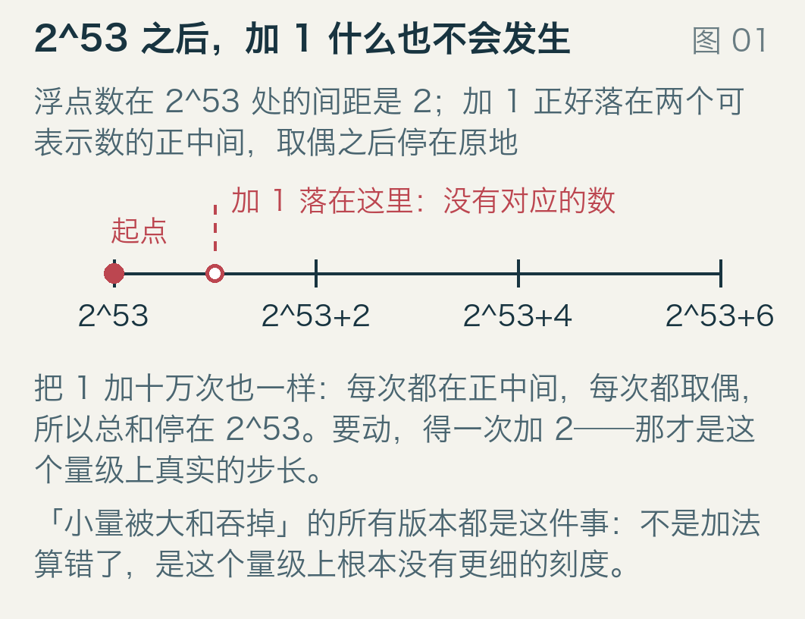
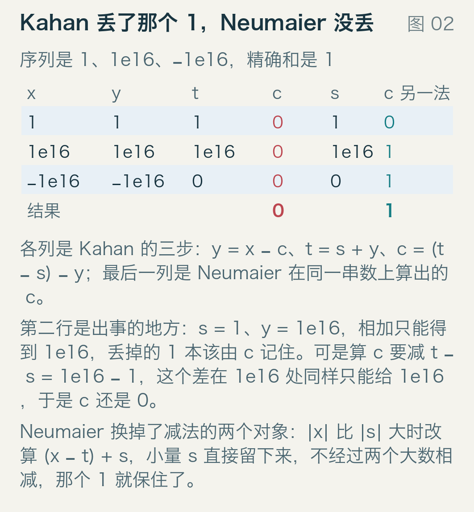
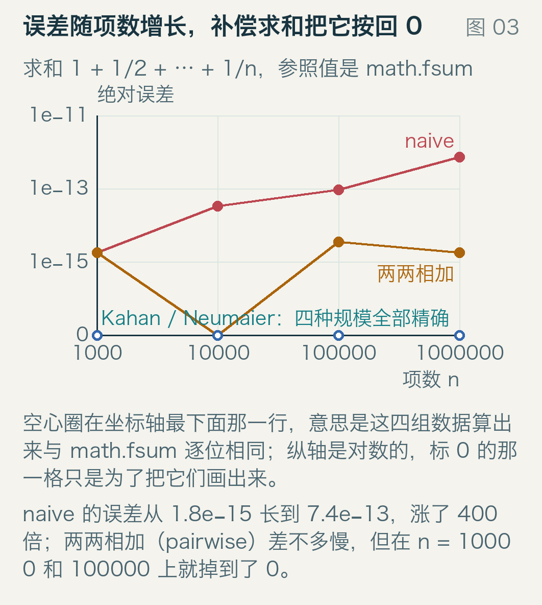
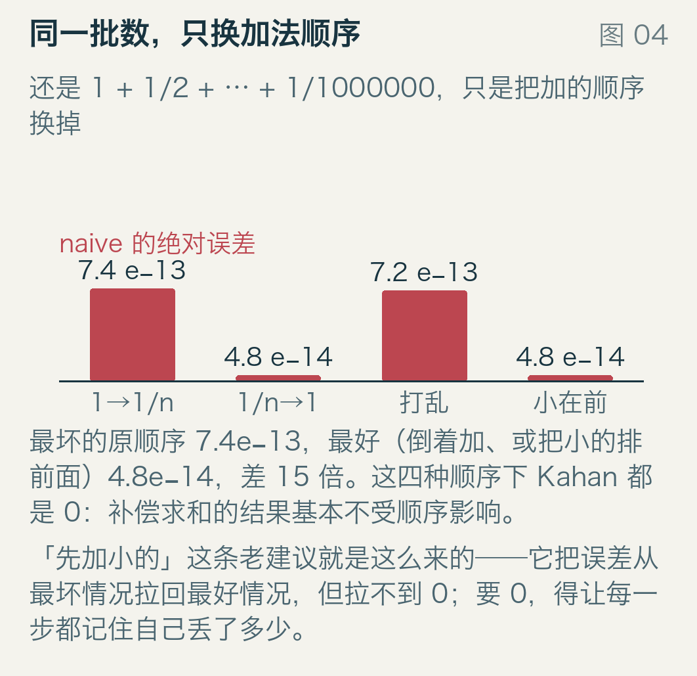
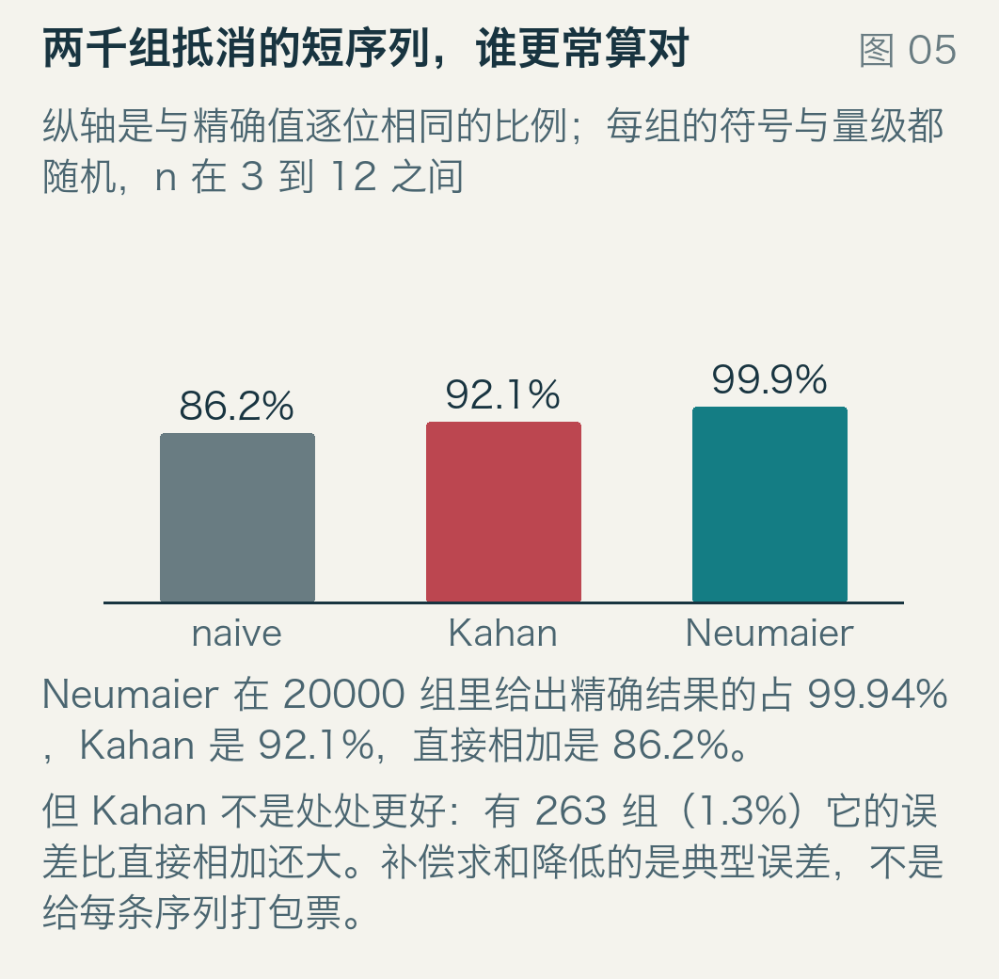
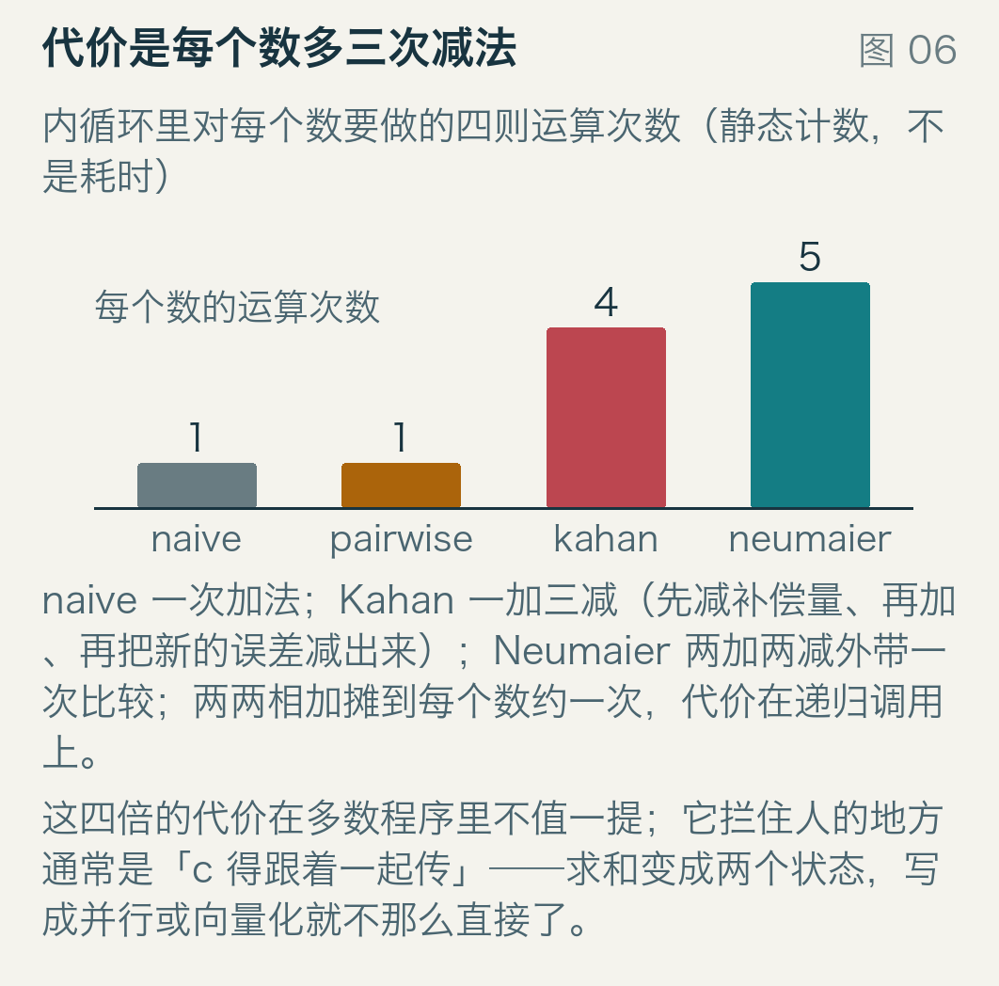
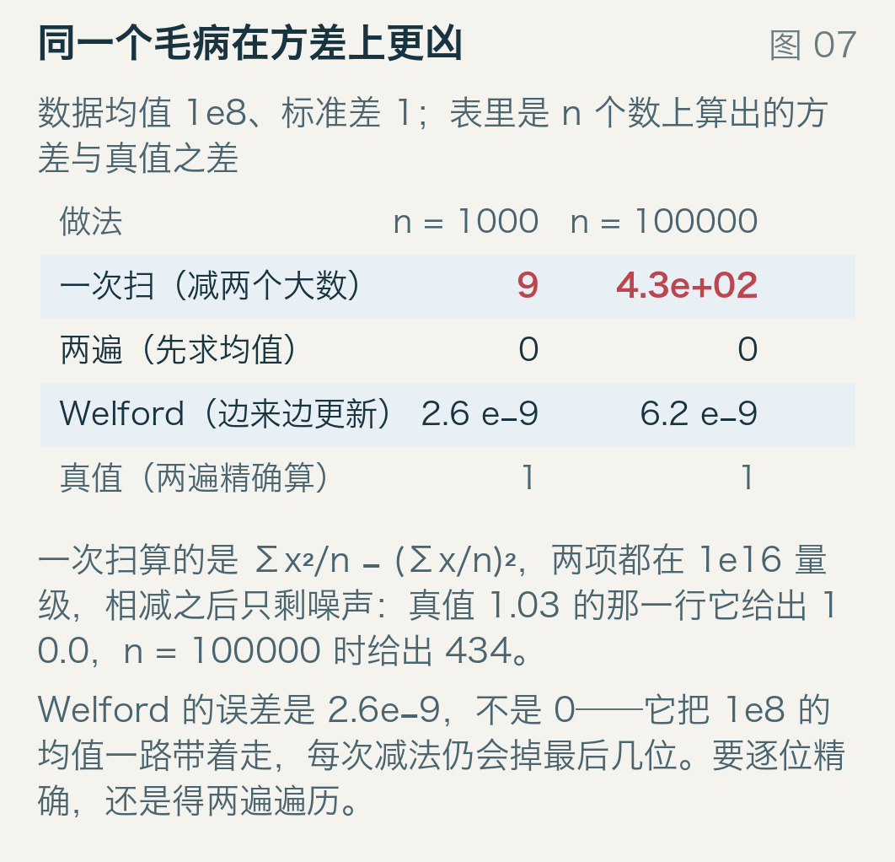
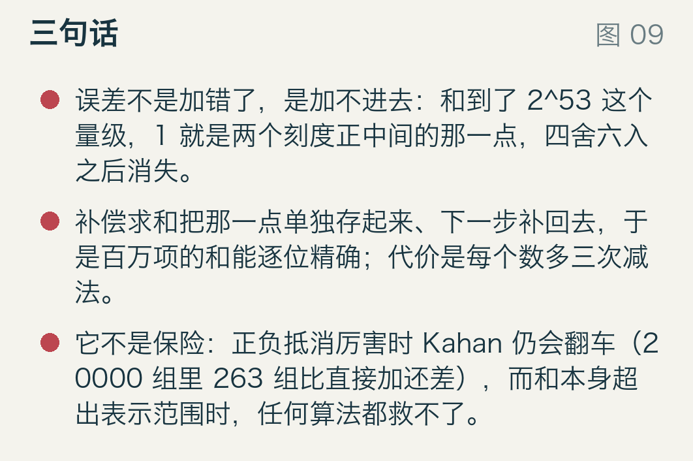

# 一亿次加法之后，和少了多少

```python
s = 0.0
for x in data:
    s += x
```

这段代码几乎不可能写错。变量名没错、循环没错、初始化没错，测试里也对得上。它唯一的问题是把一亿个数加在一起时，答案可能比精确值少一大块，而屏幕上不会出现任何提示。

这不是「浮点数不精确」这种笼统的说法。它是具体的：当累加到的和已经很大，再加进来的数如果太小，那个数会整块消失——不是变小，是消失。下面先用两个能心算的例子把这件事钉死，再看 Kahan 在 1965 年给出的补法、Neumaier 在 1974 年补的那个漏洞，以及它仍然救不了的情形。

实验中所有数字都由 `examples/run_model.py` 算出（Python 3、float64、随机数种子 20270405），参照值是 `math.fsum`——它做的是精确求和再舍入一次，可以当「正确答案」。源码在 `examples/kahan.py`，每个函数都是十行以内的直接实现。

## 先手算一件事：2^53 上加 1

双精度浮点数有 53 位有效数字。这句话的硬后果是：到了 2^53 = 9007199254740992 这个量级，相邻两个可表示的数之间隔了 2。

于是 `float(2**53) + 1.0` 落在两个可表示数的正中间。IEEE 754 的规则是「恰好一半时取偶数」，正中间那个结果就停在原地：

```
>>> float(2**53) + 1.0 == float(2**53)
True
```

从 2^53 起连续加十次 1.0，和一动不动；加 2 才前进一步。图 1 把刻度画出来了：横轴上是这个量级上真实存在的数，每隔 2 一个，红色的点表示「加 1 会落在这里」——那里没有对应的数。



看图上从「起点」往右：最近的刻度是 2^53+2，而加 1 的位置正好在 2^53 和 2^53+2 的中间，红色虚线所指。取偶之后回到 2^53。

这件事和算法无关，和精度位数有关。它也解释了一个常见错觉：很多程序里「加进去没反应」不是 bug，是那个量级上根本没有更细的格子。

## 一个 3 项的例子，看清补偿的边界

考虑下面三个数：

```
1,  1e16,  -1e16
```

精确和是 1。直接相加是 0：先 1 + 1e16 = 1e16（那个 1 就是上面那颗被吞掉的沙），再减 1e16 得 0。

这里的 1e16 比 2^53 高一成，ulp 同样是 2——踩的是同一个台阶，只是这回被吞的不是「加 1」，而是「先有一个 1，再来一个 1e16」。

Kahan 的办法是「记住这一次丢了什么」。标准形式是四行：

```python
y = x - c        # 先把上次欠的补上
t = s + y        # 相加
c = (t - s) - y  # 这一次丢了什么
s = t
```

对这三步逐个记账，图 2 是全部中间量。看第二行：s = 1、y = 1e16，相加只能得到 1e16，丢掉的 1 本该由 c 记住。可是算 c 要减 `t - s = 1e16 - 1`，而这个差在 1e16 处同样只能给 1e16——于是 c 还是 0，那个 1 在两处都掉了。最终 Kahan 也返回 0，和直接相加一样。



同一张图最后一列是 Neumaier 的做法。它的分支条件是「如果 |x| 比 |s| 大」：这时不去算 `t - s`（两个大数相减），而是算 `(x - t) + s`，让小量 s 直接留下来。第二行里 `(1e16 - 1e16) + 1 = 1`，c 保住了那个 1。第三行加上 −1e16 之后，它返回 s + c = 1，和精确值相同。

所以 Kahan 的补偿量本身也有它的适用条件：它假定当前的累加和 s 不比新来的 x 小太多。这个假定在「先来小数、后来大数」时刚好被打破。Neumaier 1974 年的那篇短文修的正是这一处。

为什么 `c = (t - s) - y` 就能拿到「这一次丢了什么」？在 |s| ≥ |y| 的前提下，`t - s` 是精确的（两个相近的数相减不会二次舍入），于是这个式子恰好等于本次加法舍入误差的相反数——记成负值，下一步 `y = x - c` 就把它加回去。这个两行小技巧在数值分析里叫 Fast2Sum，是 Dekker、Knuth 那一路的基本积木。条件反过来——|y| > |s|——`t - s` 就不再精确，补偿量自己开始掉位，这就是前面那个 3 项例子的失败机理。

## 一页纸和一篇修订

Kahan 的原文是 1965 年 1 月《Communications of the ACM》第 8 卷第 1 期第 40 页的一则短文，标题直译是「关于减少截断误差的进一步意见」，全文一页。它给出的是算法本身和一段说明，不是误差界——通行的说法是：这样能把和的误差压到与项数无关的量级（正式分析留给后来的人）。

Neumaier 的版本长这样：

```python
t = s + x
if abs(s) >= abs(x):
    c += (s - t) + x
else:
    c += (x - t) + s
s = t
```

最后返回 `s + c`，不是只返回 `s`。两个分支的差别就在于用哪一对数去减：|s| 大时减 `s - t`，|x| 大时减 `x - t`，总让大的那个当被减数，小量从另一边补上。

Neumaier 的修订发表在 1974 年《ZAMM》第 54 卷第 1 期第 39–51 页，标题是德文的《有限和若干求和方法的舍入误差分析》——从标题就能看出它做的是分析，不是提新算法。今天通行的 Neumaier 变体就是从这类分析里长出来的：把上面那个分支的条件补全，并在最后把 c 加回结果。

这两个版本在今天的数值库里都还在用：`numpy.sum` 用的是两两相加，`math.fsum` 走 Shewchuk 1997 年那套无损变换，Kahan/Neumaier 的形式常见于流式统计、GPU 归约和嵌入式累加器——那些地方不能两遍遍历，也存不下所有数。

## 百万项：误差怎么长大

第一个实验是调和级数 1 + 1/2 + … + 1/n，全是正数，没有抵消，项数从一千到一百万。图 3 的纵轴是绝对误差，对数刻度，每一格差一百倍。



四条曲线里，红色（直接相加）从 n = 1000 的 1.8e−15 一路涨到 n = 1000000 的 7.4e−13，涨了约 400 倍。琥珀色（两两相加，pairwise）在 n = 1000 时和直接相加差不多，但到 n = 10000 和 n = 100000 时误差是 0，n = 1000000 时 1.8e−15。

Kahan 和 Neumaier（空心圈，画在纵轴最下面标 0 的那一行——对数轴画不出 0，那一行只是为了让它们可见）在四个规模上都与 `math.fsum` 逐位相同。

这里只说我测到的：误差随项数增长，两两相加把它压到接近 0，补偿求和在这批数据上是 0。误差界的标准推导（部分和的量级乘以机器精度，再乘一个随项数缓慢增长的因子）写在 Higham 那本《Accuracy and Stability of Numerical Algorithms》讲求和的那一章，本文不重推。

## 同一批数，只换顺序

把同样一百万个倒数和换四种顺序加：原顺序（大在前）、倒过来（小在前）、打乱、按大小排序。图 4 是直接相加在四种顺序上的绝对误差。



原顺序 7.4e−13，打乱 7.2e−13，倒着加和排序都是 4.8e−14——最坏和最好差 15 倍。四种顺序下 Kahan 的结果都是 0。

这张图解释了「先加小的」这条流传已久的建议：它把误差从最坏情况拉回最好情况，代价是排序的 O(n log n)，而且拉不到 0。补偿求和的代价是每项多三次减法，结果基本不受顺序影响。

## Kahan 也会输

前面那个 3 项的例子说明补偿量本身会算错。这有多常见？做一批专门制造抵消的测试：每组的符号随机、量级在 1e−30 到 1e30 之间随机，长度 3 到 12，共 20000 组，每组与精确值比较是否逐位相同。



直接相加有 86.2% 的组恰好精确（短序列本来就容易算对），Kahan 是 92.1%，Neumaier 是 99.94%——20000 组里只有 13 组不精确。而 Kahan 有 263 组（1.3%）的误差比直接相加还大。

最坏的一组是这七个数：

```
1.33538e8, 9.284e5, -5.58097e-13, 1363.88, 1.73525e9, -6.38155e-26, -7.01467e-12
```

精确和是 1869714028.6787457。直接相加给出 1869714028.6787457，恰好落在正确的那个双精度数上；Kahan 给出 1869714028.678746，差半个 ulp。原因和前面一样：中间某一步 |s| 突然被抵消得很小，而 c 里还存着上一次相对这个新 s 很大的欠账，`y = x - c` 就把方向搞偏了。

所以准确的表述是：补偿求和降低典型误差，不保证每条序列都不出错。要逐位精确，得用 Shewchuk 那类无损变换（`math.fsum`），它把中间量拆成一串互不重叠的部分和，代价更高但结论确定。

## 代价

图 6 是内循环里每个数要做的四则运算次数，静态计数，不是耗时。之所以不测时间：本机上 Python 循环的开销远大于浮点运算本身，量出来的比值说明不了 C 或 GPU 上的情况。



直接相加每个数一次加法；Kahan 一加三减（先减补偿量、再加、再把新的舍入误差减出来）；Neumaier 两加两减，外加一次绝对值比较和分支。两两相加摊到每个数约一次加法，代价在递归调用上。

四倍运算量在多数程序里不是问题，真正让补偿求和难以推行的是它的形状：求和从一个变量变成两个状态（s 和 c），要一起初始化、一起传、一起归约。写成并行、向量化或者放进 GPU warp 里时，这个「一起」就得专门设计。

还有一处容易踩空：这四行的正确性依赖「每次加法都按 IEEE 754 舍入」这个前提。打开 `-ffast-math` 或 `--use_fast_math` 之后，编译器被允许假设加法不产生舍入误差，于是算 c 的那一行就成了可以整块删掉的死代码，补偿静悄悄失效。本文没有实测任何编译器，这只是把风险写在这里。

## 同一个毛病在方差上更凶

这个坑不只在求和里。方差的一次扫公式是「平方的均值减去均值的平方」，两项都在 1e16 量级，相减之后剩下的有效位极少。

用均值 1e8、标准差 1 的数据（偏移大、方差小，是传感器和时序数据的常见形状）算：



n = 1000 时真值 1.027，一次扫给出 10.0，误差 8.97；n = 100000 时真值 0.9999，一次扫给出 434，误差 433。两遍算法（先求均值再求离差平方和）在这两组上误差是 0。Welford 1962 年的单遍递推给出 2.6e−9 和 6.2e−9——比一次扫好得多，但不是 0，因为它仍然要拿 1e8 的均值去做减法。

## 边界：和本身存不下

前面所有讨论都假定答案是可表示的。这个假定会失效。

从 1e16 开始，加 1e−8，加一百万次。精确和是 1e16 + 0.01，但 1e16 处的 ulp 是 2，这个答案在双精度里根本不存在。实测：直接相加、Kahan、Neumaier 全都返回 1e16，`math.fsum` 也返回 1e16——它做的是「精确求和后舍入一次」，舍入之后还是 1e16。

所以换算法之前先问一句：目标精度是相对还是绝对？如果是「相对当前和」，补偿求和够用；如果要的是那个 0.01 的绝对增量，就得换表示——定点数、整数累加（比如按最小单位存整数）、高精度十进制，或者把大数和小数分成两路累加再合并。

## 什么时候值得换


几十个数、量级相近，直接加就行，任何补偿都是浪费。项数上万、量级差得远或者正负抵消厉害，Kahan 或 Neumaier 是划算的；已知抵消严重时选 Neumaier，它多花的只是一次比较。要求逐位精确就上 `fsum`。和本身超出表示范围，先换表示再谈算法。

## 剩下的话



一，误差不是加错了，是加不进去：和到了 2^53 这个量级，1 就是两个刻度正中间的那一点，舍入之后消失。

二，补偿求和把那一点单独存起来、下一步补回去，于是百万项的和能逐位精确，代价是每个数多三次减法；它降低典型误差，不是给每条序列打包票。

三，它修的是「加的过程丢东西」，不是「结果存不下」。1e16 + 0.01 在双精度里就是 1e16，任何算法都救不了。

## 复现

```
cd examples
python3 run_model.py        # 生成 results.json，末尾打印 13 项自检
python3 build_figures.py    # 重新生成本文全部插图
```

`results.json` 里每个数字都能从 `kahan.py` 的函数手算复现；自检项（`checks`）覆盖了本文引用的每个结论，全部通过才会写出文件。

九张插图全部原创绘制，断言的几何检查与逐张说明见 `sources.md`。
