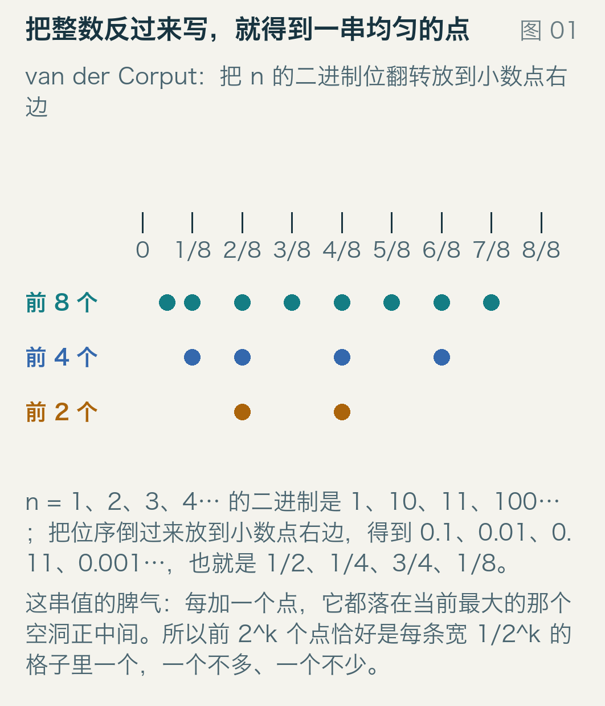
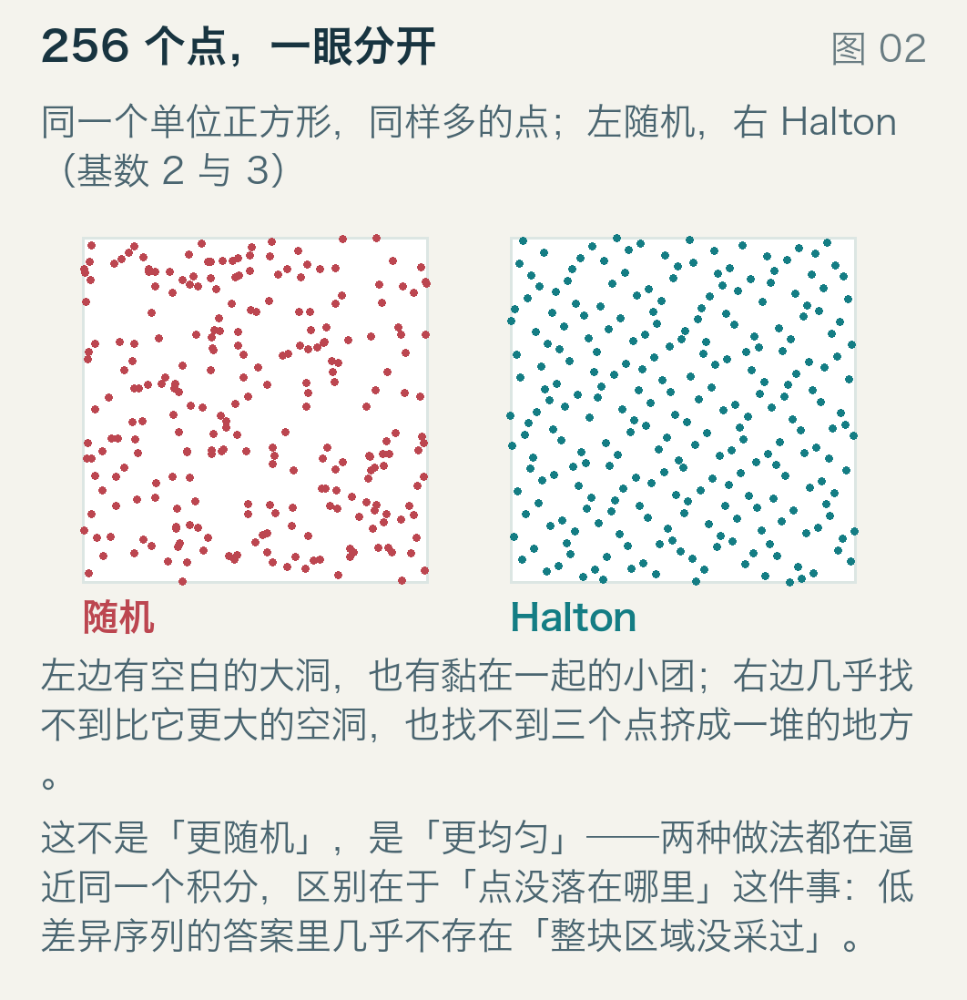
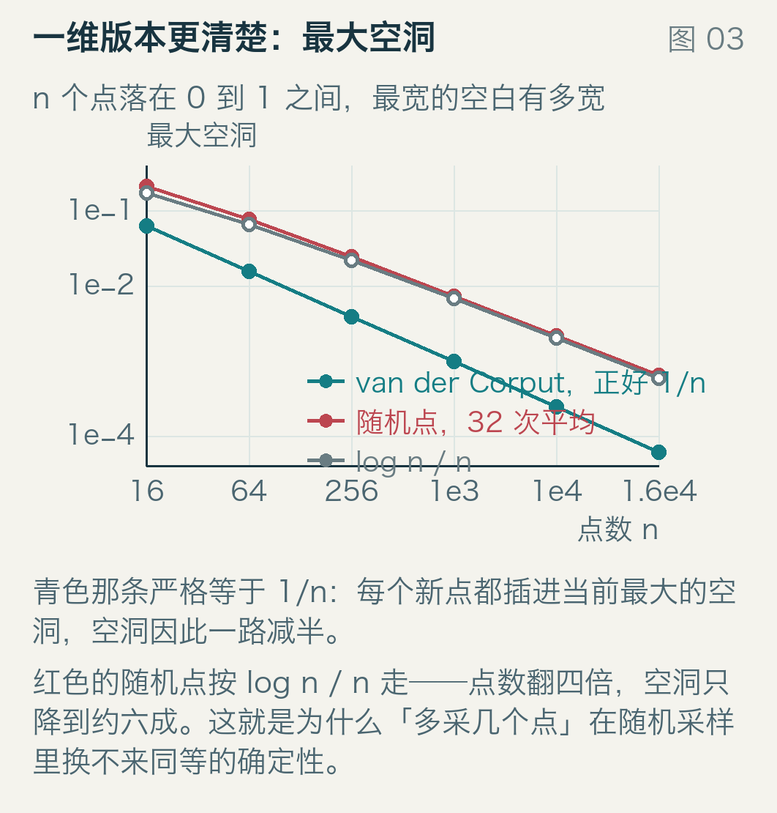
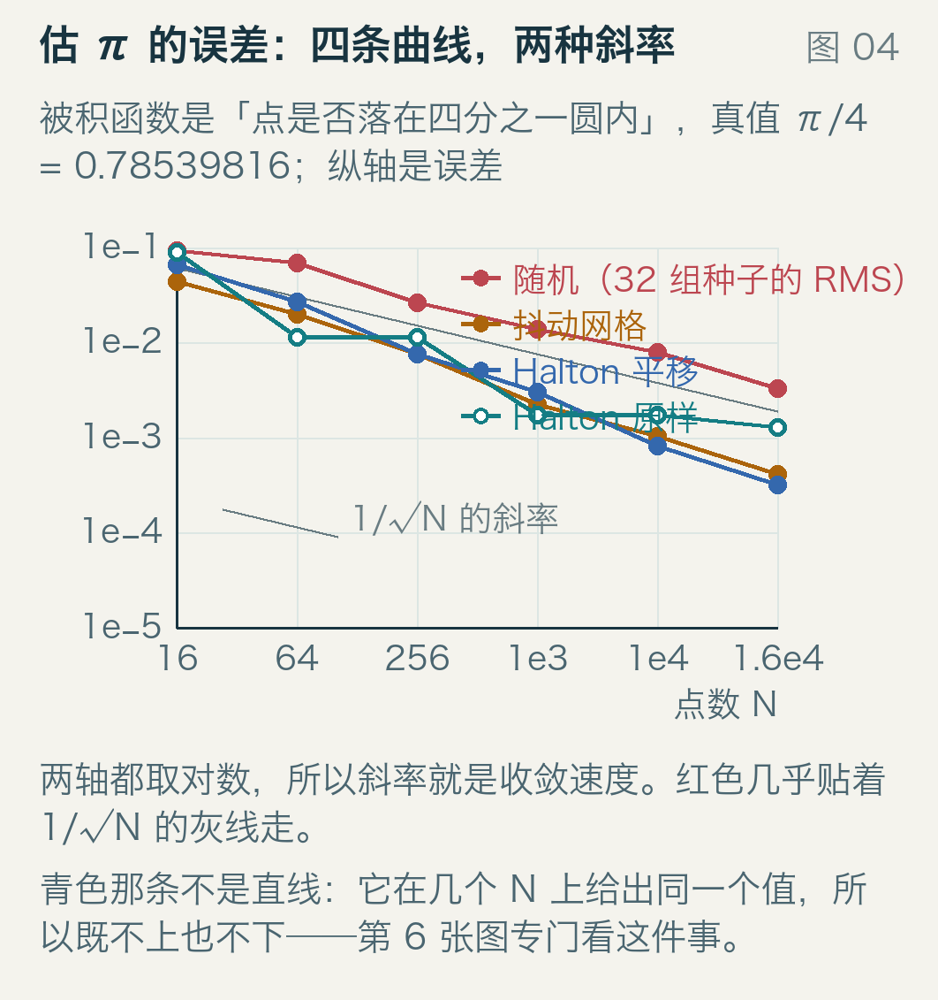
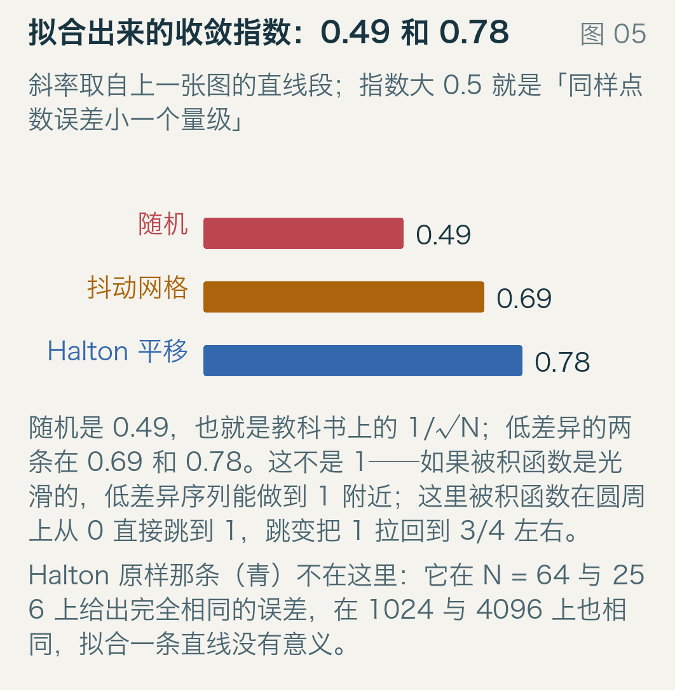
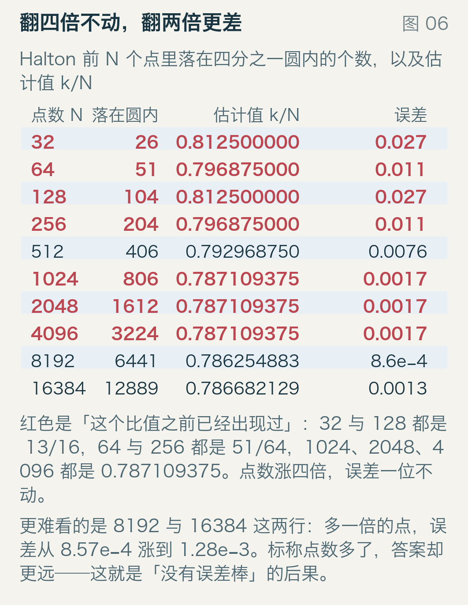
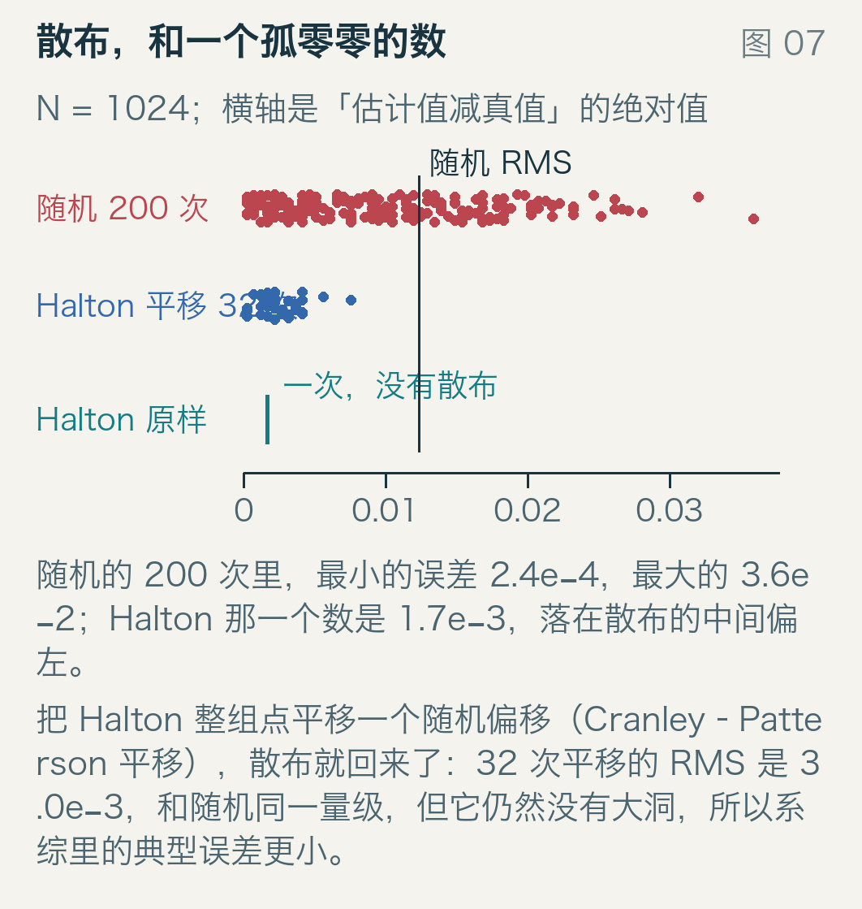

# 同样 16384 个点，误差差十倍

假设你要量一块形状古怪的金属板面积。量不了，只能用撒点法：在板所在的正方形里随机扔一千个点，数有多少落在板上，再乘正方形面积。这个方法有个出了名的脾气——误差按 1/√N 缩小，想让误差再小十倍，得扔一百倍的点。

一亿个点换十倍精度，这件事在渲染、在金融定价、在地图上求平均气温的时候都一样疼。有没有可能让每个点更「顶用」一点？

有。而且它只做一件事：**每个新点，落在当前最大的一块空白正中间。** 这篇文章就从这个规则出发，用可以手算的 8 个点起步，量出它到底能快多少（答案是 0.5 次幂变成 0.78 次幂），再讲清它的两个脾气：遇到跳变的被积函数会退化，以及它不告诉你自己有多准。

## 先把 8 个点手算出来

规则听上去像是要遍历搜索，其实不用。有一个现成的序列，第 n 项就是把 n 的二进制位倒过来写在小数点右边，这就是 van der Corput 序列，1935 年由荷兰数学家 J. G. van der Corput 给出。前八项手算一遍：

| n | 二进制 | 倒写 | 值 |
| --- | --- | --- | --- |
| 1 | 1 | 1 | 1/2 |
| 2 | 10 | 01 | 1/4 |
| 3 | 11 | 11 | 3/4 |
| 4 | 100 | 001 | 1/8 |
| 5 | 101 | 101 | 5/8 |
| 6 | 110 | 011 | 3/8 |
| 7 | 111 | 111 | 7/8 |
| 8 | 1000 | 0001 | 1/16 |

倒写出来的这一串，就是小数点右边的二进制位：第一项倒写是 1，读作 0.1；第二项倒写是 01，读作 0.01。每一步都在填空，填的是最大的空。1960 年 J. H. Halton 把它推广到多维：第 j 维就用第 j 个素数做基数。图 1 把前两个、前四个、前八个点画在同一根尺子上，能看见每多给一个点，它都恰好落进当前最大的那个空洞，并把空洞劈成两半。



三行是同一个区间，只是只取前 2 个、前 4 个、前 8 个点，横轴刻度是八等分的位置。前 4 个点落在 1/8、3/8、5/8、7/8 附近四个偶数格里，前 8 个点补上剩下四个，第一个补的恰好是 1/16，也就是最左边那个空格子的中间。前 2 个是 1/2、1/4；前 4 个再加 3/4、1/8；前 8 个再加 5/8、3/8、7/8、1/16。

## 随机点的 1/√N 是从哪来的

把「点是否落在四分之一圆内」当成一次抛硬币，正面概率 p = π/4 ≈ 0.785398163。扔 N 次，正面数除以 N 就是估计值，而这个估计的标准差是

```
σ = √(p(1 − p) / N)
```

p(1 − p) = 0.7854 × 0.2146 = 0.1685。N = 1024 时 σ = √(0.1685/1024) = 0.01283，本文实测 32 组独立随机种子的均方根误差是 0.01381，是理论值的 1.07 倍；N = 16384 时 σ = 0.00321，实测 0.00330，1.03 倍。

两处都在 10% 以内，说明 1/√N 不是经验拟合，是二项分布的标准差本身。它跟你怎么采、采哪个积分没关系，只跟「点之间互不知道彼此落在哪」有关。想让它快点，唯一的入口是让点互相知道。

## 换成低差异序列

同样是 256 个点，图 2 左边是伪随机，右边是二维的 Halton 序列：每一维用一个素数做基数，二维版就是「基数 2 的 van der Corput」配「基数 3 的 van der Corput」。



两个正方形宽高相同，都是单位面积。点越均匀，整个方框里越找不到「一整块没被采过的地方」；左边的空白洞比右边大，而且点有大有小地挤在一起，右边每个点和它邻居的距离都在一个窄范围内。

把这件事量起来，一维最清楚：n 个点排在 0 到 1 之间，最宽的那一段空白有多宽。图 3 是这条曲线，横轴点数，纵轴最大空洞。



van der Corput 的最大空洞严格等于 1/n，因为它的前 2^k 个点恰好是每条宽 1/2^k 的格子里一个，不多不少，所以 16384 个点的最大空洞正好是 6.10e−5。随机点的最大空洞按 log n / n 走：n = 1024 时实测 32 组的平均是 7.31e−3，而 log(1024)/1024 = 6.77e−3，1.08 倍；n = 16384 时 6.38e−4 对 5.92e−4，也是 1.08 倍。

两个数字差一个「log」：点数翻四倍，随机点的空洞只降到约六成，van der Corput 严格降到四分之一。这就是「点更顶用」的全部内容——它的空洞小，而且小得有保证。

## 实测：估一次 π

被积函数用最简单的：点落在四分之一圆内记 1，否则记 0，平均值乘 4 就是 π 的估计。真值是 π/4 = 0.785398163。四种点的来源，每种都用 N = 16、64、256、1024、4096、16384，每种重复 32 次（低差异序列是确定性的，重复的办法是整组点平移一个随机偏移，见后文）。图 4 是误差随点数变化的曲线，两轴都取对数，所以直线的斜率就是收敛速度。



两轴都是对数刻度，每一格是十倍的量级差，所以斜率直接就是误差里的那个指数。灰线段标了一条 1/√N 的参考斜率，红色几乎和它平行；青色那条（Halton 原样）不是直线。

| N | 随机（RMS） | 抖动网格 | Halton 原样 | Halton 平移 |
| --- | --- | --- | --- | --- |
| 16 | 9.20e−2 | 4.40e−2 | 8.96e−2 | 6.58e−2 |
| 64 | 6.83e−2 | 1.96e−2 | 1.148e−2 | 2.68e−2 |
| 256 | 2.64e−2 | 7.60e−3 | 1.148e−2 | 7.49e−3 |
| 1024 | 1.38e−2 | 2.22e−3 | 1.711e−3 | 3.01e−3 |
| 4096 | 7.85e−3 | 1.03e−3 | 1.711e−3 | 8.23e−4 |
| 16384 | 3.30e−3 | 4.12e−4 | 1.284e−3 | 3.20e−4 |

最下面一行是这篇文章想说的一句：同样 16384 个点，随机点给出 3.3e−3 的误差，把 Halton 整组平移之后是 3.2e−4，差了十倍。

## 0.49、0.69、0.78

把表里两端的数拿来直接算斜率，不用拟合。点数从 16 涨到 16384 是 1024 倍，误差缩小多少倍，取对数再除以 log(1024) = 6.93：

| 采样方式 | 16 个点的误差 | 16384 个点的误差 | 缩小倍数 | 手算指数 |
| --- | --- | --- | --- | --- |
| 随机 | 9.20e−2 | 3.30e−3 | 27.9 倍 | 0.48 |
| 抖动网格 | 4.40e−2 | 4.12e−4 | 106.8 倍 | 0.674 |
| Halton 平移 | 6.58e−2 | 3.20e−4 | 205.6 倍 | 0.769 |

对全部六个点做最小二乘，得到 0.490、0.689、0.783（图 5）。手算与拟合的差别来自中间几点不在直线上，这也是表里要列全六个点的原因。



横条长度就是指数。0.5 是随机采样的天花板，1 是「误差和点数成反比」，那是低差异序列在光滑被积函数上的目的地。三条都在 0.5 和 1 之间，Halton 平移最靠右，但它到不了 1。

为什么到不了？因为这里的被积函数不光滑：在圆周上，它从 0 直接跳到 1。低差异序列的优势来自「点铺得均匀」，而均匀性对光滑函数的效果最好；一旦被积函数在某条线上一刀切两半，误差里就多了一项「跳变线两侧点数的波动」，它下降得比 1/N 慢，实测就掉到 0.78 附近。

抖动网格是另一条路：把正方形切成 32×32，每格扔一个随机点。它比纯随机好（0.69 对 0.49），因为它保证「每格都被采过」；但它比 Halton 差，因为它只知道网格，不知道当前哪里有洞。这两件事的差别就是 0.69 和 0.78。

## 反例：点数涨了，误差不动甚至变大

上表里有一处看着像打字错误：Halton 原样在 N = 64 和 N = 256 上的误差都是 1.148e−2，在 1024 和 4096 上都是 1.711e−3。不是错，图 6 把分子摊开了。



四列分别是点数、落在圆内的个数、两者的比值、误差，红色的行表示这个比值之前已经出现过。32 个点里有 26 个在圆内，26/32 = 0.8125，128 个点里有 104 个，104/128 也是 0.8125；64 是 51/64 = 0.796875，256 是 204/256，同样；1024、2048、4096 三个点数都是 0.787109375。

手算误差就能对上：0.796875 − 0.785398 = 0.011477，那两行一模一样；0.787109375 − 0.785398 = 0.001711，那三行也一模一样。16 到 65536 之间有 11 个「四倍」对，其中 3 对的分子恰好精确翻了四倍（32→128、64→256、1024→4096）。

这是点集自相似结构的表现：前 4N 个点并不等于前 N 个点的拷贝，但在这几个 N 上，多出来的点落进圆内的比例恰好和原来相同。为什么会这样，本稿没有推出来；能确认的是这不是实现错误，分子和比值都可以用 `qmc.py` 重算一遍。

更难看的是最后两行。8192 个点的误差是 8.57e−4，16384 个点是 1.28e−3：标称点数多了一倍，答案反而更远。同样的非单调在 64 与 128 上也出现（1.148e−2 对 2.71e−2）。实际后果是你看不出它准不准：随机采样跑两百次，你能看到一片散布，从散布估出自己的误差棒；低差异序列只给你一个数，而这个数可能在四个不同的 N 上都相同，也可能在点数翻倍之后变差。

## 那就把整组点平移一下

1976 年 Cranley 与 Patterson 提出一个堵住这个缺口的办法：给整组点加上同一个随机偏移，逐维模 1。整组同时平移，点之间的相对位置不变，洞还是那么小，均匀性还在；但边界和格子的对齐关系被随机化了，于是每次平移给出不同的估计值。

图 7 是 N = 1024 的一批结果：200 次随机、32 次平移，加上 Halton 原样那一个数。横轴是误差的绝对值，离左边越近越准；上下两行是两批重复实验，每个点是一次的结果；竖线是随机那 200 次的均方根误差，青色竖线是 Halton 原样的单个值。



随机的 200 次里，最小 2.4e−4，最大 3.6e−2，均值 9.87e−3，均方根 1.23e−2。均值和均方根差了三成，因为均方根对尾部的大误差更敏感，这也是报误差时要说清是哪一个的原因。

Halton 那一个数是 1.71e−3，落在散布的中间偏左。32 次平移的均方根是 3.01e−3，和随机同一量级：它并没有因为「低差异」就必须比随机好，每次平移只把点挪了挪，边界与点的对齐关系是随机的，单次结果照样可能变差。真正变好的是系综里典型的那一个，均方根从 1.23e−2 掉到 3.0e−3。

所以实践里的用法是：低差异序列加每次平移，跑几批，用批与批之间的散布当误差棒。渲染器里「低差异采样 + 每像素随机偏移」就是这个用法。

## 什么时候别用

图 8 是一张对照表，最后一列是效果的大致量级。三条边界值得单独说。


维度上百时优势基本消失。Halton 的第 j 维用第 j 个素数做基数，基数为 101 的那一维每隔 101 个点才挪一下，点会被摆成细长的条纹，投影到任意两维都不再均匀。高维要用 1967 年 Sobol 提出的那类基于二进制和方向数的序列，而且往往还要加随机化。本文只测了二维，这个说法属于常识性边界，没有在本稿里实测。

点数必须随时能停时，别单用确定性序列。低差异序列是「按顺序的好」：前 1000 个点很好用，不代表前 100 个也好；要用任意前缀，就得对前缀本身随机化。

积分本身很便宜时，别折腾。这里的差距是十倍精度，换算成「同样的精度要多少点」是一百倍；如果一次采样只要几纳秒，而实现一个正确的低差异序列要花一天，那就先别换。

## 三句话

误差按 1/√N 缩小，不是实现问题，是「点之间互不知道彼此落在哪」的概率上限；一亿个点换十倍精度，换来的是确定的那十倍。

低差异序列让每个新点落进当前最大的空洞，于是最大空洞严格是 1/n 而不是 log n / n，收敛指数从 0.49 涨到 0.78——涨不到 1，因为被积函数在圆周上跳变。

它的代价是确定性本身：不给你误差棒，还可能连续几个点数给出同一个估计值。把整组点随机平移，误差棒回来，均匀性也还在。


---

全部数字来自 `examples/` 下的两个脚本：`run_model.py` 生成 `results.json`（43 051 字节），`build_figures.py` 只读它、不重算。随机数用自己实现的线性同余发生器，种子写死在代码里，重跑逐字节相同。九张插图全部原创绘制，逐张说明见 `sources.md`。
