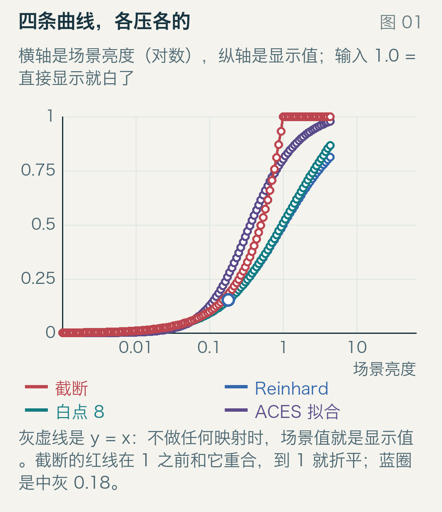
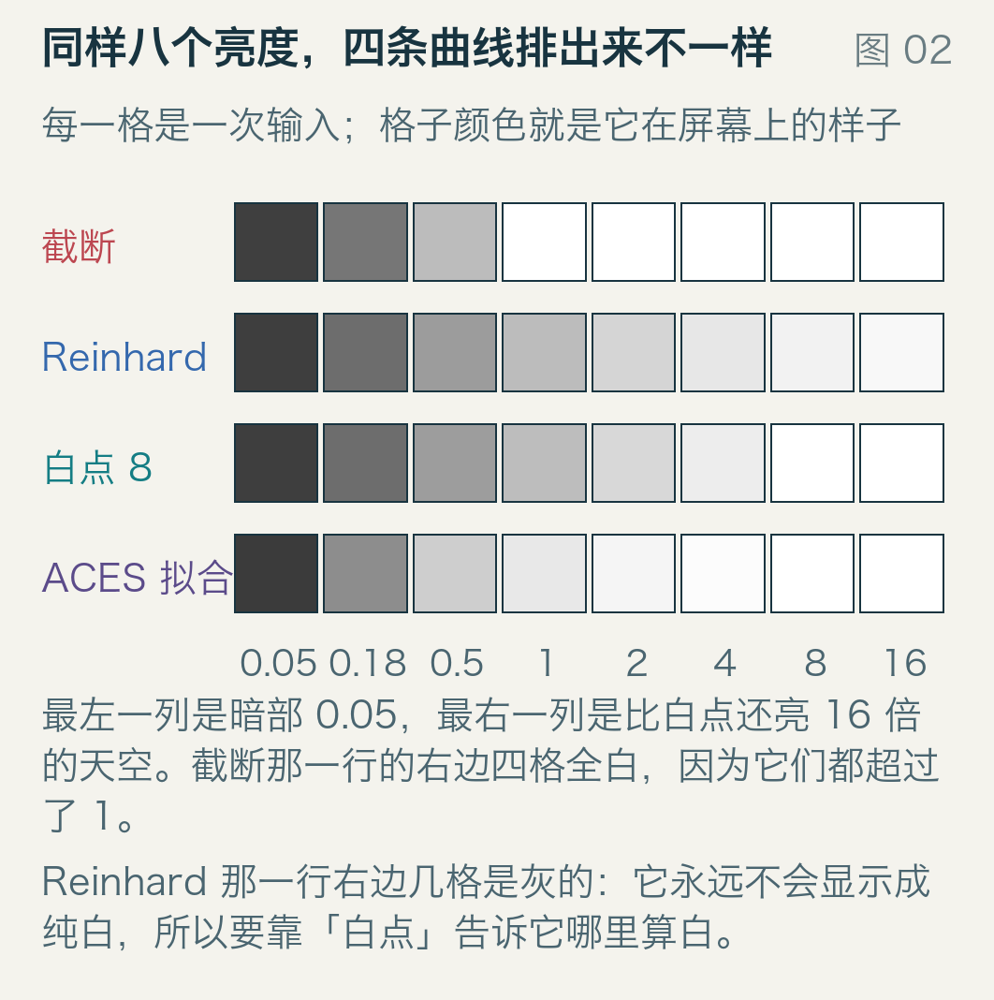
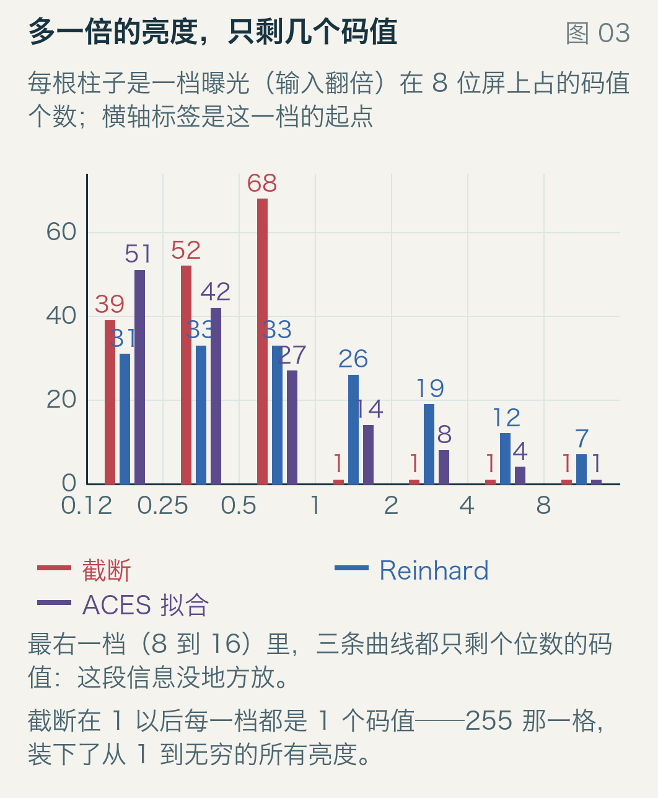
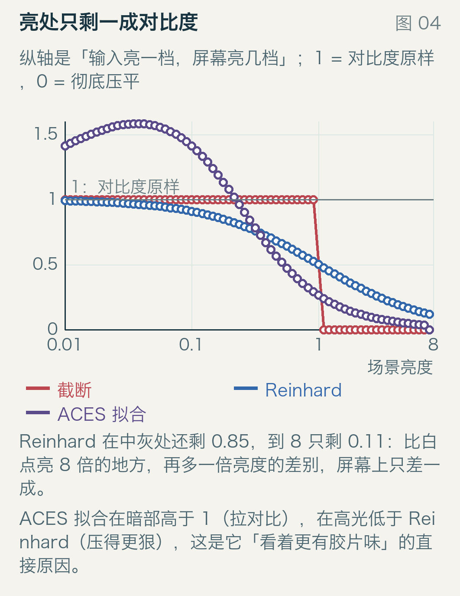
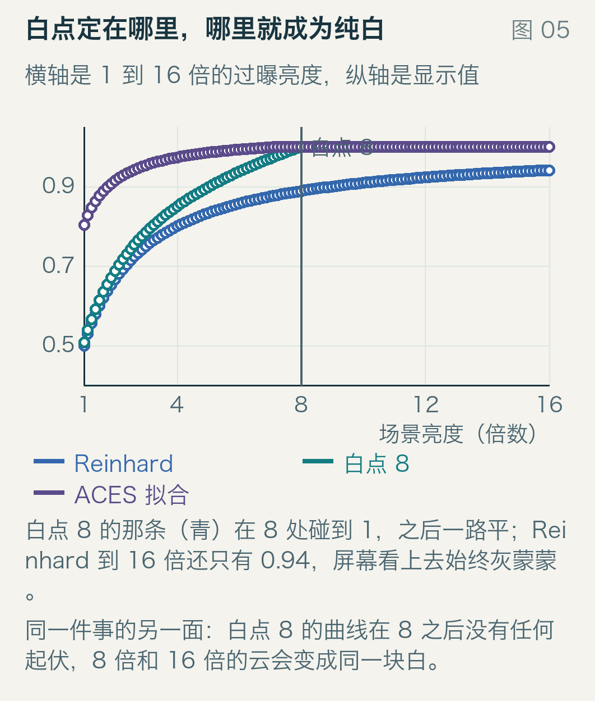
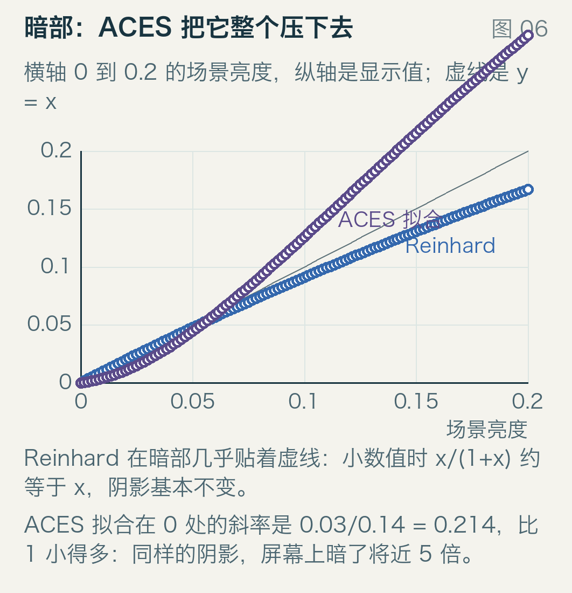
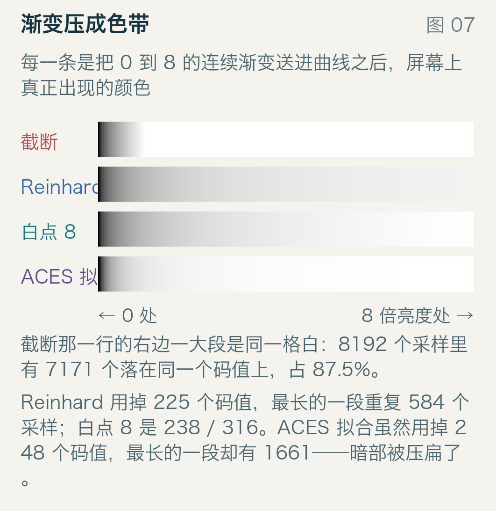
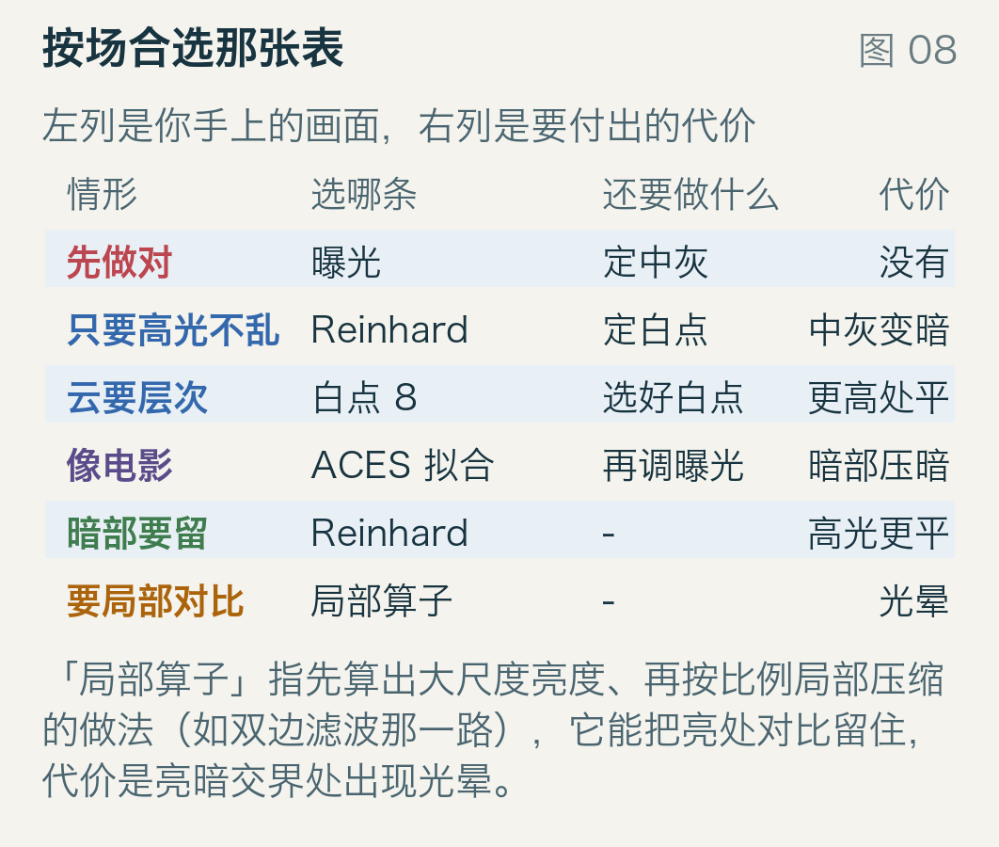
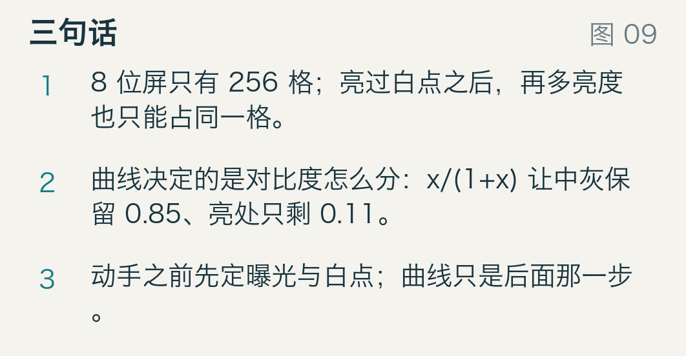

# 太亮的地方，全挤在最后一格

逆光拍一张窗外，眼睛能看见云的轮廓、云影的层次、树梢后面那一片亮斑。照片导进屏幕，窗外是一整块白。相机其实拍下来了：RAW 里那段信息有 12 位、14 位，够用。丢掉它的是最后一步——屏幕用 8 位存颜色。

8 位就是 256 格。问题不在格子不够细，在格子的位置：亮度从 0 到 1 已经用掉全部 256 格，那比 1 亮的东西呢。不管亮 2 倍、8 倍还是 1000 倍，全都挤进最后那一格。

这篇这篇文章只用几条能手算的公式，把「怎么挤」的代价摊开。每条曲线都在分配对比度，分配方式不同，代价也不同；知道代价落在哪一段，比记住哪条曲线好看有用。

## 256 个格子，不是等大的

先看那 256 格本身。屏幕上的码值不等于光量，中间隔着 sRGB 传输函数（IEC 61966-2-1）：低段是线性的 12.92 v，高段是 1.055 v^(1/2.4) − 0.055。三个锚点先算出来，它们是整篇文章的起点。

| 光量 | 编码值 | 码值 |
| --- | --- | --- |
| 0.18 | 0.4614 | 118 |
| 0.214041 | 0.5 | 127 |
| 0.5 | 0.735 | 188 |

| 码值段 | 光量起 | 光量止 | 涨幅 | 每格平均 |
| --- | --- | --- | --- | --- |
| 118 → 127 | 0.1812 | 0.2122 | 17% | 1.83% |
| 179 → 188 | 0.4508 | 0.5029 | 12% | 1.19% |

掰开看更清楚，同样走 9 格，装下的光量不一样。暗部那 9 格装得多，所以暗部的台阶更粗；台阶越粗，眼睛越容易看出条带，后面图 7 会再遇到这件事。10 位屏能缓解，但改不了结构：每通道 1024 格照样要被整个亮度范围整除，亮的还是挤在一起，只是台阶细了一点。

## 先看四条路长什么样

图 1 是四条常见曲线的形状。横轴是场景亮度，取对数；纵轴是屏幕上的显示值。输入 1.0 的意思是「这个亮度直接显示就已经是纯白」。



横轴每格差十倍，所以是一段一段等宽的十倍区间。灰虚线是 y = x，不做任何映射时的样子；红色的截断线在 1 之前和它重合，到 1 就折平，因为超出的部分被砍掉了。另外三条一路往上爬，只是爬法不同：有的到不了 1，有的提前碰到 1 换了行动方向。

光看曲线不够直观。图 2 把同样八个亮度经过四条曲线之后的颜色排出来：每一格是一次输入，格子的颜色就是它在屏幕上的样子，最左一列是暗部 0.05，最右一列是比白点还亮 16 倍的天空。



截断那一行，右边四格全是纯白。Reinhard 那一行右边几格是浅灰——它到不了纯白。ACES 拟合那一行中间几格明显更亮。

## 最笨的办法：什么都不做

截断（clamp）就是把超过 1 的值都当 1：

```
y = min(x, 1)
```

它的问题不在砍掉高光，在**在哪个位置砍**。图 3 数的是另一件事：每一档曝光（输入翻倍）在屏幕上占多少个 8 位码值。



横轴标签是这一档的起点，右端是它的两倍；纵轴是码值个数，最右边那一组对应 8 到 16 倍亮度。红色的截断柱在 1 以后每一档都是 1：它把 1 到无穷大的所有亮度都塞进 255 这一个码值。2 倍和 16 倍亮度，屏幕上完全一样。云、云影、太阳边缘，全变成同一块白。

## Reinhard：除一下

1993 年 Tumblin 与 Rushmeier 提出用「亮度匹配」做显示映射，2002 年 Reinhard 等人给出一个简单到可以手算的公式：

```
y = x / (1 + x)
```

代四个值进去：

| 输入 x | 输出 y |
| --- | --- |
| 0.18 | 0.1525 |
| 1 | 0.5 |
| 8 | 0.8889 |
| 1000 | 0.999 |

它把整个半轴压进 0 到 1，所以 8 倍亮度和 1000 倍亮度至少在屏幕上有区别。但它有两个立刻能看出来的毛病，而且这两个毛病都不在教科书常说的那一处。第一个常被说成「它永远到不了 1」。数学上确实碰不到顶：1000 倍只给 0.9990。可在 8 位屏上这条被掩盖了，0.9990 编码后就是 255，看着还是白的。真正看得见的是中间那段：16 倍亮度给 0.9412，码值 248，比白点亮 16 倍的天空，屏幕上是一层浅灰。所以 Reinhard 的病不是没有纯白，是高光被均匀地摊薄。

第二个毛病是中灰变暗。0.18 的中灰，就是 18% 灰卡那种灰，映射后是 0.1525，编码成 sRGB 是码值 109；截断给的是 118，差 9 格，肉眼能看出来。想让中灰回到 0.18，得把曝光抬到 0.2195，也就是多给 1.22 倍的光。

## 中间那段：曲线改的是对比度

把「输入亮一档，屏幕上亮几档」画出来，就是图 4 的对数斜率。纵轴 1 表示对比度原样保留，0 表示彻底压平，大于 1 表示拉大对比；灰线是 1。



Reinhard 的斜率随输入一路往下掉：

| 输入 | 对数斜率 | 读法 |
| --- | --- | --- |
| 0.01 | 0.99 | 阴影基本不变 |
| 0.18 | 0.85 | 中灰已经丢了一成半 |
| 1.0 | 0.5 | 一档只换来半档 |
| 8 | 0.11 | 一档只多一成 |

表里最后一行最要命：比白点亮 8 倍的地方，输入再亮一倍，屏幕上只多出一成。这就解释了整张照片为什么看着「平」——云影和云本身的亮度差本来是三四倍、大约两档，压完只剩两成，也就是一点灰。不是暗，是对比度被抽走了。

## 白点：告诉它哪里算白

Reinhard 的原式可以加一个参数，w 是白点：

```
y = x (1 + x / w²) / (1 + x)
```

手算 w = 8、x = 8：8 × (1 + 8/64) / 9 = 8 × 1.125 / 9 = 1.0，正好落在 1，不多不少。

图 5 是 1 到 16 倍之间的细节：横轴是场景亮度，纵轴是显示值，竖线标出白点 8 的位置。



青色的白点 8 曲线在 8 处碰到 1，之后一路平：8 倍和 16 倍的云变成同一块白。换来的是 1 到 8 之间用掉更多码值——同样一段输入，截断只给 1 个码值，白点 8 给 67 个。

白点选在哪里，等于说「多亮算白」。这是艺术决定，没有正确答案：选小了，云有层次但太阳是一块白；选大了，太阳有层次但整张图发灰。四个白点值的手算结果如下，中灰那一列是 0.18 经过曲线后的 sRGB 码值，最后一列是 1 到 8 这一段用掉多少码值。

| 白点 w | 中灰码值 | 1 到 8 的码值数 |
| --- | --- | --- |
| 2 | 111 | 49 |
| 4 | 109 | 63 |
| 8 | 109 | 67 |
| 16 | 109 | 58 |

注意最后一行。白点从 8 加到 16，1 到 8 这一段反而只剩 58 个码值，因为曲线在那段更接近直线，把预算推给了更高的地方。白点不是越大越能装。

## 另一条路：ACES 拟合

2010 年代之后很多引擎用一条叫 ACES 的曲线，来自美国电影艺术与科学学院（AMPAS）牵头的色彩管理规范。完整的那套 RRT 加 ODT 很复杂，代码里常见的是下面这个有理拟合：

```
y = x (2.51 x + 0.03) / (x (2.43 x + 0.59) + 0.14)
```

得说清楚：这个拟合不是官方规范的一部分，只是流传很广的一条近似。本稿没取到它的一手出处：哪个人、哪一年、哪篇文章都没有，所以下文一律叫它「ACES 拟合」，不叫「ACES 曲线」。几个值：0.18 → 0.2669，1 → 0.8038，8 → 1.0。

中灰 0.2669 比 Reinhard 亮得多：换算成 sRGB 是码值 141，比 Reinhard 的 109 亮 32 格。换句话说，这条曲线自带大约 +0.47 档曝光，用之前必须把曝光调回来——把 0.2669 压回 0.18 需要 0.72 倍的光。

图 6 看暗部。ACES 拟合在 0 处的斜率是 0.03 ÷ 0.14 = 0.214，比 1 小得多；横轴只画 0 到 0.2 的场景亮度，纵轴同样范围，虚线是 y = x。



Reinhard 在暗部几乎贴着虚线，x/(1+x) 在小数值时约等于 x，阴影基本不变。ACES 拟合在同样的阴影下暗了将近 5 倍：好处是黑得下去、对比感更强，代价是暗部细节被推进更少的码值里，噪声和条带都更容易看见。同一条曲线在暗部省下来的态度，会在亮部还给你。

## 码值不够时，看得见

图 7 把 0 到 8 的连续渐变送进四条曲线，画出屏幕上真正出现的颜色。每一条是一个从暗到亮的水平渐变，右边更亮。



截断那一行右边一大段是同一格白。8192 个采样点送进去，四条曲线各自用掉多少码值、最长的一段平在哪里，数出来是这样。

| 曲线 | 用掉的码值 | 最长连续段 | 平在哪 |
| --- | --- | --- | --- |
| 截断 | 238 | 7171 采样 | 高光 |
| Reinhard | 225 | 584 采样 | 高光 |
| 白点 8 | 238 | 316 采样 | 高光 |
| ACES 拟合 | 248 | 1661 采样 | 暗部 |

截断的最长一段占 87.5%，这不用解释。真正有意思的是最后一行：ACES 拟合用掉的码值比谁都多，最长的一段却有 1661 个采样。那段不在高光，在暗部——0.214 的斜率把暗部压进了更少的码值里。

所以条带的宽窄由「多少码值」和「码值怎么分布」共同决定。只数码值总数，会看错方向。

## 该先定什么

图 8 是一张对照表：横着是几种常见情形，竖着是该先动哪个旋钮。



**先定曝光，再挑曲线。** 同样一条 Reinhard，中灰在曝光 0 时是码值 109，抬一档 141，抬两档 173，抬三档 202。曲线形状固定，落在哪一段由曝光决定。先调曝光再选曲线，和先选曲线再补救，结果不同。

没有最好的曲线。它们都是把有限的动态范围分给不同段落：截断全给暗部，Reinhard 均匀地压，白点版把预算花在 0 到白点之间，ACES 拟合多给中高光、少给暗部。选哪条，等于选「你希望观众先看见什么」。

局部算子解决的是另一个问题。2002 年 Durand 与 Dorsey 用双边滤波把画面分成「大尺度亮度」和「细节」两部分，只压前者，亮处的细节就留住了。代价是亮暗交界处出现光晕：一扇窗户周围会有一圈发亮或发暗的边。

## 三句话

8 位屏只有 256 格。亮过白点之后，再多亮度也只能占同一格，截断就是把 1 到无穷全塞进 255。

曲线的本质是分配对比度：x/(1+x) 在中灰保留 0.85，到 8 倍亮度只剩 0.11；换成白点或 ACES 拟合，只是换个分配方案。

动手之前先定曝光与白点，曲线是后面那一步。顺序反了，再好的曲线也只是把错误压扁。



---

全部数字来自 `examples/` 下的两个脚本：`run_model.py` 生成 `results.json`，`build_figures.py` 只读它、不重算。sRGB 编解码用 IEC 61966-2-1 的分段式，没有做任何近似。九张插图全部原创绘制，逐张说明见 `sources.md`。
